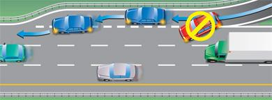
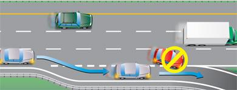

# R10 · Freeways & HOV lanes

**Rules half** · [Back to Rules](../README.md) · [Quiz: R10 questions](../questions/R10-freeway-hov.md)

## What a freeway is
- A **high-speed, multi-lane** road (also called an **expressway**). Each direction is separated, and **ramps** take you on and off.
- **No intersections, bicycles or pedestrians.**
- **G1 drivers** may only drive on freeways with a **licensed driving instructor**. (G1s may not drive on 400-series highways over **80 km/h**, the QEW, DVP, Gardiner, E.C. Row or Conestoga Parkway.)

## Getting on
- **Entrance ramp → acceleration lane.** Check your mirrors and blind spot along the ramp.
- In the acceleration lane, **speed up to match freeway traffic**, signal, and **merge smoothly**.
- Drivers already on the freeway should **move over, if safe**, to leave room for merging traffic.
- A few ramps join on the **left**, straight into the **fastest** lane. Speed up more quickly.

## Driving on a freeway
- Keep a **steady speed** and **stay right**. The left lanes are for **passing**.
- Look ahead **15 to 20 seconds** (or as far as you can see).
- Stay clear of large trucks. Don't cut anyone off.
- On freeways with 3+ lanes each way, large trucks can't use the far left lane.

## Getting off
- **Deceleration lane → exit ramp → intersection** (stop sign, yield sign or lights).
- Signal, move into the deceleration lane, and **don't slow down until you're in it**. Then slow to the ramp speed.
- **Check your speedometer**. After fast driving, slow feels slower than it is. This is called **"velocitization"** (speed adaptation).
- **Missed your exit? Take the next one.** Never stop or back up on a freeway.

## Trouble on the freeway
- At the first sign of trouble, **pull onto the nearest shoulder**. Don't wait to stall in a lane. Turn on your **hazard lights**.
- **Never stop in a driving lane.**
- Get out on the side away from traffic if you can. **Don't raise the hood.**
- **Stay in the car with the doors locked** while you wait. The OPP patrols the QEW and 400-series highways.
- **Don't drive on or block the shoulder.** Emergency vehicles use it when the lanes are jammed.

## HOV (High Occupancy Vehicle) lanes
- For vehicles with **at least 2 people**, plus: **buses, licensed taxis, green-plate (electric) vehicles, airport limousines, motorcycles, emergency vehicles**, and HOT permit holders where allowed.
- **Large trucks** are **never** allowed, no matter how many people are inside.
- Open **24 hours a day, 7 days a week**.
- A **striped buffer** separates the HOV lane from other lanes. **Crossing it is illegal.** Enter and leave only at the marked entry/exit zones.
- Commercial vehicles need **2+ people** and must be under **6.5 m** long.
- Green-plate vehicles may use HOV lanes with **any number** of people.
- Improper HOV use: you can be ticketed (**3 demerit points**).

## Memory tricks
- **"Speed up on, slow down off."** Match speed in the acceleration lane. Slow down only once you're in the deceleration lane.
- **Missed exit = next exit.**
- **HOV = 2+ people. Big trucks never.**
