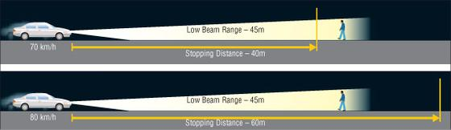

# R11 · Night, bad weather, skids, emergencies & collisions

**Rules half** · [Back to Rules](../README.md) · [Quiz: R11 questions](../questions/R11-night-weather-emergencies.md)

## Headlights
- **Required** from **½ hour before sunset to ½ hour after sunrise**, and any time you can't clearly see people or vehicles **150 metres** away (fog, snow, rain).
- Headlights must shine white light seen at least **150 m** ahead and light up objects **110 m** away. Red tail lights must be seen from **150 m**.
- **Switch to low beams**:
  - within **150 m** of an **oncoming** vehicle.
  - when you're less than **60 m behind** another vehicle (unless you're passing it).
  - These rules apply on **all roads, including divided ones**.
- **Daytime running lights are not headlights.** In poor light, turn your headlights on.
- **Parking lights are only for parking.**

## Seeing at night
- **Overdriving your headlights** means going so fast that your **stopping distance is longer than you can see**. Slow down at night.
- Glare from oncoming lights: look **up, beyond and slightly to the right**.
- On country roads, switch to **low beams at curves and hilltops**.
- Entering a tunnel on a sunny day: slow down, take off your sunglasses, turn on your headlights.

## Fog, rain, snow and ice
- **Fog**: best to **not drive** in it. Use **low beams**, because high beams reflect off the fog. Use fog lights *with* low beams. Use the **right edge** of the road as a guide. Leave more space. **Don't stop on the road**. If it gets too thick, pull **completely off** the road and turn on your **hazard flashers** (keep low beams on).
- **Rain**: roads are most slippery **when it first starts**. **Hydroplaning** is when your tires ride on top of the water like water skis. Slow down and keep good tires.
- **Flooded road**: avoid it. If you must drive through, **test your brakes** afterward: stop quickly and firmly at **50 km/h**. The car should stop straight, and the pedal should feel firm, not spongy.
- **Snow**: slow down, no sudden moves, **no cruise control**.
- **Whiteout**: drive only if you must, use **low beams**, and get off the road if you can't see. Stranded? **Stay with your car**. Open a window a little, run the motor **sparingly**, and turn on your flashers. Carry a winter kit.
- **Ice**: shaded spots, **bridges and overpasses freeze first**. **Black ice** looks like **black, shiny asphalt**; winter asphalt should look grey-white.
- **Snow plows**: **flashing blue lights** seen from **150 m**. A plow's wing can stick out **3 m** to the right. **Never pass between plows** working side by side, and **never pass a moving plow**.

## Skids and braking
- Most skids come from **driving too fast for conditions**.
- In a skid: **ease off** the gas or brake, and **steer in the direction you want to go**. Don't oversteer. On a very slippery road, shift to **neutral** if you can.
- **ABS (anti-lock brakes)**: press **hard** and let the system work. The pedal may **pulse**; **don't let go**. ABS keeps you steering, but it **doesn't shorten** your stopping distance.
- **Threshold braking** (no ABS): brake hard **until a wheel starts to lock**, ease off a little, then press again. **Don't pump** the brakes.

## Emergencies
| Problem | What to do |
|---|---|
| **Brakes fail** | **Pump** the brake pedal. Still nothing: apply the **parking brake** gently but firmly, holding the release button. Don't drive away; call for help. |
| **Gas pedal sticks** | Lift it with your **foot** (never reach down with your hands). Still stuck: **hazard lights**, shift to **neutral**, stop off the road, turn off the ignition. |
| **Headlights go out** | Check the switch. Still out: **hazard lights**, stop off the road. |
| **Wheels go off the pavement** | Don't panic. Grip the wheel, **ease off the gas**, avoid hard braking. Steer back when the car is under control. |
| **Tire blows out** | **Ease off the gas**, steer **firmly** where you want to go, and stop off the road. |
| **Trouble on a freeway** | Pull onto the **shoulder** right away, use **hazard lights**, never stop in a lane, stay inside with the doors locked. |

## Collisions
- Every driver involved must **stay at the scene** (or go back right away) and **help**. Leaving the scene = **7 points**.
- **Report to police** if anyone is **injured**, or damage is **over $5,000**.
- **No injuries and the cars can move**: move them off the road. **"Steer it, clear it."**
- Damage **under $5,000**: you still must **exchange information** with the other driver, but you don't have to call police.
- With injuries: turn off engines, use **flashers** and warning flares, **no smoking**. If there's a fire, get people out. Otherwise **don't move injured people**; cover them to help with **shock**, and stay with them until help arrives.
- Give police: your name and address, the registered owner, plate and permit numbers, and your **liability insurance card**. Get **witnesses'** names, addresses and phone numbers.

> **Heads-up:** older books and practice tests may show a lower dollar amount. The current handbook says **$5,000**.

## Memory tricks
- **½ hour around sunset and sunrise. 150 m visibility.**
- **Low beams at 150 (oncoming) and 60 (following).** Following is closer, so it's the smaller number.
- **Skid: look and steer where you want to go.**
- **Fog and snow: low beams.** High beams bounce back at you.
- **$5,000 or injury = call police.**

> **Official sample questions:** "To get your vehicle out of a skid, you should first…" → **steer in the direction you want to go.** · "It is more dangerous to drive at the maximum speed limit at night than during daytime as…" → **you cannot see as far ahead at night.**
