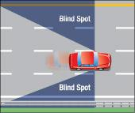

# R12 · Safe driving: seatbelts, child seats, distraction, fatigue, road rage

**Rules half** · [Back to Rules](../README.md) · [Quiz: R12 questions](../questions/R12-safe-driving.md)

## Before you drive
- Don't drive when you're **sick, injured, tired, upset or angry**, or after **alcohol or drugs** (including some medicines).
- Learn your controls so you can use wipers, lights and the defroster **without looking**. A warning light that **stays on** after you drive away could mean a serious problem.
- **Keep a clear view.** Nothing blocking the windows, and no window coating that stops you seeing out (or, on the windshield and front side windows, stops others seeing in).
- **Blind spots** are usually to the **back left and back right**. Mirrors can't show them. **Shoulder checks are the only way to be sure.**

## Seatbelts
- **Everyone** buckles up, each in their **own** belt, car seat or booster.
- **The driver is responsible** for passengers **under 16**.
- Driver not buckled up: fine + **2 demerit points**.
- **G1**: the only front-seat passenger is your accompanying driver. **G1 and G2**: there must be a working seatbelt **for every passenger**. Otherwise you can lose your licence for at least **30 days**.
- **Never** put two people in one belt. Shoulder strap goes **over the shoulder**, never under the arm or behind the back. Lap belt goes **low over the hips**.
- **Airbags don't replace seatbelts.**
- Riding in a **pickup box** or a **towed trailer** is not safe.

## Child car seats
| Child | Seat |
|---|---|
| **Infant under 9 kg (20 lb)** | **Rear-facing** car seat. Best in the **back seat**. **Never** in front of an active airbag. |
| **Toddler 9–18 kg (20–40 lb)** | Car seat with the **tether strap** attached. (May stay rear-facing longer if the seat allows.) |
| **Under 8 years, 18–36 kg (40–80 lb), under 145 cm (4'9")** | **Booster seat**, used with a **lap and shoulder** belt. |
| **Seatbelt only when** | the child turns **8**, **or** weighs **36 kg (80 lb)**, **or** is **145 cm (4'9")** tall. Any one is enough. |

- A correctly used car seat cuts the chance of injury or death by **75%**. A booster gives **60%** more protection than a seatbelt alone.
- An installed car seat should move no more than **2.5 cm (1 inch)** at the belt path.
- Children under **13** are safest in the **back seat**.

## Distracted driving
- Illegal while driving, **even stopped at a red light**: hand-held phone (except to call **911**), hand-held games or tablets, screens not related to driving, programming a GPS except by voice.
- Allowed: **hands-free** use (earpiece, Bluetooth), and a GPS screen that's **built in or securely mounted**.
- Eating, drinking, grooming and reaching aren't in the distracted-driving law, but you can still be charged with **careless driving**.
- Texting makes a crash **10 times** more likely. Drivers aged **16–25** are the most likely to drive distracted.
- Penalties: see [R3](R3-suspensions-alcohol-drugs.md).

## Drowsy driving
- Tired drivers can be as impaired as drunk drivers.
- Most drowsy crashes happen **2–6 a.m.** and **2–4 p.m.**
- Warning signs: heavy eyelids, nodding, yawning, drifting from your lane, missing signs, not remembering the last few km.
- **The only cure is sleep.** Pull off somewhere safe and nap. Coffee, loud radio and an open window don't fix it.

## Aggressive driving and road rage
- Don't compete, retaliate or try to "educate" other drivers. Leave enforcement to police.
- Feel threatened? **Stay in your car, lock the doors, call police, use your horn and signals.**
- **Being followed? Don't drive home.** Go to a **police station** or a **busy public place**.
- Plan your route. Lost drivers make bad moves.

## Workers on the road
- Obey construction signs and **traffic-control people**. It's an offence to disobey a STOP or SLOW sign held by a traffic-control person or firefighter.
- In a construction zone: slow down, **don't change lanes**, be ready to stop.
- Speeding fines are **doubled** in construction zones when workers are present.

## Animals
- Watch for **moose and deer**, especially from **dusk to dawn**. Scan from shoulder to shoulder and watch for **shining eyes**.
- See an animal: **slow down and sound your horn**. **Don't swerve around it.** Watch for more animals.
- Hit a deer or moose: report it to **police** or the **Ministry of Natural Resources**. Don't try to move an injured animal.

## Memory tricks
- **Car seats: 9 → 18 → 36 kg** (each step roughly doubles). **Booster until 8 years, 36 kg or 145 cm.**
- **Driver = responsible for anyone under 16.**
- **Followed? Police station, not home.**
- **Tired? Only sleep fixes it.**
