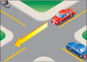
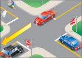
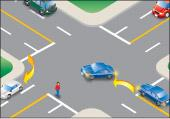
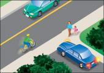

# R4 · Intersections & right-of-way

**Rules half** · [Back to Rules](../README.md) · [Quiz: R4 questions](../questions/R4-intersections-right-of-way.md)

"Yielding the right-of-way" means **letting the other person go first**. **Signalling never gives you the right-of-way.** You still have to make sure the way is clear.

## Two kinds of intersections
- **Controlled**: traffic lights, yield signs or stop signs.
- **Uncontrolled**: **no** signs or lights. Be extra careful.

## Who goes first?
| Situation | Who goes first |
|---|---|
| **Uncontrolled** intersection | The vehicle that got there **first**. Same time: the vehicle on the **right**. (The driver on the left yields.) |
| **All-way stop** | The **first** vehicle to come to a **complete stop**. Same time: the vehicle on the **right**. |
| **Traffic lights are out** (power failure) | Treat it like an **all-way stop**: yield to vehicles in the intersection and to vehicles coming from your **right**. |
| You face a **yield sign** | Traffic in the intersection or on the other road. Slow down or stop if needed. |
| You're **turning left** | **Oncoming traffic** and **pedestrians** in or near your path. |
| You're **turning right** | **Pedestrians** in or near your path. Check your right blind spot for **cyclists**. |
| Entering the road from a **driveway or private road** | **Vehicles on the road** and **pedestrians on the sidewalk**. |
| **Pedestrian crossover**, or a **school crossing** with a guard | Pedestrians, until they have **completely crossed** the road. |
| You're in a **roundabout** | **You** do. Traffic already in the roundabout goes first, so entering drivers yield (look **left**). |
| Two drivers facing each other, **both turning left** | Each turns to the **left of the other**, after yielding to pedestrians and oncoming traffic. |
| A **bus** in a bus bay flashing its **left signal** to pull out | The **bus**. You must let it back into traffic. |
| Two roads **merge** into one | Both drivers are **equally** responsible for merging safely. |
| **Emergency vehicle** with lights or siren | It does. Pull to the right and stop. |
| A road-work lane is blocked and **no one is directing** | The driver coming from the **opposite** direction. |

## At a green, yellow or red light
- **Green**: drive through carefully. If it has been green a while, be ready to stop when it turns yellow.
- **Yellow**: stop if you safely can. If you are too close to stop safely, go through with caution.
- **Red**: come to a **complete stop** and wait for green.
- A main-road intersection is **blocked** with traffic: **stop before entering** and wait. (This doesn't apply when you're turning left or right.)

## Watch out
- Scan **sidewalks and paths/trails** too. Children may not know traffic laws, and cycling on the sidewalk may be allowed by local bylaw.
- Turning left at a green light: oncoming cyclists must pass before you turn.
- **When in doubt, let the other driver go first.**

## Memory tricks
- **"Right goes first."** Uncontrolled, all-way stop or dead lights, at the same time: the car on your **right** goes first.
- **"First to stop, first to go"** at an all-way stop.
- **"In the circle wins."** Roundabout traffic already circling has the right-of-way.
- **"Driveway drivers wait."**

> **Official sample question:** "What must a driver do before entering a highway from a private road or driveway?" → **Yield right-of-way to all vehicles approaching on the highway.**
