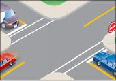
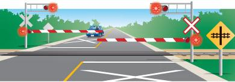
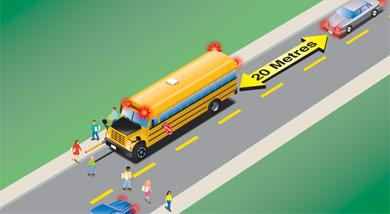
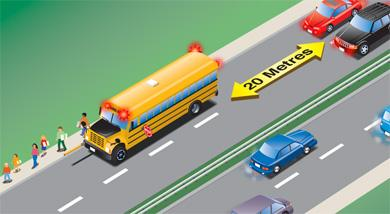
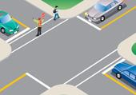
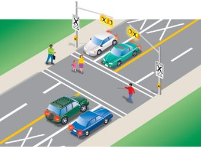

# R5 · Stopping: stop lines, railways, school buses, crossovers

**Rules half** · [Back to Rules](../README.md) · [Quiz: R5 questions](../questions/R5-stopping.md)

## Where to stop (stop sign or red light)
Come to a **complete stop**. Stop at the first one of these that exists:
1. The **stop line**
2. The **crosswalk** (marked or not)
3. The **edge of the sidewalk**
4. The **edge of the intersection**

Then wait until the way is clear.

## Railway crossings
- Public railway crossings are marked with large **red and white "X"** signs. You may also see yellow warning signs and a big **X on the pavement**.
- **Slow down, listen and look both ways.**
- Train coming: stop at least **5 metres** from the **nearest rail or gate**.
- A train can need up to **2 km** to stop. **Never race a train.**
- Wait until the lights **stop flashing** and the gate is **all the way up**.
- **Never** drive around, under or through a gate while it is down, going down or going up.
- Make sure there's room to get **all the way across** before you start. Don't shift gears on the tracks.
- **Stuck on the tracks?** Get **everyone out** and away from the car first, then call for help.
- **School buses stop at every railway crossing.** Most buses stop at unprotected crossings. Be ready to stop behind them.
- A crossing with a **stop sign**: you must stop (unless a flagman directs you).

## School buses (chrome yellow, "School Bus")
| Bus is showing | What you do |
|---|---|
| **Amber** (yellow) overhead lights flashing | It's **about to stop**. Slow down and **prepare to stop**. |
| **Red** overhead lights flashing or **stop arm** out | **STOP**, whether you're **behind** it or **coming toward** it. |

- Coming **from behind**: stop at least **20 metres** back.
- Coming **from the front**: stop far enough back for children to get off and cross safely.
- **Road with a median** (a physical divider you can't drive over): **only traffic behind** the bus must stop.
- Wait until the bus **moves**, or the lights **stop flashing** and the stop arm folds away.
- The law applies on **any road**, any number of lanes, any speed limit, and **any time** of day, not just school hours.
- Not stopping: big fine + **6 demerit points** (first offence). The bus driver or a witness can report you; the **registered owner** can be fined.

## School crossings
- A crossing guard holds up a red and white **stop sign**: stop **before** the crossing.
- Stay stopped until **everyone, including the guard**, has cleared the **whole road**.

## Pedestrian crossovers
- A crossing **without traffic lights**, marked by signs, overhead **yellow lights**, and **double white lines** with an **X** in each approaching lane.
- Drivers **and cyclists** must **stop and yield the whole roadway**. Go only when pedestrians have **completely crossed** and are on the sidewalk.
- **No passing** any vehicle within **30 metres** of a pedestrian crossover.
- Failing to stop at a crossover = **4 demerit points**.

## Crosswalks
- Not all crosswalks are marked, but **nearly all intersections have crosswalks**.
- **Don't pass** a vehicle stopped at a crosswalk. A pedestrian may be crossing in front of it.

## Memory tricks
- **"5 from the train, 20 from the bus."**
- **Amber = get ready. Red = stop.** Same as traffic lights.
- **Median = only the cars behind stop.** The median protects the other side.
- **Crossover: wait until they're all the way across**, not just out of your lane.
- **Where to stop: Line → Crosswalk → Sidewalk → Intersection edge.**
