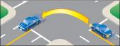
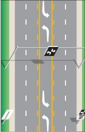
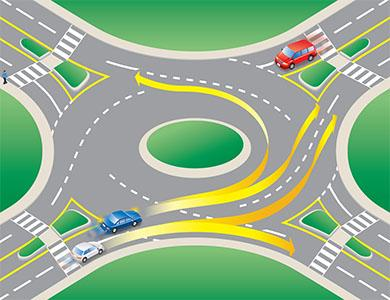

# R6 · Turns, lane changes, passing & roundabouts

**Rules half** · [Back to Rules](../README.md) · [Quiz: R6 questions](../questions/R6-turns-lanes-passing.md)

## Turning
- **Signal well before** the turn. Get into the right lane: **far right** to turn right, **far left** (in your direction) to turn left.
- **Slow down before** the turn, and finish braking **before** you turn the wheel. Try not to brake and steer at the same time.
- Sharp turns: **hand-over-hand** steering.
- **Right turn**: begin and end **close to the right side**. Look **ahead, left, right, left again**, and check your **right rear blind spot** for bikes. Let cyclists and mopeds go through first.
- **Left turn**: begin and end in the **far left lane** in your direction.
- Waiting to turn left: **keep your wheels straight** until you can go. If you're hit from behind with your wheels turned left, you'll be pushed into oncoming traffic.
- Behind a **motorcycle or bike** that's turning left: don't pull up beside it. Wait behind it.

## Which lane to turn into (left turns)
| From → to | Turn from → into |
|---|---|
| **Two-way → two-way** | Lane closest to the centre line → lane **just right of the centre line**, then move to the right curb lane when you can |
| **Two-way → one-way** | Lane closest to the centre line → **left curb lane** |
| **One-way → two-way** | **Left curb lane** → lane **just right of the centre line** |
| **One-way → one-way** | **Left curb lane** → **left curb lane** |

## Turning on a red light
- **Right on red**: OK **unless a sign says no**, after a **complete stop**. Yield to pedestrians and traffic.
- **Left on red**: only from a **one-way road onto a one-way road**, after a **complete stop**.

## Left-turn lanes
- Marked left-turn lanes: turn **from** that lane and keep your lane position as you turn.
- **Two-way left-turn lane** (centre lane): signal, move in **shortly before** your turn, slow down, then turn when clear. Drivers from **both** directions use it. **Never use it for passing.**

## Roundabouts
- **Choose your lane early**: **left lane** = turn **left** or go **straight**. **Right lane** = turn **right** or go **straight**. Don't enter from the right lane to turn left.
- Slow down and watch for **pedestrians** at the entrance.
- **Traffic already in the roundabout has the right-of-way.** Look **left**, wait for a safe gap, and stop at the yield sign if needed.
- Drive **counter-clockwise**, keeping to the **right** of the centre island.
- Inside: **don't stop** (except to avoid a crash) and **don't change lanes**. Missed your exit? Go around again.
- **Signal right** after you pass the exit **before** the one you want.
- Give **large trucks and buses** plenty of room. They may use both lanes and the **apron** (the raised edge of the centre island).
- **Emergency vehicle** coming while you're in the roundabout: leave at your exit, then pull over **past the traffic island**.

## Backing up
- Look **over your shoulder** in the direction you're moving. Going straight back or to the right: look over your **right** shoulder. Backing to the left: **left** shoulder. Check the other side too.
- You may take off your **seatbelt** to see while backing up. Buckle up again before you drive forward.
- It's **illegal to reverse on a divided road with a speed limit over 80 km/h**, on the road or its shoulder, unless you're helping someone in trouble.

## Turning around
- **Driving around the block** is the simplest and safest way.
- **U-turn**: first check that there's **no sign** forbidding it. You must see at least **150 metres** both ways. Never make one on a **curve**, on or near a **railway crossing** or **hilltop**, or near a **bridge or tunnel** that blocks your view.
- **Three-point turn** (narrow roads): start from the far right side, with the same "no curve / hill / railway / bridge" rule.

## Changing lanes
1. Check your **mirrors**.
2. **Shoulder check** your blind spot, and **signal**.
3. Check again.
4. **Steer gradually**. Keep your speed or gently speed up.

Never cut in, avoid weaving, and **don't change lanes in or near an intersection**.

## Passing
- Signal left and check ahead and behind. Watch for bikes hidden in front of the vehicle you're passing.
- Go back into your lane when you can see the **whole front** of the vehicle you passed in your **inside (rear-view) mirror**. Signal first.
- Being passed? **Move right** and let them by. **Never speed up** when someone is passing you; that's illegal.
- **No passing** within **30 m** of a **pedestrian crossover**. **No passing left of the centre line** within **30 m** of a **bridge, viaduct or tunnel**. No passing near the top of a hill or on a curve where you can't see.
- **Never pass a moving snow plow.**
- **Right shoulder**: only to pass a vehicle **turning left**, and only if the shoulder is **paved**. **Never pass on the left shoulder.**
- **Passing on the right** is allowed on **multi-lane or one-way** roads, and when passing a **streetcar** or a **left-turning** vehicle.
- At night: **low beams** as you come up behind, **high beams** once you're beside the vehicle.
- On many roads with 3+ lanes each way, **trucks can't use the far left lane**. If a truck wants to pass you in the next lane over, move right.

## Memory tricks
- **Left lane: left or straight. Right lane: right or straight.** (Roundabouts.)
- **Red-light turns: "right any time after a stop; left only one-way to one-way".**
- **U-turn needs 150 m of view.**
- **30 m: no passing near crossovers, bridges, viaducts and tunnels.**

> **Official sample questions:** "Never change lanes in traffic without…" → **giving proper signal and looking to make sure the move can be made safely.** · "Deciding whether to make a U-turn, your first consideration should be to check…" → **traffic regulations.** · "When another vehicle is about to pass you, you must…" → **move to the right and allow such vehicle to pass.**
