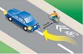
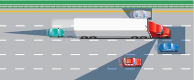
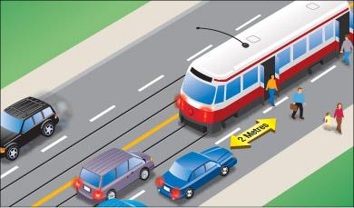
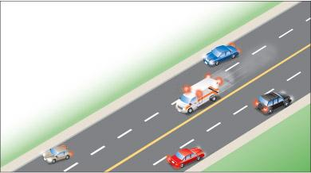
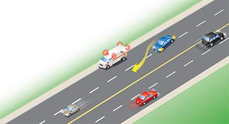

# R7 · Sharing the road

**Rules half** · [Back to Rules](../README.md) · [Quiz: R7 questions](../questions/R7-sharing-the-road.md)

## Pedestrians
- In most cases, **yield to pedestrians**. **Eye contact** is one of the keys to their safety.
- **Children** may dart out between parked cars. Expect the unexpected, especially near schools and at twilight.
- **Not all crosswalks are marked**, but nearly all intersections have them. Don't pass a vehicle stopped at a crosswalk.
- **Community safety zones** (signed areas): fines are **increased**.
- People using **wheelchairs or medical scooters** are pedestrians too. A **white cane or guide dog** means the person is blind or has low vision.
- In a **hybrid or electric** car, people who are blind may not hear you coming. Be extra careful.
- More pedestrians are hit by cars **turning left** than by cars turning right.

## Cyclists
- Bikes ride about **1 metre** from the curb or parked cars, but **may use any part of the lane** when they need to (puddles, potholes, sewer grates, crossing tracks at **90°**, or a lane too narrow to share).
- **Passing a cyclist: leave at least 1 metre** where practical. Not doing so: fine + **2 demerit points**. Change lanes to pass when you can.
- Don't follow closely. **Bikes have no brake lights.**
- **Turning right**: signal and check your mirror and **right blind spot**.
- **Turning left**: wait for **oncoming bikes** to pass.
- Don't honk unless you must. If you do, give a **quick, light tap** from a distance.
- **Bike lanes**: usually a **solid white line**. Enter one to turn right only when it's safe.
- **Bike box** (painted box with a bike symbol): stop **behind** it at a red light.
- **Sharrow** (bike symbol with two chevrons) = the lane is **shared** with bikes.
- A cyclist may signal a **right turn** by holding the **right arm straight out**.
- Before opening your door, check your **mirrors and blind spot** for bikes.

## Motorcycles and mopeds
- Harder to see. **They use a full lane.** Treat them like other vehicles.
- Their turn signals often **don't shut off** on their own. Make sure an oncoming motorcycle is **really turning** before you turn left in front of it.

## Large trucks and buses
- **Big blind spots** on both sides and right behind. **If you can't see the driver's face in their side mirror, they can't see you.**
- They need **much longer to stop**. Don't cut in front after passing.
- **Wide turns**: a truck turning right may swing left first. **Don't move into the gap** on its right.
- **Rollback**: leave room when stopped behind one on a hill.
- Spray in bad weather, and **air turbulence** when you pass.

## Municipal (city) buses
- A bus in a **bus bay** flashing its **left signal** to pull out: you **must let it back in**.

## Farm machinery and horse-drawn vehicles
- Tractors and combines usually go **40 km/h or less**. They show an **orange and red slow-moving vehicle** sign. Slow down, stay back, and pass only when safe.
- Horse-drawn buggies are among the **slowest** road users. They also show the slow-moving sign and often reflective tape. Slow down and give lots of room.
- A buggy coming **toward** you: move to the **far right** of your lane.

## School buses and streetcars
- School buses: see [R5 Stopping](R5-stopping.md). **Red lights = stop**; from behind, at least **20 m**.
- **Streetcars**: pass on the **right** (unless it's a one-way road). At a streetcar stop, stay at least **2 metres behind the rear doors** where people are getting on or off.

## Emergency vehicles
- **Coming toward you or behind you** (flashing red, or red and blue lights, siren or bell): **stop right away**, as close as practical to the **right** curb or edge, parallel to the road and clear of intersections.
  - On a one-way or divided road with more than 2 lanes: move to the **nearest** curb.
  - In an intersection waiting to turn? **Don't turn.** Go **straight** through when safe, then pull right and stop.
  - **Don't stop on the shoulder.** Emergency vehicles may use it.
- It's **illegal to follow within 150 metres** of a **fire vehicle** answering an alarm.
- **Flashing green light** on a car = a **volunteer firefighter or medical responder**. Please yield.
- Not responding to an emergency vehicle: fine + **3 demerit points** (first offence). Repeat offences: up to **6 months** in jail.

### Stopped emergency vehicle or tow truck ("slow down, move over")
- An emergency vehicle (red, or red and blue lights) or a **tow truck (amber lights)** stopped on your side of the road: **slow down** and pass carefully.
- On a road with **2 or more lanes** your way: also **move over a lane** away from it, if safe.
- Same fines and **3 points** as above.

## Memory tricks
- **1 m for bikes, 2 m for streetcar doors, 20 m for school buses, 150 m behind fire trucks.**
- **No face in the mirror = they can't see you** (trucks).
- **Slow down AND move over** for anything stopped with flashing red, blue or amber lights.
