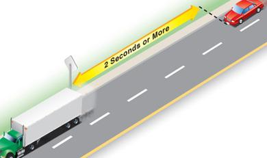
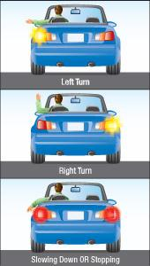

# R8 · Speed, space, signals & police

**Rules half** · [Back to Rules](../README.md) · [Quiz: R8 questions](../questions/R8-speed-and-space.md)

## Speed limits
- **No speed limit sign?** **50 km/h** in cities, towns and villages. **80 km/h** everywhere else.
- Always drive at a speed that lets you **stop safely**. Go below the limit in bad weather, heavy traffic and construction zones.
- **School zones** and **construction zones** often have lower limits.
- **Cruise control**: don't use it on wet, icy or slippery roads, in heavy traffic, or when you're tired.
- **Radar detectors** (speed-measuring warning devices) are **illegal**: fine + demerit points.
- Driving **too slowly** for no reason is also an offence (don't block normal traffic).

> **Heads-up, ontario.ca (not in the handbook):** speeding fines are per km/h over: under 20 over **$3.00**, 20–29 over **$4.50**, 30–49 over **$7.00**, 50+ over **$9.75**. Example: 40 over = 40 × $7 = **$280**.

## Following distance: the 2-second rule
- Stay at least **2 seconds** behind the vehicle ahead.
- How to check: when its rear passes a marker (a sign or pole), count "**one thousand and one, one thousand and two**". If you reach the marker before you finish, you're **too close**.
- 2 seconds is the **minimum**, for **ideal** conditions only. Leave **more space** in bad weather, behind **motorcycles or big trucks**, or when carrying a **heavy load**.
- **Following too closely** = **4 demerit points**.

## Seeing and being seen
- Defensive driving is based on **visibility, space and communication**.
- Check your **mirrors every 5 seconds or so**.
- Hold the wheel at **9 o'clock and 3 o'clock**.
- Sit high enough to see the ground about **4 metres** in front of the car. The back of your head should be at the **middle of the headrest**.
- **Keep right** unless you're turning left or passing, especially if you're slower than other traffic.

## Signals
- Signal **before** you stop, slow down, turn, change lanes, leave the road or pull out from parking. **Signalling alone isn't enough**: check that it's clear.
- **Hand signals** (left arm out the window):
  - **Left turn**: arm **straight out**.
  - **Right turn**: arm out and **bent up**.
  - **Slow or stop**: arm out and **bent down**.
- Cyclists may signal a right turn with the **right arm straight out**.

## Police
- **Obey a police officer directing traffic**, even if it's different from the lights or signs.
- Pulled over: move as far **right** as is safe, **stop completely**, **stay in the car** and wait.
- Hand over your **licence, vehicle permit and insurance right away** when asked. There's **no 24-hour grace period**.
- Not stopping for police: **7 points**, possible jail, and a licence suspension of at least **5 years**.

## Memory tricks
- **50 in town, 80 out of town** when no sign is posted.
- **2-second rule = "one thousand and one, one thousand and two".**
- **Hands at 9 and 3. Mirrors every 5 seconds.**
- **Hand signals: straight = left, up = right, down = stop.**

> **Official sample question:** "You should under all conditions drive at a speed which will allow you to…" → **stop within a safe distance.**
