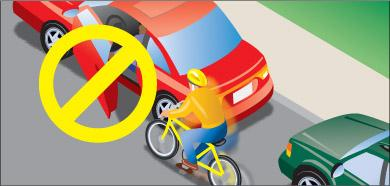
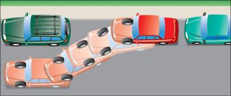
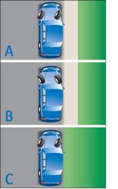

# R9 · Parking & roadside stops

**Rules half** · [Back to Rules](../README.md) · [Quiz: R9 questions](../questions/R9-parking.md)

## Never park…
- On the **travelled part** of a road. Pull onto the shoulder if you must stop.
- On a **curve, hill**, or anywhere you can't see at least **125 metres** both ways.
- Where you'd **block** a parked car, a sidewalk, crosswalk, pedestrian crossing or road entrance, or get in the way of traffic or **snow clearing**.

## Parking distances (exam favourites)
| Do not park within… | Distance |
|---|---|
| a **fire hydrant** | **3 m** |
| a public entrance to a **hotel, theatre or public hall** (when open) | **6 m** |
| an **intersection** | **9 m** |
| an intersection **with traffic lights** | **15 m** |
| the nearest rail of a **level railway crossing** | **15 m** |
| a **bridge** (on it, or this close to it) | **100 m** |

Not all parking bylaws are posted on signs.

## Opening your door
- **Check first** that you won't hit a person, bike or car. Watch for **cyclists**, who often ride close to parked cars.
- Use the **"Dutch reach"**: open the driver's door with your **right hand**. It turns you into a shoulder check.
- Keep the door open only as long as you need to load or unload. (Improper door opening = **3 points**.)

## After you park
- Turn off the engine and lights, take the key, and **lock** the car.
- **Never leave children or animals** in the car.
- Pulling out: **signal and check** traffic first.

## Accessible parking
- An **Accessible Parking Permit** goes on the dashboard or the turned-down sun visor. It belongs to the **person**, not the car.
- Never park in an accessible space unless the permit is **yours or your passenger's**.
- Permit types: **regular (blue)**, valid **5 years** · **temporary (red)**, for a disability expected to last more than **2 months**, not renewable · **traveller (purple)**, up to **1 year** · **company (green)**, up to **5 years**.

## Parallel parking
- Park on the **right side**, in the direction of traffic. On a **one-way** road you may park on **both** sides unless signs say otherwise.
- Find a space about **1½ times** your car's length.
- Pull up beside the car ahead of the space, about **1 metre** away, with your rear bumpers lined up.
- **Reverse**, turning the wheel **fully toward the curb**. When you see the **outside rear corner** of the car in front of the space, straighten your wheels. Then turn the wheel **fully toward the road** to line up with the curb.
- Set the **parking brake** and shift to park (manual: 1st or reverse gear).

## Parking on a hill
| You're facing | Turn your front wheels |
|---|---|
| **Downhill** | **toward the curb** (or the right shoulder) |
| **Uphill, with a curb** | **toward the road** (steering wheel turned **left**). The tires catch the curb if the car rolls back. |
| **Uphill, no curb** | **sharply right**. If it rolls, it goes **off the road**, not into traffic. |

Always set the **parking brake**.

## Roadside stop
1. Check your mirrors and blind spot.
2. **Signal before slowing down**, unless cars are waiting to pull out of side roads or driveways between you and your stopping spot. Pass those first, so they don't think you're turning.
3. Stop **parallel**, no more than about **30 cm** from the curb or edge.
4. Turn off your signal and turn on your **hazard lights**.

**Pulling out again:** release the parking brake, turn off the flashers, **signal left**, check your **mirrors and blind spot**, then speed up smoothly.

## Memory tricks
- **"3-6-9-15"**: hydrant **3**, theatre door **6**, intersection **9**, traffic lights or railway **15**.
- **"Down to the curb, up away (with a curb), up and right (no curb)."**
- **125 m** clear view to park; **150 m** to make a U-turn.
- **30 cm** from the curb for a roadside stop.
