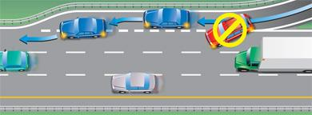
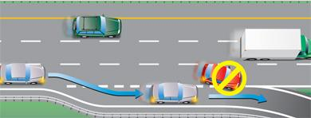

<!-- Generated by build.py. Edit data/ or the guide files instead, then run: python3 build.py -->

# R10 · Freeways & HOV lanes: questions

**Rules half** · 24 questions · [Study guide](../guide/R10-freeway-hov.md) · [All rules topics](../README.md)

Answers are hidden. Tap **Answer** under each question to check yourself.

---

### 1. What is the minimum number of people a passenger car must carry to use an HOV lane on a provincial highway?

*Exact numbers*

- **A.** 3
- **B.** 2
- **C.** 4
- **D.** 1

Answer

**B. 2**

HOV = at least 2 people (buses, taxis, green-plate cars and some others are exempt).

> 📖 Handbook: "vehicles carrying at least two people"

---

### 2. On a freeway, how far ahead should you look?

*Exact numbers*

- **A.** Only at the car in front
- **B.** About 5 seconds ahead
- **C.** About 15 to 20 seconds ahead (or as far as you can see)
- **D.** About 2 seconds ahead

Answer

**C. About 15 to 20 seconds ahead (or as far as you can see)**

At higher speeds you need to look farther ahead.

> 📖 Handbook: "Look ahead to where you are going to be in the next 15 to 20 seconds, or as far ahead as you can see, when you travel at faster speeds."

---

### 3. You're driving in the right lane of a freeway. A car is coming up the on-ramp to merge. What should you do?

*Right-of-way*

- **A.** Speed up so it has to merge behind you
- **B.** If it's safe, move over a lane to leave room for the merging car
- **C.** Stop to let it in
- **D.** Honk to warn it

Answer

**B. If it's safe, move over a lane to leave room for the merging car**

Freeway drivers should move over, if it's safe, to leave room for merging vehicles.

> 📖 Handbook: "Freeway drivers should move over, if it is safe to do so, leaving room for merging vehicles."

---

### 4. You're in the acceleration lane of a freeway entrance. What's your job?

*Right-of-way*

- **A.** Drive on the shoulder until there's a gap
- **B.** Merge slowly and let freeway traffic adjust to you
- **C.** Signal, speed up to match freeway traffic, and merge smoothly into a safe gap
- **D.** Stop at the end of the lane and wait

Answer

**C. Signal, speed up to match freeway traffic, and merge smoothly into a safe gap**

The acceleration lane is for matching the speed of the traffic you're joining.

> 📖 Handbook: "Signal and increase your speed to merge smoothly with traffic."

---

### 5. On a freeway, is it OK for a slower vehicle to change lanes in front of a faster one?

*Right-of-way*

- **A.** Yes, if it signals first
- **B.** Yes, slower vehicles have the right-of-way
- **C.** No: it's dangerous and illegal for a slower vehicle to cut in front of a faster vehicle
- **D.** Only if the faster vehicle is speeding

Answer

**C. No: it's dangerous and illegal for a slower vehicle to cut in front of a faster vehicle**

Be careful not to cut off any vehicle when changing lanes or joining traffic.

> 📖 Handbook: "It is dangerous and illegal for a slower moving vehicle to cut in front of a faster moving vehicle."

---

### 6. You're in the far LEFT lane of a divided highway with three lanes your way. An ambulance comes up behind you with its siren on. Where should you pull over?

*Right-of-way*

- **A.** To the nearest edge of the road, which here is the left side
- **B.** Stop right where you are
- **C.** Onto the left shoulder and keep driving
- **D.** Across all lanes to the right shoulder

Answer

**A. To the nearest edge of the road, which here is the left side**

On a one-way road or divided highway with more than two lanes, move to the closest curb or edge.

> 📖 Handbook: "When on a one-way road or divided highway having more than two lanes of traffic, move to the closest curb or edge of the roadway."

---

### 7. Some freeway entrance ramps join on the LEFT. What does that mean for you?

*Right-of-way*

- **A.** You enter the fastest lane first, so you must match your speed more quickly
- **B.** You should stop at the end of the ramp
- **C.** You must cross to the right lane right away
- **D.** You have the right-of-way over freeway traffic

Answer

**A. You enter the fastest lane first, so you must match your speed more quickly**

Use the acceleration lane to match your speed to the traffic.

> 📖 Handbook: "A few entrance ramps join the freeway on the left. This means you enter the fastest lane of traffic first."

---

### 8. Traffic on the freeway is jammed. Why must you keep off the shoulder?

*Right-of-way*

- **A.** The shoulder is only for trucks
- **B.** The shoulder is a passing lane in traffic jams
- **C.** Emergency vehicles use the shoulder when all lanes are blocked
- **D.** It's fine to use the shoulder in a jam

Answer

**C. Emergency vehicles use the shoulder when all lanes are blocked**

Don't drive on or block the shoulder on freeways.

> 📖 Handbook: "Don't drive on or block the shoulder on freeways. Emergency vehicles will use the shoulder of the road if all lanes are blocked."

---

### 9. When leaving a freeway, when should you start slowing down?

*Word traps*

- **A.** While still in the freeway lane, before signalling
- **B.** As soon as you see the exit sign
- **C.** Once you're in the deceleration lane
- **D.** Only at the end of the exit ramp

Answer

**C. Once you're in the deceleration lane**

Signal and move into the deceleration lane first. Don't slow down on the freeway itself.

> 📖 Handbook: "When leaving the freeway, signal that you want to move into the deceleration lane, but do not slow down."

---

### 10. You missed your freeway exit. What must you NOT do?

*Word traps*

- **A.** Take the next exit
- **B.** Keep driving at a steady speed
- **C.** Check your mirrors
- **D.** Stop or back up on the freeway

Answer

**D. Stop or back up on the freeway**

Never stop or reverse on a freeway. Just take the next exit.

> 📖 Handbook: "If you miss an exit, do not stop or reverse on the freeway. Take the next exit."

---

### 11. A large truck has three people in it. May it use the HOV lane?

*Word traps*

- **A.** No: large trucks are never allowed in HOV lanes, no matter how many people are inside
- **B.** Yes, outside rush hour
- **C.** Yes, with 2 or more people
- **D.** Only if it's under 10 tonnes

Answer

**A. No: large trucks are never allowed in HOV lanes, no matter how many people are inside**

Large trucks are not permitted in HOV lanes.

> 📖 Handbook: "Large trucks are not permitted on the HOV lanes, regardless of the number of occupants."

---

### 12. Which of these may use a provincial HOV lane with only the driver inside?

*Word traps*

- **A.** A regular car
- **B.** A large truck
- **C.** A car with green licence plates
- **D.** A pickup truck

Answer

**C. A car with green licence plates**

Green-plate (plug-in hybrid and electric) vehicles may use HOV lanes with any number of people. So may licensed taxis and airport limousines.

> 📖 Handbook: "Vehicles with the “Green” licence plate are permitted in the HOV lane with any number of occupants."

---

### 13. Once you've merged onto the freeway, where should you normally drive?

*Best action*

- **A.** In the far left lane, since it's fastest
- **B.** In the right-hand lane, using the left lanes only for passing
- **C.** In whichever lane is emptiest
- **D.** In the centre lane, always

Answer

**B. In the right-hand lane, using the left lanes only for passing**

Keep right; pass on the left; don't stay in the left lane.

> 📖 Handbook: "Traffic should keep to the right, using the left lanes for passing."

---

### 14. You've just left a freeway onto the exit ramp. Why should you check your speedometer?

*Best action*

- **A.** After driving fast, you may be going faster than you think ("velocitization")
- **B.** To check your fuel use
- **C.** To see if you can speed up
- **D.** Because ramps have no speed limits

Answer

**A. After driving fast, you may be going faster than you think ("velocitization")**

Speed adaptation makes slow speeds feel slower than they are.

> 📖 Handbook: "Losing your ability to judge your speed accurately is sometimes called speed adaptation or velocitization."

---

### 15. Your car starts having trouble on the freeway. What should you do?

*Best action*

- **A.** Stop in your lane and turn on hazards
- **B.** Slow down in the left lane
- **C.** Keep going until it stalls
- **D.** Pull over to the nearest shoulder right away, with your hazard lights on

Answer

**D. Pull over to the nearest shoulder right away, with your hazard lights on**

At the first sign of trouble, pull over. Never stop in the driving lanes.

> 📖 Handbook: "At the first sign of trouble, begin to pull over. Do not wait for your vehicle to stall on the freeway."

---

### 16. You're stopped on the freeway shoulder waiting for help. What should you do?

*Best action*

- **A.** Sit on the guardrail
- **B.** Stay in your car with the doors locked
- **C.** Raise the hood and walk to the nearest exit
- **D.** Stand behind your car to wave down help

Answer

**B. Stay in your car with the doors locked**

Don't raise the hood. If someone stops, ask them to call police for you.

> 📖 Handbook: "While you wait for help, stay in your vehicle with the doors locked."

---

### 17. You must get out of your broken-down car on the freeway shoulder. Which door should you use?

*Best action*

- **A.** The driver's door, always
- **B.** Climb out a window
- **C.** The door away from traffic, if possible
- **D.** Whichever door is fastest

Answer

**C. The door away from traffic, if possible**

Be careful getting out, and leave through the door away from traffic if you can.

> 📖 Handbook: "If possible, leave through the door away from traffic."

---

### 18. How should you drive near large trucks on a freeway?

*Best action*

- **A.** Cut in front of them after passing
- **B.** Follow closely to save fuel
- **C.** Stay clear of them and leave space around your car
- **D.** Drive beside them for a long time

Answer

**C. Stay clear of them and leave space around your car**

Large vehicles block your view. Space gives you time to react.

> 📖 Handbook: "Stay clear of large vehicles. Because of their size, they block your view more than other vehicles."

---

### 19. Exit signs on a freeway are posted far in advance. Why?

*Best action*

- **A.** They are for trucks only
- **B.** So you have time to make any lane changes safely
- **C.** So you can stop and read them
- **D.** So you can slow down on the freeway

Answer

**B. So you have time to make any lane changes safely**

Plan your lane change early.

> 📖 Handbook: "Signs telling you that there are freeway exits ahead are far enough in advance for you to make any lane changes safely."

---

### 20. When may a G1 driver drive on a freeway?

*Laws & consequences*

- **A.** Only during the day
- **B.** Only on weekends
- **C.** Only with a licensed driving instructor
- **D.** Any time, with any accompanying driver

Answer

**C. Only with a licensed driving instructor**

New drivers should learn to drive at low speeds first.

> 📖 Handbook: "Class G1 drivers may only drive on freeways with a licensed driving instructor."

---

### 21. What separates an HOV lane from the other lanes, and what is the rule?

*Laws & consequences*

- **A.** Nothing; you may enter anywhere
- **B.** A striped buffer zone, and it's illegal to cross it
- **C.** A solid yellow line that you may cross any time
- **D.** Orange cones you may drive between

Answer

**B. A striped buffer zone, and it's illegal to cross it**

Enter and leave HOV lanes only at the marked entry/exit zones.

> 📖 Handbook: "The HOV lane is separated from the other general traffic lanes by a striped buffer zone. It is illegal and unsafe to cross the striped buffer pavement markings."

---

### 22. When are provincial HOV lanes in effect?

*Laws & consequences*

- **A.** Only during rush hour
- **B.** 24 hours a day, 7 days a week
- **C.** Only in winter
- **D.** Only on weekdays

Answer

**B. 24 hours a day, 7 days a week**

Provincial HOV lanes are open 24/7.

> 📖 Handbook: "HOV lanes are open 24 hours a day, seven days a week."

---

### 23. A police officer stops you for using an HOV lane improperly. Besides a ticket, what must you do?

*Laws & consequences*

- **A.** Nothing else
- **B.** Pull onto the shoulder and wait
- **C.** Pay the fine on the spot
- **D.** Return to the general lanes at the next entry/exit zone

Answer

**D. Return to the general lanes at the next entry/exit zone**

Improper HOV use is also 3 demerit points.

> 📖 Handbook: "You will be required to re-enter the general lanes at the next entry/exit zone."

---

### 24. What must a commercial vehicle have to use an HOV lane?

*Laws & consequences*

- **A.** Only a valid permit
- **B.** Two or more people, and be under 6.5 metres long
- **C.** A green plate
- **D.** One person, if it's a delivery

Answer

**B. Two or more people, and be under 6.5 metres long**

Large trucks are never allowed, but smaller commercial vehicles can qualify.

> 📖 Handbook: "Commercial motor vehicles must have two or more people in the vehicle and be less than 6.5 metres in total length to be in the HOV lane."

