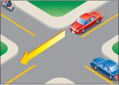
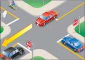
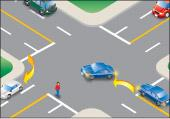
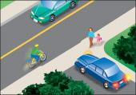

<!-- Generated by build.py. Edit data/ or the guide files instead, then run: python3 build.py -->

# R4 · Intersections & right-of-way: questions

**Rules half** · 30 questions · [Study guide](../guide/R4-intersections-right-of-way.md) · [All rules topics](../README.md)

Answers are hidden. Tap **Answer** under each question to check yourself.

---

### 1. You and another car reach an uncontrolled intersection (no signs or lights) at the same time. The other car is on your right. Who goes first?

*Right-of-way*

- **A.** You do, because you're on the left
- **B.** The car on your right
- **C.** Whoever is going straight
- **D.** Whoever is going faster

Answer

**B. The car on your right**

Same time at an uncontrolled intersection: the driver on the left yields to the driver on the right.

> 📖 Handbook: "if you arrive at the same time, the vehicle approaching from the right has the right-of-way"

---

### 2. At an intersection with no signs or lights, another car got there before you. Who goes first?

*Right-of-way*

- **A.** The car that arrived first
- **B.** Whoever honks first
- **C.** You, if you're on the right
- **D.** You, if you're going straight

Answer

**A. The car that arrived first**

Yield to a vehicle that approached the intersection before you.

> 📖 Handbook: "At an intersection without signs or lights, you must yield the right-of-way to a vehicle approaching the intersection before you"

---

### 3. At an all-way stop, who has the right-of-way?

*Right-of-way*

- **A.** The vehicle on the left
- **B.** The vehicle going straight
- **C.** The largest vehicle
- **D.** The first vehicle to come to a complete stop

Answer

**D. The first vehicle to come to a complete stop**

First to stop, first to go.

> 📖 Handbook: "At an intersection with stop signs at all corners, you must yield the right-of-way to the first vehicle to come to a complete stop."

---

### 4. At an all-way stop, you and a car on your right stop at the same time. Who goes first?

*Right-of-way*

- **A.** You do
- **B.** The car on your right
- **C.** Whoever signals first
- **D.** Whoever is turning left

Answer

**B. The car on your right**

Same time: the vehicle on the left yields to the vehicle on the right.

> 📖 Handbook: "If two vehicles stop at the same time, the vehicle on the left must yield to the vehicle on the right"

---

### 5. At an all-way stop, you and a car on your LEFT stop at the same time. Who goes first?

*Right-of-way*

- **A.** Whoever has more passengers
- **B.** Whoever is turning
- **C.** You do: the car on the left must yield to you
- **D.** The car on your left

Answer

**C. You do: the car on the left must yield to you**

Same time: left yields to right. You are on its right, so you go.

> 📖 Handbook: "If two vehicles stop at the same time, the vehicle on the left must yield to the vehicle on the right"

---

### 6. The traffic lights are out because of a power failure. A car is already in the intersection. What do you do?

*Right-of-way*

- **A.** Go through, since you're on the main road
- **B.** Yield to it, then go when it's your turn, as at an all-way stop
- **C.** Honk and go
- **D.** Follow it through without stopping

Answer

**B. Yield to it, then go when it's your turn, as at an all-way stop**

Dead lights: yield to vehicles in the intersection and to those entering from your right.

> 📖 Handbook: "Yield the right-of-way to vehicles in the intersection and to vehicles entering the intersection from your right."

---

### 7. You're turning left on a green light. An oncoming car is going straight through. Who goes first?

*Right-of-way*

- **A.** Whoever enters the intersection first
- **B.** You do, if you signalled
- **C.** You do, because your light is green
- **D.** The oncoming car

Answer

**D. The oncoming car**

When turning left, wait for approaching traffic to pass or turn.

> 📖 Handbook: "If you are turning left, you must wait for approaching traffic to pass or turn and for pedestrians in or approaching your path to cross."

---

### 8. You're turning left. Pedestrians are crossing the road you're turning onto. What do you do?

*Right-of-way*

- **A.** Turn, since your light is green
- **B.** Turn quickly before they reach your lane
- **C.** Honk so they hurry
- **D.** Wait for the pedestrians to cross

Answer

**D. Wait for the pedestrians to cross**

Yield to pedestrians in or approaching your path.

> 📖 Handbook: "If you are turning left, you must wait for approaching traffic to pass or turn and for pedestrians in or approaching your path to cross."

---

### 9. You're turning right on a green light. A pedestrian is about to cross the road you're turning onto. What do you do?

*Right-of-way*

- **A.** Turn; the pedestrian must wait for you
- **B.** Wait for the pedestrian to cross
- **C.** Honk and turn
- **D.** Turn behind the pedestrian while they're still crossing

Answer

**B. Wait for the pedestrian to cross**

When turning right, wait for pedestrians in or approaching your path.

> 📖 Handbook: "If you are turning right, you must wait for pedestrians to cross if they are in or approaching your path"

---

### 10. You're about to turn right. A cyclist is coming up behind you in the bike lane on your right. Who goes first?

*Right-of-way*

- **A.** The cyclist: check your blind spot and let them pass before turning
- **B.** You, if you signalled
- **C.** You, because you're in front
- **D.** Whoever is going faster

Answer

**A. The cyclist: check your blind spot and let them pass before turning**

Check your right blind spot for cyclists before you turn right.

> 📖 Handbook: "You should also check your blind spot for cyclists approaching from behind, particularly in a bike lane to your right"

---

### 11. You face a yield sign. A car is coming on the road you're entering. Who goes first?

*Right-of-way*

- **A.** The car on the other road
- **B.** You, if you're going straight
- **C.** Whoever is bigger
- **D.** You, if you got to the sign first

Answer

**A. The car on the other road**

Yield = slow down or stop if needed, and let traffic in the intersection or on the other road go first.

> 📖 Handbook: "A yield sign means you must slow down or stop if necessary and yield the right-of-way to traffic in the intersection or on the intersecting road."

---

### 12. You're pulling out of a driveway. A person is walking along the sidewalk across the driveway. What do you do?

*Right-of-way*

- **A.** Go; drivers have the right-of-way
- **B.** Honk so they stop
- **C.** Stop and let the pedestrian pass
- **D.** Pull out quickly behind them

Answer

**C. Stop and let the pedestrian pass**

Entering a road from a driveway, yield to vehicles on the road AND pedestrians on the sidewalk.

> 📖 Handbook: "When entering a road from a private road or driveway, you must yield to vehicles on the road and pedestrians on the sidewalk"

---

### 13. You and an oncoming driver are both waiting to turn left at the same intersection. How do you turn?

*Right-of-way*

- **A.** Neither may turn until the light turns red
- **B.** Each driver turns to the left of the other, after yielding to pedestrians and oncoming traffic
- **C.** Each driver turns in front of the other
- **D.** Whoever arrived first turns; the other waits

Answer

**B. Each driver turns to the left of the other, after yielding to pedestrians and oncoming traffic**

Opposite left-turners pass driver side to driver side.

> 📖 Handbook: "When two vehicles coming from opposite directions meet in an intersection waiting to turn left, each should turn to the left of the other after yielding the right-of-way to pedestrians and oncoming traffic."

---

### 14. A city bus in a bus bay starts flashing its left-turn signal to pull out. You're in the lane next to it. What must you do?

*Right-of-way*

- **A.** Move to the bus bay
- **B.** Speed up to pass it first
- **C.** Honk to let it know you're there
- **D.** Let the bus re-enter traffic

Answer

**D. Let the bus re-enter traffic**

You must allow a bus leaving a bus bay to re-enter traffic.

> 📖 Handbook: "you must allow the bus to re-enter traffic"

---

### 15. Two roads going the same way join into one. Who is responsible for merging safely?

*Right-of-way*

- **A.** Only drivers on the ending road
- **B.** Drivers on both roads, equally
- **C.** Only drivers on the through road
- **D.** The faster driver

Answer

**B. Drivers on both roads, equally**

Merging is a shared job.

> 📖 Handbook: "Drivers on both roads are equally responsible for seeing that traffic merges smoothly and safely."

---

### 16. You're facing a flashing green light and want to turn left. What about the oncoming traffic?

*Right-of-way*

- **A.** They may turn right in front of you
- **B.** They also have a green, so you must yield
- **C.** They face a red light, so you may turn left
- **D.** They have a flashing yellow, so you must wait

Answer

**C. They face a red light, so you may turn left**

Flashing green = advance green: oncoming traffic still has a red.

> 📖 Handbook: "This is called an advanced green light because oncoming traffic still faces a red light."

---

### 17. A pedestrian started crossing on a walk signal. The orange hand appears while they're still in the road. Who has the right-of-way?

*Right-of-way*

- **A.** You, if your light is green
- **B.** Whoever is moving faster
- **C.** The pedestrian
- **D.** You, as soon as the hand appears

Answer

**C. The pedestrian**

Pedestrians already crossing still have the right-of-way over vehicles.

> 📖 Handbook: "While they are crossing, pedestrians still have the right-of-way over vehicles."

---

### 18. At a transit priority signal (white vertical bar), who must yield?

*Right-of-way*

- **A.** Transit vehicles yield to cars
- **B.** Only left-turning cars yield
- **C.** Other traffic and pedestrians must yield to transit vehicles
- **D.** Only pedestrians yield

Answer

**C. Other traffic and pedestrians must yield to transit vehicles**

The white bar gives buses and streetcars their turn.

> 📖 Handbook: "Traffic and pedestrians must yield to public transit vehicles at a transit priority signal."

---

### 19. Road work blocks your lane and no one is directing traffic. A car is coming from the opposite direction. Who goes first?

*Right-of-way*

- **A.** Whoever is bigger
- **B.** Whoever honks first
- **C.** The car coming from the opposite direction
- **D.** You, because your lane is blocked

Answer

**C. The car coming from the opposite direction**

Yield to the driver coming from the opposite direction, then go carefully around the obstacle.

> 📖 Handbook: "If your lane is blocked and no one is directing traffic, yield to the driver coming from the opposite direction."

---

### 20. You're about to enter a roundabout. A car is already circling inside it. Who has the right-of-way?

*Right-of-way*

- **A.** You, if you're on the right
- **B.** Whoever is faster
- **C.** You, if you're going straight
- **D.** The car already in the roundabout

Answer

**D. The car already in the roundabout**

Traffic in the roundabout has the right-of-way. Look left and wait for a gap.

> 📖 Handbook: "Traffic in the roundabout has the right-of-way."

---

### 21. You have a green light. An ambulance with its siren on is coming toward the intersection. What do you do?

*Right-of-way*

- **A.** Keep going, since you have a green light
- **B.** Pull to the right and stop; the ambulance goes first
- **C.** Stop in the middle of the intersection
- **D.** Speed up to get out of its way

Answer

**B. Pull to the right and stop; the ambulance goes first**

Emergency vehicles with lights or sirens always get the right-of-way. Pull over and stop.

> 📖 Handbook: "you are required to bring your vehicle to an immediate stop"

---

### 22. You're not sure whether you or the other driver should go first. What should you do?

*Right-of-way*

- **A.** Flash your lights and go
- **B.** Honk and go
- **C.** Go first so they know your intention
- **D.** Let the other driver go first

Answer

**D. Let the other driver go first**

If in doubt, yield the right-of-way.

> 📖 Handbook: "If you're in doubt, let the other driver go first - yield the right-of-way."

---

### 23. What must a driver do before entering a highway from a private road or driveway?

*Right-of-way* ⭐ *Official MTO sample question*

- **A.** Sound horn and proceed with caution.
- **B.** Enter or cross the highway as quickly as possible.
- **C.** Give hand signal then take right-of-way.
- **D.** Yield right-of-way to all vehicles approaching on the highway.

Answer

**D. Yield right-of-way to all vehicles approaching on the highway.**

Official MTO sample question. Drivers coming out of a driveway must wait.

> 📖 Handbook: "When entering a road from a private road or driveway, you must yield to vehicles on the road"

---

### 24. How many main types of intersections are there, according to the handbook?

*Exact numbers*

- **A.** 1: all intersections are the same
- **B.** 4: one for each direction
- **C.** 2: controlled and uncontrolled
- **D.** 3: stop, yield and signal

Answer

**C. 2: controlled and uncontrolled**

Controlled = lights or signs. Uncontrolled = no signs or lights.

> 📖 Handbook: "There are two main types of intersections: controlled and uncontrolled."

---

### 25. Which statement about signalling is TRUE?

*Word traps*

- **A.** Signalling gives you the right-of-way
- **B.** You only need to signal if a car is behind you
- **C.** Signalling does not give you the right-of-way
- **D.** Once you signal, others must let you in

Answer

**C. Signalling does not give you the right-of-way**

Signal, then make sure the way is clear before you move.

> 📖 Handbook: "Remember, signalling does not give you the right-of-way. You must make sure the way is clear."

---

### 26. On a main road, the intersection ahead is blocked with traffic. You must stop before entering and wait. This rule does NOT apply when you are…

*Word traps*

- **A.** Driving a truck
- **B.** In a hurry
- **C.** Turning left or right
- **D.** Going straight on a green light

Answer

**C. Turning left or right**

Going straight, don't block the intersection. The rule doesn't apply to turning vehicles.

> 📖 Handbook: "This does not apply if you are turning left or right."

---

### 27. Which of these intersections is UNcontrolled?

*Word traps*

- **A.** One with traffic lights
- **B.** One with a yield sign
- **C.** One with no signs and no traffic lights
- **D.** One with stop signs on every corner

Answer

**C. One with no signs and no traffic lights**

Uncontrolled = no signs or lights. Be extra careful there.

> 📖 Handbook: "Uncontrolled intersections have no signs or traffic lights."

---

### 28. You're coming up to a green light that has been green for a while. What should you do?

*Best action*

- **A.** Keep going no matter what
- **B.** Speed up to make it through
- **C.** Be prepared to stop when it turns yellow
- **D.** Stop now, before it changes

Answer

**C. Be prepared to stop when it turns yellow**

A "stale" green may turn yellow soon.

> 📖 Handbook: "If the light has been green for a while, be prepared to stop when it turns yellow."

---

### 29. As you come to an intersection, where should you look?

*Best action*

- **A.** Only to the left
- **B.** Only at the traffic light
- **C.** Only straight ahead
- **D.** The roadways, and also the sidewalks and paths/trails for pedestrians and cyclists

Answer

**D. The roadways, and also the sidewalks and paths/trails for pedestrians and cyclists**

Children may not know the rules, and cycling on the sidewalk may be allowed by local bylaw.

> 📖 Handbook: "Be sure to scan any sidewalks and paths/trails as well as the roadways."

---

### 30. What must you do at a yield sign?

*Laws & consequences*

- **A.** Slow down or stop if necessary, and let traffic in the intersection or on the other road go first
- **B.** Speed up to merge ahead of traffic
- **C.** Stop only if a police officer is there
- **D.** Always come to a complete stop

Answer

**A. Slow down or stop if necessary, and let traffic in the intersection or on the other road go first**

Yield = let them go first. Stop only if you need to.

> 📖 Handbook: "At a controlled intersection where you face a yield sign, slow down or stop if necessary and wait until the way is clear before driving through the intersection."

