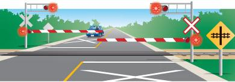
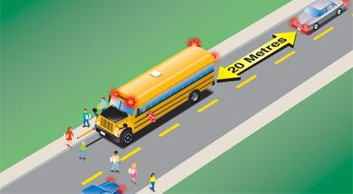
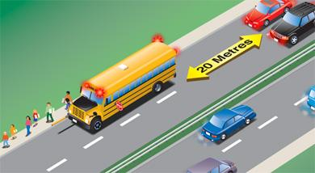
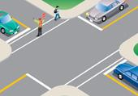

<!-- Generated by build.py. Edit data/ or the guide files instead, then run: python3 build.py -->

# R5 · Stopping: stop lines, railways, school buses, crossovers: questions

**Rules half** · 23 questions · [Study guide](../guide/R5-stopping.md) · [All rules topics](../README.md)

Answers are hidden. Tap **Answer** under each question to check yourself.

---

### 1. A train is coming. How far from the nearest rail or gate must you stop?

*Exact numbers*

- **A.** At least 5 metres
- **B.** At least 2 metres
- **C.** At least 30 metres
- **D.** At least 15 metres

Answer

**A. At least 5 metres**

Stop at least 5 m from the nearest rail or gate.

> 📖 Handbook: "If a train is coming, stop at least five metres from the nearest rail or gate."

---

### 2. You're coming up behind a school bus with its red lights flashing. How far back must you stop?

*Exact numbers*

- **A.** At least 5 metres
- **B.** At least 30 metres
- **C.** At least 10 metres
- **D.** At least 20 metres

Answer

**D. At least 20 metres**

From behind, stop at least 20 m back.

> 📖 Handbook: "If you are coming from behind the bus, stop at least 20 metres away."

---

### 3. You must not pass any vehicle within how many metres of a pedestrian crossover?

*Exact numbers*

- **A.** 20 metres
- **B.** 30 metres
- **C.** 50 metres
- **D.** 10 metres

Answer

**B. 30 metres**

No passing within 30 m of a pedestrian crossover.

> 📖 Handbook: "You must not pass any vehicle within 30 metres of a pedestrian crossover."

---

### 4. Under full emergency braking, how far can it take a train to stop?

*Exact numbers*

- **A.** About 500 metres
- **B.** About 50 metres
- **C.** Up to 2 kilometres
- **D.** About 100 metres

Answer

**C. Up to 2 kilometres**

Trains can't stop quickly. Never race a train.

> 📖 Handbook: "Remember it can take up to two kilometres for a train to stop under full emergency braking."

---

### 5. A school bus is stopped with its red lights flashing on an undivided road. You're coming toward it from the front. What must you do?

*Right-of-way*

- **A.** Keep going; only traffic behind it must stop
- **B.** Honk and pass
- **C.** Slow down and pass carefully
- **D.** Stop

Answer

**D. Stop**

On a road without a median, traffic from both directions must stop.

> 📖 Handbook: "You must stop whenever you approach a stopped school bus with its upper alternating red lights flashing, regardless of whether you are behind the bus or approaching it from the front."

---

### 6. A school bus is stopped with red lights flashing on the other side of a road with a median. You're coming toward it from the front. Must you stop?

*Right-of-way*

- **A.** No: on a road with a median, only vehicles coming from behind the bus must stop
- **B.** Only if children are in the road
- **C.** Yes, but only during school hours
- **D.** Yes, everyone must always stop

Answer

**A. No: on a road with a median, only vehicles coming from behind the bus must stop**

A median is a physical divider you can't drive over. Still watch carefully for children.

> 📖 Handbook: "If you are on a road with a median strip, only vehicles coming from behind the bus must stop."

---

### 7. A school bus ahead has its overhead AMBER lights flashing. What does it mean, and what should you do?

*Right-of-way*

- **A.** It's about to stop: slow down and prepare to stop
- **B.** It's leaving: pass it quickly
- **C.** Stop right away, even if it's far ahead
- **D.** Nothing; only red lights matter

Answer

**A. It's about to stop: slow down and prepare to stop**

Amber = getting ready to stop. Red = stopped: you must stop.

> 📖 Handbook: "Slow down and prepare to stop whether you are behind or approaching the bus"

---

### 8. You're stopped for a school bus with red lights flashing. When may you go?

*Right-of-way*

- **A.** When the children are on the sidewalk
- **B.** After 30 seconds
- **C.** When the bus moves, or the red lights stop flashing and the stop arm folds away
- **D.** When the bus driver waves at you

Answer

**C. When the bus moves, or the red lights stop flashing and the stop arm folds away**

Wait for the bus to move or the lights and stop arm to go off.

> 📖 Handbook: "Remain stopped until the arm folds away and all lights stop flashing."

---

### 9. A school crossing guard is holding up a stop sign. The children have crossed your lane, but the guard is still in the road. What do you do?

*Right-of-way*

- **A.** Go once the children pass your lane
- **B.** Go slowly around the guard
- **C.** Honk to tell the guard to move
- **D.** Stay stopped until everyone, including the guard, has cleared the whole road

Answer

**D. Stay stopped until everyone, including the guard, has cleared the whole road**

Wait until all people, including the guard, have cleared the entire roadway.

> 📖 Handbook: "you must stop before reaching the crossing and remain stopped until all people, including the school crossing guard, have cleared the entire roadway"

---

### 10. A pedestrian at a crossover has passed your lane and is now in the far lane. When may you go?

*Right-of-way*

- **A.** Now, since they're out of your lane
- **B.** When the overhead lights stop flashing
- **C.** When they reach the centre line
- **D.** Only when they have completely crossed the road

Answer

**D. Only when they have completely crossed the road**

At a crossover, wait until the pedestrian is safely on the sidewalk.

> 📖 Handbook: "Only when pedestrians and school crossing guards have crossed and are safely on the sidewalk can drivers and cyclists proceed."

---

### 11. The railway crossing lights are still flashing, but the train has passed and the gate is going up. What do you do?

*Right-of-way*

- **A.** Go as soon as the gate starts rising
- **B.** Wait until the lights stop flashing and the gate is all the way up
- **C.** Go if you can see no second train
- **D.** Go around the gate since the train is gone

Answer

**B. Wait until the lights stop flashing and the gate is all the way up**

Never drive under or around a gate that is down, being lowered or being raised.

> 📖 Handbook: "If there are signal lights, wait until they stop flashing and, if the crossing has a gate or barrier, wait until it rises before you cross the tracks."

---

### 12. In the lane beside you, a car is stopped at a crosswalk. What should you do?

*Right-of-way*

- **A.** Honk and pass
- **B.** Don't pass it: a pedestrian may be crossing in front of it
- **C.** Pass it carefully
- **D.** Pass it on the right

Answer

**B. Don't pass it: a pedestrian may be crossing in front of it**

A stopped vehicle at a crosswalk may be a clue that a pedestrian is crossing.

> 📖 Handbook: "Do not pass a vehicle stopped at a crosswalk. A stopped vehicle may be a clue that a pedestrian is crossing."

---

### 13. You're driving behind a school bus that is approaching a railway crossing. What should you expect?

*Right-of-way*

- **A.** The bus will stop at the crossing, without using its red lights, so be ready to stop behind it
- **B.** The bus will speed up to cross
- **C.** The bus will flash its red lights and stop arm
- **D.** The bus will pull onto the shoulder

Answer

**A. The bus will stop at the crossing, without using its red lights, so be ready to stop behind it**

All school buses must stop at all railway crossings. They don't use the upper red lights for these stops.

> 📖 Handbook: "All school buses must stop at all railway crossings. The upper alternating red lights are not used for these stops, so be alert."

---

### 14. When does the school bus law apply?

*Word traps*

- **A.** Only in school zones
- **B.** On any road, any number of lanes, any speed limit, at any time of day
- **C.** Only on roads with a speed limit under 80 km/h
- **D.** Only during school hours

Answer

**B. On any road, any number of lanes, any speed limit, at any time of day**

Be prepared to stop for a school bus at any time, not just during school hours.

> 📖 Handbook: "You must obey the school bus law on any road, no matter how many lanes or what the speed limit. Be prepared to stop for a school bus at any time, not just within school hours."

---

### 15. When is it legal to drive around, under or through a railway crossing gate?

*Word traps*

- **A.** When you can see no train coming
- **B.** When the gate is only halfway down
- **C.** When you're in a hurry and the crossing is clear
- **D.** Never while it is down, being lowered or being raised

Answer

**D. Never while it is down, being lowered or being raised**

Going around a railway barrier is illegal and dangerous (3 demerit points).

> 📖 Handbook: "Never drive around, under or through a railway gate or barrier while it is down, being lowered or being raised."

---

### 16. A school bus is stopped with red lights flashing on a divided road with a median. You're BEHIND the bus. Must you stop?

*Word traps*

- **A.** No, the median means nobody has to stop
- **B.** Yes: traffic behind the bus must stop, even on a road with a median
- **C.** Only if children are getting off
- **D.** Only if you're in the right lane

Answer

**B. Yes: traffic behind the bus must stop, even on a road with a median**

The median only frees the traffic coming the other way.

> 📖 Handbook: "If you are on a road with a median strip, only vehicles coming from behind the bus must stop."

---

### 17. Which vehicles must stop at EVERY railway crossing, even ones with gates or signal lights?

*Word traps*

- **A.** Vehicles towing trailers
- **B.** All trucks
- **C.** Motorcycles
- **D.** School buses

Answer

**D. School buses**

Most buses stop at unprotected crossings. School buses stop at every crossing.

> 📖 Handbook: "School buses must stop at railway crossings whether or not they are protected by gates or signal lights."

---

### 18. You come to a railway crossing on a quiet country road. There are no gates or lights. What should you do?

*Best action*

- **A.** Honk and cross quickly
- **B.** Cross at your normal speed; trains always use lights
- **C.** Stop on the tracks to look both ways
- **D.** Slow down, listen, and look both ways to make sure the way is clear before crossing

Answer

**D. Slow down, listen, and look both ways to make sure the way is clear before crossing**

Not every crossing has gates or lights. Never stop on the tracks themselves.

> 📖 Handbook: "Slow down, listen and look both ways to make sure the way is clear before crossing the tracks."

---

### 19. Your car stalls on the railway tracks. What should you do FIRST?

*Best action*

- **A.** Try to restart the car
- **B.** Get everyone out and away from the car, then call for help
- **C.** Push the car off the tracks
- **D.** Stay inside with your seatbelt on

Answer

**B. Get everyone out and away from the car, then call for help**

Get everyone to a safe place first, then contact authorities.

> 📖 Handbook: "If you get trapped on a crossing, immediately get everyone out and away from the vehicle. Move to a safe place and then contact authorities."

---

### 20. Traffic is heavy and backed up across the railway tracks ahead. What should you do?

*Best action*

- **A.** Follow the car ahead onto the tracks
- **B.** Stop on the tracks; traffic will move soon
- **C.** Wait until there's room to get completely across the tracks before you start
- **D.** Cross the tracks in the oncoming lane

Answer

**C. Wait until there's room to get completely across the tracks before you start**

Never stop on the tracks.

> 📖 Handbook: "Avoid stopping in the middle of railway tracks; for example, in heavy traffic, make sure you have enough room to cross the tracks completely before you begin."

---

### 21. You're driving a car with a manual transmission over railway tracks. What should you avoid?

*Best action*

- **A.** Crossing at the posted speed
- **B.** Driving straight across
- **C.** Looking both ways
- **D.** Shifting gears while crossing the tracks

Answer

**D. Shifting gears while crossing the tracks**

Shifting on the tracks could stall the car.

> 📖 Handbook: "Avoid shifting gears while crossing tracks."

---

### 22. A railway crossing has a stop sign. What must you do?

*Laws & consequences*

- **A.** Stop only if a train is visible
- **B.** Slow down and look
- **C.** Stop, unless a flagman directs you otherwise
- **D.** Stop only at night

Answer

**C. Stop, unless a flagman directs you otherwise**

A stop sign at a railway crossing means stop.

> 📖 Handbook: "If you are approaching a railway crossing with a stop sign, you must stop unless otherwise directed by a flagman."

---

### 23. A driver passes a stopped school bus with its red lights flashing, and a witness reports the car. Who can be fined?

*Laws & consequences*

- **A.** The vehicle's registered owner (fines only, not demerit points or jail)
- **B.** No one, unless police saw it
- **C.** Only the bus driver
- **D.** The witness, for not stopping the car

Answer

**A. The vehicle's registered owner (fines only, not demerit points or jail)**

School bus drivers and other witnesses can report vehicles that illegally pass a school bus.

> 📖 Handbook: "If you are the vehicle’s registered owner, these fines, but not demerit points or jail time, may be applied to you."

