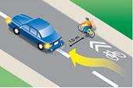
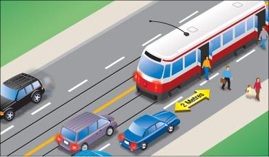
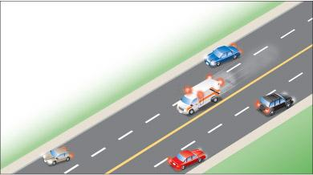
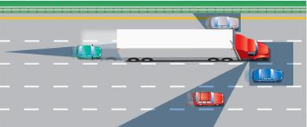
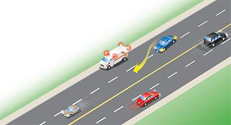

<!-- Generated by build.py. Edit data/ or the guide files instead, then run: python3 build.py -->

# R7 · Sharing the road: questions

**Rules half** · 26 questions · [Study guide](../guide/R7-sharing-the-road.md) · [All rules topics](../README.md)

Answers are hidden. Tap **Answer** under each question to check yourself.

---

### 1. When passing a cyclist, how much space must you leave, where practical?

*Exact numbers*

- **A.** At least 3 metres
- **B.** At least 2 metres
- **C.** At least 30 centimetres
- **D.** At least 1 metre

Answer

**D. At least 1 metre**

Minimum 1 m. Better: change lanes to pass when you can.

> 📖 Handbook: "When passing a cyclist, drivers of motor vehicles must maintain a minimum distance of one metre, where practical between their vehicle and the cyclist."

---

### 2. A streetcar is stopped and passengers are getting on and off. How far behind its rear doors must you stop?

*Exact numbers*

- **A.** At least 1 metre
- **B.** At least 5 metres
- **C.** At least 20 metres
- **D.** At least 2 metres

Answer

**D. At least 2 metres**

2 m behind the rear doors, unless there's a special safety island or zone for passengers.

> 📖 Handbook: "At streetcar stops, stay at least two metres behind the rear doors where passengers are getting off or on."

---

### 3. It is illegal to follow a fire vehicle that is answering an alarm closer than…

*Exact numbers*

- **A.** 50 metres
- **B.** 150 metres
- **C.** 100 metres
- **D.** 300 metres

Answer

**B. 150 metres**

Stay at least 150 m behind a fire vehicle answering an alarm.

> 📖 Handbook: "it is illegal to follow within 150 metres of a fire vehicle responding to an alarm"

---

### 4. Most tractors and combines have a maximum speed of about…

*Exact numbers*

- **A.** 20 km/h
- **B.** 60 km/h
- **C.** 40 km/h
- **D.** 80 km/h

Answer

**C. 40 km/h**

They often go even slower when towing. Watch for the orange slow-moving vehicle sign.

> 📖 Handbook: "Most tractors and combines have a maximum speed of 40 km/h"

---

### 5. An ambulance with flashing lights and siren is coming up behind you. What must you do?

*Right-of-way*

- **A.** Pull onto the left shoulder
- **B.** Speed up to stay ahead of it
- **C.** Pull as close as practical to the right edge, clear of intersections, and stop
- **D.** Stop right where you are in your lane

Answer

**C. Pull as close as practical to the right edge, clear of intersections, and stop**

Signal, move right, stop parallel to the road, and wait until it passes.

> 📖 Handbook: "you are required to bring your vehicle as near as is practical to the right-hand curb or edge of the roadway"

---

### 6. You're in an intersection waiting to turn left when an emergency vehicle comes with its siren on. What should you do?

*Right-of-way*

- **A.** Complete your left turn quickly
- **B.** Back up out of the intersection
- **C.** Stop right where you are
- **D.** Don't turn: go straight through when it's safe, then pull to the right and stop

Answer

**D. Don't turn: go straight through when it's safe, then pull to the right and stop**

Clearing the intersection straight ahead avoids a crash if the emergency vehicle passes on the side you meant to turn to.

> 📖 Handbook: "you should abandon the turn and clear the intersection by proceeding straight when safe to do so, then pull to the right and stop"

---

### 7. A car behind you has a flashing GREEN light on its dashboard. Who is it, and what should you do?

*Right-of-way*

- **A.** A tow truck: speed up
- **B.** A police officer: pull over and wait for a ticket
- **C.** A volunteer firefighter or medical responder: yield to let them through
- **D.** A funeral procession: stop

Answer

**C. A volunteer firefighter or medical responder: yield to let them through**

Some firefighters and volunteer medical responders use a flashing green light in their own vehicles.

> 📖 Handbook: "Some firefighters and volunteer medical responders may display a flashing green light when using their own vehicles to respond to a fire or medical emergency."

---

### 8. A horse-drawn buggy is coming toward you on a two-lane road. What should you do?

*Right-of-way*

- **A.** Move to the far right of your lane and slow down
- **B.** Flash your high beams
- **C.** Speed up to pass it quickly
- **D.** Honk to let the driver know you're there

Answer

**A. Move to the far right of your lane and slow down**

Give horses lots of room. Startling them can make them swerve.

> 📖 Handbook: "When approaching a horse-drawn vehicle travelling in the opposite direction, move to the far right of your lane."

---

### 9. You're turning left. Two cyclists are coming toward you from the other direction. What do you do?

*Right-of-way*

- **A.** Stop and wait for the oncoming bicycles to pass before turning
- **B.** Honk and turn
- **C.** Turn before them; cars have priority
- **D.** Turn if they're slowing down

Answer

**A. Stop and wait for the oncoming bicycles to pass before turning**

Bicycles are vehicles. Wait for oncoming bikes just like oncoming cars.

> 📖 Handbook: "When turning left, you must stop and wait for oncoming bicycles to pass before turning."

---

### 10. A cyclist ahead of you is turning left at an intersection. You're turning left too. What should you do?

*Right-of-way*

- **A.** Pass the cyclist on the right
- **B.** Honk so the cyclist hurries
- **C.** Pull up beside the cyclist and turn together
- **D.** Stay behind the cyclist and turn when the way is clear

Answer

**D. Stay behind the cyclist and turn when the way is clear**

Don't pull up beside a bike, motorcycle or moped turning left. Wait behind it.

> 📖 Handbook: "If you are making a left turn behind one of these vehicles, do not pull up beside it to make your turn at the same time."

---

### 11. An oncoming motorcycle has its turn signal on. You want to turn left in front of it. What should you do?

*Right-of-way*

- **A.** Flash your lights and turn
- **B.** Honk and turn
- **C.** Make sure it's actually turning before you go: the rider may have forgotten to switch the signal off
- **D.** Turn right away; it's turning

Answer

**C. Make sure it's actually turning before you go: the rider may have forgotten to switch the signal off**

Many motorcycle turn signals don't shut off by themselves.

> 📖 Handbook: "Make sure the motorcyclist is actually turning; he or she may have just forgotten to switch off the turn signal."

---

### 12. A large truck ahead of you is making a right turn and swings wide to the left. A gap opens on its right. What should you do?

*Right-of-way*

- **A.** Honk so the truck moves back
- **B.** Stay well back until the truck has completely cleared the lane
- **C.** Move into the gap and pass on the right
- **D.** Pass it on the left quickly

Answer

**B. Stay well back until the truck has completely cleared the lane**

If you move into that space, you can get squeezed between the trailer and the curb.

> 📖 Handbook: "Stay well back until the truck has completely cleared the lane."

---

### 13. You're in a roundabout when an emergency vehicle comes up behind you. What should you do?

*Right-of-way*

- **A.** Leave at your intended exit, drive past the traffic island, then pull over
- **B.** Stop right away inside the roundabout
- **C.** Pull onto the centre island
- **D.** Keep circling until it passes

Answer

**A. Leave at your intended exit, drive past the traffic island, then pull over**

If you haven't entered yet, pull over to the right and wait.

> 📖 Handbook: "If you are in a roundabout when an emergency vehicle approaches, exit at your intended exit and proceed beyond the traffic island before pulling over."

---

### 14. A police car with flashing lights is stopped on the shoulder. Your side of the highway has two lanes, and you're in the right lane. What must you do?

*Right-of-way*

- **A.** Slow down and, if safe, move into the lane away from it
- **B.** Speed up to get past quickly
- **C.** Stop beside the police car
- **D.** Keep your speed and lane

Answer

**A. Slow down and, if safe, move into the lane away from it**

Slow down AND move over. It's 3 demerit points if you don't.

> 📖 Handbook: "When the roadway has two or more lanes of traffic in the same direction of your travel, you are required to move into a lane away from the emergency vehicle or tow truck, if safe to do so"

---

### 15. A tow truck with its amber lights flashing is stopped on the shoulder ahead, on your side of the road. What must you do?

*Right-of-way*

- **A.** Honk as you pass
- **B.** Nothing; the move-over law is only for police
- **C.** Stop behind the tow truck
- **D.** Slow down and pass with caution, and move over a lane if there is one and it's safe

Answer

**D. Slow down and pass with caution, and move over a lane if there is one and it's safe**

The slow-down-and-move-over law covers tow trucks with flashing amber lights too.

> 📖 Handbook: "a tow truck with its amber lights flashing in the same direction of your travel, you are required to reduce the speed of your vehicle and proceed with caution"

---

### 16. You're turning right into a driveway, across a bike lane marked with a solid white line. What should you do?

*Right-of-way*

- **A.** Honk to warn cyclists, then turn
- **B.** Turn quickly; bike lanes are optional
- **C.** Enter the bike lane only after making sure it's safe, then turn
- **D.** Stop in the bike lane and wait

Answer

**C. Enter the bike lane only after making sure it's safe, then turn**

Bike lanes are for cyclists. Check for bikes before you cross into it.

> 📖 Handbook: "Enter the bike lane only after ensuring that you can do so safely, and then make the turn."

---

### 17. A pedestrian with a white cane is waiting to cross at the corner where you're turning. What should you do?

*Right-of-way*

- **A.** Yield and give them time and space to cross
- **B.** Drive past quickly before they start
- **C.** Wave them across from your car
- **D.** Honk so they know you're there

Answer

**A. Yield and give them time and space to cross**

A white cane or guide dog means the person is blind or has low vision. In most cases, drivers yield to pedestrians.

> 📖 Handbook: "Pedestrians who are blind or with a visual disability may use a white cane or guide dog to help them travel safely along sidewalks and across intersections."

---

### 18. When you pull over for an approaching emergency vehicle, where should you NOT stop?

*Word traps*

- **A.** On the shoulder, because emergency vehicles may be using it
- **B.** Near the right-hand curb
- **C.** Parallel to the road
- **D.** Clear of the intersection

Answer

**A. On the shoulder, because emergency vehicles may be using it**

Pull close to the right edge, but don't move onto or stop on the shoulder.

> 📖 Handbook: "Do not move onto or stop on the shoulder of the roadway, as emergency vehicles may be travelling along it."

---

### 19. Which statement about cyclists is TRUE?

*Word traps*

- **A.** They may use any part of the lane if they need to for safety, such as to avoid potholes or sewer grates
- **B.** They may never ride in the middle of a lane
- **C.** They must always ride against the curb
- **D.** They must ride on the sidewalk

Answer

**A. They may use any part of the lane if they need to for safety, such as to avoid potholes or sewer grates**

Cyclists usually ride about 1 m from the curb, but may take the lane when needed.

> 📖 Handbook: "However, they can use any part of the lane if necessary for safety"

---

### 20. Which of these people is considered a pedestrian?

*Word traps*

- **A.** A person on a motorcycle
- **B.** A cyclist in a bike lane
- **C.** A person riding an e-bike in traffic
- **D.** A person using a motorized wheelchair or medical scooter

Answer

**D. A person using a motorized wheelchair or medical scooter**

People operating motorized wheelchairs and medical scooters are pedestrians too.

> 📖 Handbook: "People operating motorized wheelchair and medical scooters are pedestrians too."

---

### 21. Which statement about motorcycles is TRUE?

*Word traps*

- **A.** They must ride on the shoulder
- **B.** You may share their lane if it's wide enough
- **C.** They always have the right-of-way
- **D.** They use a full lane; treat them like other vehicles

Answer

**D. They use a full lane; treat them like other vehicles**

Never squeeze into a motorcycle's lane.

> 📖 Handbook: "Motorcycles use a full lane; treat them like other vehicles when driving."

---

### 22. You're driving beside a large truck. How can you tell if the driver can see you?

*Best action*

- **A.** If you can't see the driver's face in their side mirror, the driver can't see you
- **B.** Trucks have no blind spots
- **C.** If the driver honks
- **D.** If you can see the truck's wheels

Answer

**A. If you can't see the driver's face in their side mirror, the driver can't see you**

Trucks have big blind spots on both sides and behind.

> 📖 Handbook: "Remember that if you can't see the driver’s face in the large vehicle’s side-view mirror, the driver cannot see you."

---

### 23. Why should you leave extra space behind a cyclist?

*Best action*

- **A.** Cyclists can't hear cars
- **B.** It's only a courtesy
- **C.** Bicycles don't have brake lights to warn you when they slow down or stop
- **D.** Bicycles are faster than cars

Answer

**C. Bicycles don't have brake lights to warn you when they slow down or stop**

Don't follow cyclists too closely.

> 📖 Handbook: "They do not have brake lights to warn you when they are slowing or stopping."

---

### 24. You're overtaking a cyclist and feel you must use your horn. What should you do?

*Best action*

- **A.** Tap it quickly and lightly while you're still some distance away
- **B.** Never use the horn; flash your lights instead
- **C.** Give a long blast right beside them
- **D.** Honk twice as you pass

Answer

**A. Tap it quickly and lightly while you're still some distance away**

A loud horn up close can frighten a cyclist and make them lose control.

> 📖 Handbook: "If you feel that you must use your horn, tap it quickly and lightly while you are still some distance away from the cyclist."

---

### 25. What is the penalty for not leaving at least 1 metre when passing a cyclist?

*Laws & consequences*

- **A.** A warning only
- **B.** A 30-day suspension
- **C.** A fine and 2 demerit points
- **D.** A fine and 6 demerit points

Answer

**C. A fine and 2 demerit points**

Failing to share the road / pass safely = 2 points plus a fine.

> 📖 Handbook: "Failure to do so may result in a fine and an additional two demerit points on the driver’s record."

---

### 26. You don't pull over for an emergency vehicle with its lights and siren on. What can happen (first offence)?

*Laws & consequences*

- **A.** Only a fine
- **B.** A warning letter
- **C.** A fine and 3 demerit points
- **D.** Your licence is cancelled

Answer

**C. A fine and 3 demerit points**

Repeat offences: higher fines and possible jail for up to 6 months.

> 📖 Handbook: "If you don’t stop, you can be fined and get three demerit points for a first offence."

