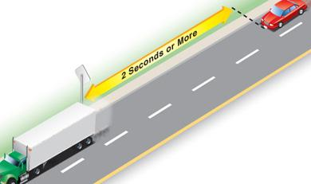
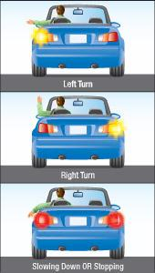

<!-- Generated by build.py. Edit data/ or the guide files instead, then run: python3 build.py -->

# R8 · Speed, space, signals & police: questions

**Rules half** · 25 questions · [Study guide](../guide/R8-speed-and-space.md) · [All rules topics](../README.md)

Answers are hidden. Tap **Answer** under each question to check yourself.

---

### 1. Unless a sign says otherwise, what is the maximum speed in cities, towns and villages?

*Exact numbers*

- **A.** 60 km/h
- **B.** 80 km/h
- **C.** 50 km/h
- **D.** 40 km/h

Answer

**C. 50 km/h**

No sign: 50 in town, 80 elsewhere.

> 📖 Handbook: "Where there are no posted speed limits, the maximum speed is 50 km/h in cities, towns and villages, and 80 km/h elsewhere."

---

### 2. Unless a sign says otherwise, what is the maximum speed outside cities, towns and villages?

*Exact numbers*

- **A.** 70 km/h
- **B.** 80 km/h
- **C.** 90 km/h
- **D.** 100 km/h

Answer

**B. 80 km/h**

No sign: 80 out of town, 50 in town.

> 📖 Handbook: "and 80 km/h elsewhere"

---

### 3. What is the minimum safe following distance in ideal conditions?

*Exact numbers*

- **A.** 1 second
- **B.** 2 seconds
- **C.** 1 car length
- **D.** 4 seconds

Answer

**B. 2 seconds**

At least 2 seconds behind the vehicle ahead, and more in bad conditions.

> 📖 Handbook: "A safe following distance is at least two seconds behind the vehicle in front of you."

---

### 4. About how often should you check your mirrors?

*Exact numbers*

- **A.** Every 30 seconds
- **B.** Every minute
- **C.** Only before changing lanes
- **D.** Every 5 seconds or so

Answer

**D. Every 5 seconds or so**

Keep your eyes moving: scan ahead and to the sides, and check mirrors about every 5 seconds.

> 📖 Handbook: "checking your mirrors every five seconds or so"

---

### 5. Picture the steering wheel as a clock. Where should your hands be?

*Exact numbers*

- **A.** At 12 o'clock
- **B.** At 10 o'clock and 2 o'clock
- **C.** At 9 o'clock and 3 o'clock
- **D.** At 6 o'clock

Answer

**C. At 9 o'clock and 3 o'clock**

9 and 3.

> 📖 Handbook: "Picture the steering wheel as a clock and place your hands at nine o'clock and three o'clock."

---

### 6. A police officer directing traffic waves you through, but your light is red. What do you do?

*Right-of-way*

- **A.** Wait for the green light
- **B.** Honk to confirm, then wait
- **C.** Turn right instead
- **D.** Follow the officer's directions

Answer

**D. Follow the officer's directions**

Police directions overrule traffic lights and signs.

> 📖 Handbook: "When police officers are directing traffic, you must follow their directions, even if the directions are different from traffic lights or signs."

---

### 7. You're pulling out from a parking spot at the curb. Who goes first?

*Right-of-way*

- **A.** Whoever honks first
- **B.** Traffic on the road: signal, check, and pull out only when it's safe
- **C.** You do, once you signal
- **D.** You do, if you're already moving

Answer

**B. Traffic on the road: signal, check, and pull out only when it's safe**

Before moving from a parked position, signal and check for traffic. Pull out only when it's safe.

> 📖 Handbook: "Before moving from a parked position, always signal and check for traffic, pulling out only when it is safe to do so."

---

### 8. A pedestrian is crossing the road ahead of you. There's no crosswalk. What should you usually do?

*Right-of-way*

- **A.** Honk and keep going
- **B.** Drive around them
- **C.** Speed up to pass before they reach your lane
- **D.** Yield to the pedestrian

Answer

**D. Yield to the pedestrian**

Drivers must take care around pedestrians. In most cases, that means yielding.

> 📖 Handbook: "In most cases, that means yielding to the pedestrian."

---

### 9. Which statement about the 2-second rule is TRUE?

*Word traps*

- **A.** It's the maximum following distance
- **B.** It's the MINIMUM following distance, for ideal conditions only
- **C.** It's only for bad weather
- **D.** It's only for trucks

Answer

**B. It's the MINIMUM following distance, for ideal conditions only**

You need more space in bad weather, behind motorcycles or trucks, or with a heavy load.

> 📖 Handbook: "Remember that the two-second rule gives a minimum following distance. It applies only to ideal driving conditions."

---

### 10. In which situation is a 2-second following distance enough?

*Word traps*

- **A.** Driving in heavy rain
- **B.** Carrying a heavy load
- **C.** Following a car on a dry road in ideal conditions
- **D.** Following a motorcycle

Answer

**C. Following a car on a dry road in ideal conditions**

Bad weather, motorcycles, large trucks and heavy loads all need extra space.

> 📖 Handbook: "You will need extra space in certain situations, such as bad weather, when following motorcycles or large trucks, or when carrying a heavy load."

---

### 11. Is it legal to drive with a radar detector (speed-measuring warning device) in your car?

*Word traps*

- **A.** Yes, as long as you don't speed
- **B.** Only on highways
- **C.** Yes, if it's turned off
- **D.** No: it's illegal, and you can be fined and get demerit points

Answer

**D. No: it's illegal, and you can be fined and get demerit points**

Radar detectors are illegal in Ontario (3 demerit points).

> 📖 Handbook: "Speed measuring warning devices are illegal. If you get caught driving with such a device, you will be fined and accumulate demerit points."

---

### 12. Your turn signals are broken. What is the hand signal for a RIGHT turn?

*Word traps*

- **A.** Right arm out the passenger window
- **B.** Left arm out the window, bent UP at the elbow
- **C.** Left arm straight out
- **D.** Left arm bent DOWN at the elbow

Answer

**B. Left arm out the window, bent UP at the elbow**

Left arm: straight out = left turn, bent up = right turn, bent down = slow or stop.

> 📖 Handbook: "a driver flashing right-turn signal and making hand signal for right turn-left arm extended out and bent up at right angle"

---

### 13. When should you NOT use cruise control?

*Word traps*

- **A.** During the daytime
- **B.** On wet, icy or slippery roads, in heavy traffic, or when you're tired
- **C.** When going the speed limit
- **D.** On a dry, empty highway

Answer

**B. On wet, icy or slippery roads, in heavy traffic, or when you're tired**

Cruise control can save fuel on the highway, but not in those conditions.

> 📖 Handbook: "there are some circumstances in which cruise control should not be used, such as adverse driving conditions (wet, icy or slippery roads), in heavy traffic or when you are feeling fatigued"

---

### 14. It's raining hard and traffic is heavy. The speed limit is 80 km/h. How fast should you drive?

*Best action*

- **A.** Below the limit, at a speed that lets you stop safely
- **B.** Faster than traffic, to get out of the rain sooner
- **C.** Exactly 80 km/h
- **D.** As fast as the car in front

Answer

**A. Below the limit, at a speed that lets you stop safely**

The posted limit is a maximum, not a target. Slow down in bad conditions.

> 📖 Handbook: "This means driving below the maximum speed in bad weather, in heavy traffic or in construction zones."

---

### 15. A police officer signals you to pull over. What should you do?

*Best action*

- **A.** Keep driving to the next exit
- **B.** Pull as far to the right as is safe, stop completely, and stay in your car
- **C.** Stop in your lane right away
- **D.** Get out and walk to the police car

Answer

**B. Pull as far to the right as is safe, stop completely, and stay in your car**

Stay in your vehicle and wait for the officer.

> 📖 Handbook: "you must pull over as far to the right as you safely can and come to a complete stop. Stay in your vehicle and wait for the police officer."

---

### 16. On a multi-lane road, which lane should you normally drive in?

*Best action*

- **A.** The middle lane, always
- **B.** Whichever lane is empty
- **C.** The left lane, because it's faster
- **D.** The right-hand lane, unless you're turning left or passing

Answer

**D. The right-hand lane, unless you're turning left or passing**

Keep right, especially if you're driving slower than other traffic.

> 📖 Handbook: "Keep to the right of the road or in the right-hand lane on multi-lane roads unless you want to turn left or pass another vehicle."

---

### 17. How do you check that you're at least 2 seconds behind the car ahead?

*Best action*

- **A.** Count the car lengths between you
- **B.** When its rear passes a marker, count "one thousand and one, one thousand and two" until your front reaches the marker
- **C.** Check your speedometer
- **D.** Watch its brake lights

Answer

**B. When its rear passes a marker, count "one thousand and one, one thousand and two" until your front reaches the marker**

If you reach the marker before you finish counting, you're too close.

> 📖 Handbook: "If you reach the marker before you count "one thousand and two," you are following too closely."

---

### 18. Your brake lights and turn signals stop working. How should you signal?

*Best action*

- **A.** Flash your headlights
- **B.** Don't signal; just drive carefully
- **C.** Honk your horn
- **D.** Use hand and arm signals

Answer

**D. Use hand and arm signals**

Hand and arm signals are the backup.

> 📖 Handbook: "If your turn signals and brake lights are not working, use hand and arm signals."

---

### 19. How should you adjust your seat?

*Best action*

- **A.** So you can see over the wheel and hood, and see the ground about 4 metres ahead, with elbows slightly bent
- **B.** As far back as possible
- **C.** So your chin is on the wheel
- **D.** So your arms are fully straight

Answer

**A. So you can see over the wheel and hood, and see the ground about 4 metres ahead, with elbows slightly bent**

Your feet should reach the pedals easily.

> 📖 Handbook: "You should be able to see the ground four metres in front of the vehicle."

---

### 20. When must you signal?

*Laws & consequences*

- **A.** Before stopping, slowing down, turning, changing lanes, leaving the road, or pulling out from a parked position
- **B.** Only when other cars are around
- **C.** Only for turns
- **D.** Only on highways

Answer

**A. Before stopping, slowing down, turning, changing lanes, leaving the road, or pulling out from a parked position**

Signal well before you act, and make sure the way is clear. Signalling alone isn't enough.

> 📖 Handbook: "Use your turn signals and brake lights to signal before stopping, slowing down, turning, changing lanes, leaving the road or moving out from a parked position."

---

### 21. Driving too slowly for no reason, so you block normal traffic, is…

*Laws & consequences*

- **A.** Legal at any speed
- **B.** Always the safest choice
- **C.** An offence: don't block the normal and reasonable movement of traffic
- **D.** Only a problem on freeways

Answer

**C. An offence: don't block the normal and reasonable movement of traffic**

Unnecessary slow driving = 2 demerit points.

> 📖 Handbook: "Do not block the normal and reasonable movement of traffic."

---

### 22. Defensive driving is based on which three ideas?

*Laws & consequences*

- **A.** Horn, lights and signals
- **B.** Visibility, space and communication
- **C.** Speed, power and control
- **D.** Mirrors, brakes and gas

Answer

**B. Visibility, space and communication**

See and be seen, keep space around you, and let others know what you're doing.

> 📖 Handbook: "Defensive driving is based on three ideas: visibility, space and communication."

---

### 23. Why do school zones and construction zones often have lower speed limits?

*Laws & consequences*

- **A.** To protect children and people working on or near the road
- **B.** To raise money from fines
- **C.** To save fuel
- **D.** To reduce noise

Answer

**A. To protect children and people working on or near the road**

Obey the lower limit.

> 📖 Handbook: "School zones and construction zones often have lower speed limits to protect children and those who work on or near the road."

---

### 24. A police officer asks you to pull over and you don't. What can happen?

*Laws & consequences*

- **A.** Only demerit points
- **B.** A fine, a licence suspension, or even prison
- **C.** Nothing, if you didn't see them
- **D.** Only a warning

Answer

**B. A fine, a licence suspension, or even prison**

Failing to stop for police is 7 demerit points, and your licence can be suspended for at least 5 years.

> 📖 Handbook: "If you do not obey a police officer’s direction to pull over, you risk being fined, having your licence suspended or even serving time in prison."

---

### 25. You should under all conditions drive at a speed which will allow you to:

*Laws & consequences* ⭐ *Official MTO sample question*

- **A.** Stop within a safe distance.
- **B.** Stop within 90 metres (300 feet).
- **C.** Stop within 150 metres (500 feet).
- **D.** Stop within 60 metres (200 feet).

Answer

**A. Stop within a safe distance.**

Official MTO sample question. There's no fixed distance: it depends on conditions.

> 📖 Handbook: "but always drive at a speed that will let you stop safely"

