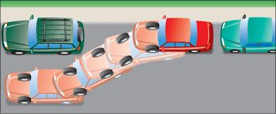
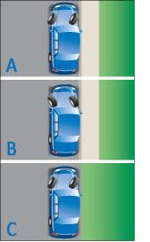
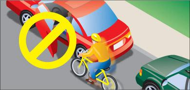

<!-- Generated by build.py. Edit data/ or the guide files instead, then run: python3 build.py -->

# R9 · Parking & roadside stops: questions

**Rules half** · 26 questions · [Study guide](../guide/R9-parking.md) · [All rules topics](../README.md)

Answers are hidden. Tap **Answer** under each question to check yourself.

---

### 1. How close to a fire hydrant may you park?

*Exact numbers*

- **A.** No closer than 6 metres
- **B.** No closer than 3 metres
- **C.** No closer than 9 metres
- **D.** No closer than 1 metre

Answer

**B. No closer than 3 metres**

3 m from a hydrant. Think "3-6-9-15".

> 📖 Handbook: "Do not park within three metres of a fire hydrant"

---

### 2. How close to an intersection (without traffic lights) may you park?

*Exact numbers*

- **A.** No closer than 6 metres
- **B.** No closer than 15 metres
- **C.** No closer than 3 metres
- **D.** No closer than 9 metres

Answer

**D. No closer than 9 metres**

9 m from an intersection, or 15 m if it has traffic lights.

> 📖 Handbook: "Do not park within nine metres of an intersection or within 15 metres if it is controlled by traffic lights."

---

### 3. How close to an intersection WITH traffic lights may you park?

*Exact numbers*

- **A.** No closer than 30 metres
- **B.** No closer than 15 metres
- **C.** No closer than 6 metres
- **D.** No closer than 9 metres

Answer

**B. No closer than 15 metres**

Traffic lights = 15 m. No lights = 9 m.

> 📖 Handbook: "within 15 metres if it is controlled by traffic lights"

---

### 4. How close to the nearest rail of a level railway crossing may you park?

*Exact numbers*

- **A.** No closer than 5 metres
- **B.** No closer than 30 metres
- **C.** No closer than 15 metres
- **D.** No closer than 9 metres

Answer

**C. No closer than 15 metres**

Parking: 15 m from the rail. (Stopping for a train: 5 m.)

> 📖 Handbook: "Do not park within 15 metres of the nearest rail of a level railway crossing."

---

### 5. How close to the public entrance of a hotel, theatre or public hall (while it's open) may you park?

*Exact numbers*

- **A.** No closer than 9 metres
- **B.** No closer than 3 metres
- **C.** No closer than 6 metres
- **D.** No closer than 15 metres

Answer

**C. No closer than 6 metres**

6 m from a public entrance, when the place is open to the public.

> 📖 Handbook: "within six metres of a public entrance to a hotel, theatre or public hall when it is open to the public"

---

### 6. Outside of town, you may not park on a bridge, or within how far of one?

*Exact numbers*

- **A.** 150 metres
- **B.** 100 metres
- **C.** 50 metres
- **D.** 30 metres

Answer

**B. 100 metres**

Don't park on or within 100 m of a bridge.

> 📖 Handbook: "on or within 100 metres of a bridge"

---

### 7. Never park anywhere you can't see clearly in both directions for at least…

*Exact numbers*

- **A.** 125 metres
- **B.** 150 metres
- **C.** 50 metres
- **D.** 100 metres

Answer

**A. 125 metres**

Parking needs 125 m of clear view. (A U-turn needs 150 m.)

> 📖 Handbook: "Never park on a curve, hill or anywhere you do not have a clear view for at least 125 metres in both directions."

---

### 8. During a roadside stop, how far from the curb or edge of the road should you be?

*Exact numbers*

- **A.** As far as possible
- **B.** No more than about 30 centimetres
- **C.** About 50 centimetres
- **D.** About 1 metre

Answer

**B. No more than about 30 centimetres**

Stop parallel and close: about 30 cm.

> 📖 Handbook: "You should not be more than about 30 centimetres away from it."

---

### 9. To parallel park, look for a space about how long?

*Exact numbers*

- **A.** Exactly your car's length
- **B.** Twice your car's length
- **C.** Three times your car's length
- **D.** About 1½ times the length of your car

Answer

**D. About 1½ times the length of your car**

About one and a half car lengths.

> 📖 Handbook: "find a space that is about one and one-half times longer than your vehicle"

---

### 10. A temporary Accessible Parking Permit (red) is issued when a disability is expected to last more than…

*Word traps*

- **A.** 5 years
- **B.** 2 weeks
- **C.** 6 months
- **D.** 2 months (but it isn't permanent)

Answer

**D. 2 months (but it isn't permanent)**

Regular (blue): permanent, valid 5 years. Temporary (red): more than 2 months, not renewable.

> 📖 Handbook: "A temporary permit (red) is issued when the disability is expected to last more than two months, but is not a permanent disability."

---

### 11. You're driving your grandmother's car, which has her Accessible Parking Permit. She isn't with you. May you park in an accessible space?

*Word traps*

- **A.** Yes, if you're picking her up later
- **B.** No: the permit must belong to you or a passenger in the car
- **C.** Yes, for up to 15 minutes
- **D.** Yes, the permit is for the car

Answer

**B. No: the permit must belong to you or a passenger in the car**

The permit is issued to the person, not to a vehicle.

> 📖 Handbook: "The permit must belong to you or one of your passengers."

---

### 12. On a one-way road, on which side(s) may you parallel park?

*Word traps*

- **A.** Only the left side
- **B.** Neither side
- **C.** Only the right side
- **D.** Both sides, unless signs say otherwise

Answer

**D. Both sides, unless signs say otherwise**

Normally you park on the right, but one-way roads allow both sides unless signed.

> 📖 Handbook: "Unless there are signs saying otherwise, you can parallel park on both sides of a one-way road."

---

### 13. Are all parking rules posted on signs?

*Word traps*

- **A.** No: not all parking bylaws are posted, so you must know the basic rules
- **B.** Only in big cities
- **C.** Yes, always
- **D.** Yes, if there's no sign you can park anywhere

Answer

**A. No: not all parking bylaws are posted, so you must know the basic rules**

For example, no sign is needed to ban parking near a fire hydrant.

> 📖 Handbook: "Be aware that not all parking by-laws are posted on signs."

---

### 14. You must not park within 6 metres of a theatre's public entrance. When does that rule apply?

*Word traps*

- **A.** Only on weekends
- **B.** Only at night
- **C.** Only during a show
- **D.** When the theatre is open to the public

Answer

**D. When the theatre is open to the public**

The rule applies when the hotel, theatre or public hall is open to the public.

> 📖 Handbook: "when it is open to the public"

---

### 15. You park facing DOWNHILL next to a curb. Which way should you turn your front wheels?

*Best action*

- **A.** Straight ahead
- **B.** It doesn't matter
- **C.** Toward the curb (to the right)
- **D.** Toward the road (to the left)

Answer

**C. Toward the curb (to the right)**

If the brakes let go, the car rolls into the curb, not into traffic.

> 📖 Handbook: "When parking facing downhill, turn your front wheels towards the curb or right shoulder."

---

### 16. You park facing UPHILL next to a curb. Which way should you turn your front wheels?

*Best action*

- **A.** Toward the road (steering wheel turned left)
- **B.** Toward the curb
- **C.** Sharply right, toward the shoulder
- **D.** Straight ahead

Answer

**A. Toward the road (steering wheel turned left)**

If the car rolls back, the tires catch the curb.

> 📖 Handbook: "Turn the steering wheel to the left so the wheels are turned towards the road if you are facing uphill with a curb."

---

### 17. You park facing UPHILL on a road with NO curb. Which way should you turn your front wheels?

*Best action*

- **A.** Straight ahead
- **B.** Sharply to the right
- **C.** Sharply to the left
- **D.** Toward the centre line

Answer

**B. Sharply to the right**

If it rolls, it goes off the road rather than into traffic.

> 📖 Handbook: "When facing uphill without a curb, turn the wheels sharply to the right."

---

### 18. You've parked on the street and want to get out. What's the safest way to open your door?

*Best action*

- **A.** Open it quickly to get out fast
- **B.** Open it a little and wait for cars to honk
- **C.** Check for traffic and cyclists first, and use the "Dutch reach" (open the door with your right hand)
- **D.** Open it with your left hand without looking

Answer

**C. Check for traffic and cyclists first, and use the "Dutch reach" (open the door with your right hand)**

The Dutch reach turns your body so you do a shoulder check.

> 📖 Handbook: "Generally, a good practice is to use the Dutch reach method, meaning you open the driver’s door with your right hand as this will force a shoulder check at the same time."

---

### 19. You want to make a roadside stop, but a car is waiting to pull out of a driveway between you and your stopping spot. When should you signal?

*Best action*

- **A.** Right away, before the driveway
- **B.** Don't signal at all
- **C.** Only after you've stopped
- **D.** After you pass the driveway, so the driver doesn't think you're turning into it

Answer

**D. After you pass the driveway, so the driver doesn't think you're turning into it**

Normally you signal before slowing down, except in this situation.

> 📖 Handbook: "Wait until you have passed these entrances so that drivers will not think you are turning before the stopping point."

---

### 20. You've made a roadside stop. What should you do with your lights?

*Best action*

- **A.** Turn off all lights
- **B.** Leave your turn signal on
- **C.** Turn off your turn signal and turn on your hazard lights
- **D.** Turn on your high beams

Answer

**C. Turn off your turn signal and turn on your hazard lights**

Hazard lights warn others that you're stopped.

> 📖 Handbook: "Turn off your signal and turn on your hazard lights."

---

### 21. You're pulling back out after a roadside stop. What's the right order?

*Best action*

- **A.** Turn on high beams and pull out
- **B.** Honk, then pull out quickly
- **C.** Release the parking brake, turn off the flashers, signal left, check mirrors and blind spot, then speed up smoothly
- **D.** Pull out, then signal

Answer

**C. Release the parking brake, turn off the flashers, signal left, check mirrors and blind spot, then speed up smoothly**

Turn off your left signal once you're back in traffic.

> 📖 Handbook: "Turn off your flashers and turn on your left-turn signal."

---

### 22. You've parked your car. What should you always do before leaving it?

*Best action*

- **A.** Leave the keys under the mat
- **B.** Turn off the engine and lights, take the key, and lock the doors
- **C.** Leave a window open for the dog
- **D.** Leave the engine running if you'll be quick

Answer

**B. Turn off the engine and lights, take the key, and lock the doors**

Never leave children or animals in the vehicle.

> 📖 Handbook: "After parking your vehicle, always turn off the ignition and the lights, remove the key and lock the door to deter theft. Do not leave children or animals in the vehicle."

---

### 23. Where should you NEVER park?

*Laws & consequences*

- **A.** On a residential street with no signs
- **B.** On the travelled part of a road
- **C.** On a paved shoulder
- **D.** In a marked parking space

Answer

**B. On the travelled part of a road**

If you must stop, pull onto the shoulder.

> 📖 Handbook: "Never park on the travelled part of a road. Drive off the road onto the shoulder if you must stop for some reason."

---

### 24. Which of these must you NOT block when you park?

*Laws & consequences*

- **A.** A tree
- **B.** A sidewalk, crosswalk, pedestrian crossing or road entrance
- **C.** A parking meter
- **D.** A bus shelter's roof

Answer

**B. A sidewalk, crosswalk, pedestrian crossing or road entrance**

Also don't block a parked car, traffic or snow clearing.

> 📖 Handbook: "Do not park where you will block a vehicle already parked or where you will block a sidewalk, crosswalk, pedestrian crossing or road entrance."

---

### 25. How much does an Accessible Parking Permit cost?

*Laws & consequences*

- **A.** It's free for people who qualify
- **B.** It depends on the city
- **C.** $100 one-time fee
- **D.** $50 per year

Answer

**A. It's free for people who qualify**

A licensed health professional must certify the condition.

> 📖 Handbook: "The Accessible Parking Permit is issued free of charge to qualified individuals."

---

### 26. When parallel parking on a two-way road, which side of the road do you park on?

*Laws & consequences*

- **A.** Either side
- **B.** The right side, in the direction of traffic
- **C.** Whichever side has more room
- **D.** The left side

Answer

**B. The right side, in the direction of traffic**

Park on the right, facing the same way as traffic.

> 📖 Handbook: "Park on the right side of the road in the direction of traffic."

