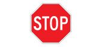
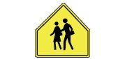
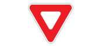

<!-- Generated by build.py. Edit data/ or the guide files instead, then run: python3 build.py -->

# S1 · Sign shapes & colours

**Signs half** · [Back to Signs](../README.md) · [Quiz: S1 questions](../questions/S1-shapes-colours.md)

## Key points
- Signs use **shapes** and **colours** so you can tell what kind of sign it is before you can read it.
- **Stop** sign: **8 sides** (octagon), **red** with white letters. Come to a complete stop.
- **Yield** sign: **triangle**, **white** with a **red border**. Let traffic go first; stop if needed.
- **School zone** sign: **5 sides** (pentagon), **fluorescent yellow/green** with black symbols.
- **Railway crossing** sign: **X-shaped**, **white** with a **red outline**.
- **Regulatory** signs (rules you must obey): usually **rectangle or square**, **white or black** background.
- **Green circle** = you **may or must** do the activity shown. **Red circle with a line** through it = **not allowed**.
- **Warning** signs: usually **diamond**, **yellow** with black letters or symbols.
- **Temporary condition** signs (road work, detours): usually **diamond**, **orange** with black letters or symbols.
- **Information and direction** signs: usually **rectangle**, **green** with white letters. Other colours guide you to facilities, services and attractions.
- **Slow-moving vehicle** sign: **orange triangle** with a **red border** (vehicle goes **40 km/h or less**).

## The 4 pictures
| Picture | What it means |
|---|---|
|  | **Stop.** A stop sign is eight-sided and has a red background with white letters. It means you must come to a complete stop. **Do:** Stop at the stop line. No line: stop at the crosswalk. No crosswalk: edge of the sidewalk. No sidewalk: edge of the intersection. |
|  | **School zone.** A school zone sign is five-sided and has a fluorescent yellow/green background with black symbols. It warns that you are coming to a school zone. **Do:** Slow down, drive with extra caution and watch for children. |
|  | **Yield.** A yield sign is a triangle with a white background and a red border. It means you must let traffic in the intersection or close to it go first. **Do:** Stop if necessary and go only when the way is clear. |
|  | **Railway crossing.** A railway crossing sign is X-shaped with a white background and red outline. It warns that railway tracks cross the road. **Do:** Slow down and look both ways for trains. Be prepared to stop. |

## Memory tricks
- **8 sides = STOP.** No other sign has 8 sides.
- **5 sides = school.** It looks like a little school house.
- **Upside-down triangle = YIELD.** It points down: "slow down and let them go".
- **Yellow diamond = warning. Orange diamond = road work.** Orange = construction cones.
- **Green circle = OK. Red circle + slash = NO.**
- **Green rectangle = where to go** (towns, exits, distances).
