<!-- Generated by build.py. Edit data/ or the guide files instead, then run: python3 build.py -->

# S2 · Regulatory & HOV signs

**Signs half** · [Back to Signs](../README.md) · [Quiz: S2 questions](../questions/S2-regulatory-hov.md)

## Key points
- Regulatory signs give a **direction that must be obeyed**.
- They are usually **rectangular or square** with a **white or black** background and black, white or coloured letters.
- **Green circle** = you **may or must** do it. **Red circle with a line** = **not allowed**.
- **No stopping** = not even for a moment. **No standing** = only to load/unload **passengers**. **No parking** = only to load/unload **passengers or merchandise**.
- **HOV** (high occupancy vehicle) lanes use a **white diamond** symbol.

## The 35 pictures
| Picture | What it means |
|---|---|
| 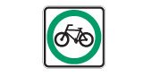 | **Official bicycle route.** This road is an official bicycle route. Watch for cyclists and be prepared to share the road with them. |
| 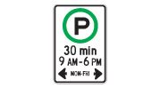 | **Parking allowed during posted times.** You may park in the area between the signs during the times posted. (Used in pairs or groups.) |
| 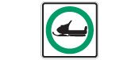 | **Snowmobiles may use this road.** |
| 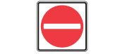 | **Do not enter.** Do not enter this road. |
| 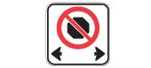 | **No stopping.** Do not stop in the area between the signs. This means you may not stop your vehicle in this area, even for a moment. (Used in pairs or groups.) |
| 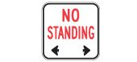 | **No standing.** Do not stand in the area between the signs. This means you may not stop your vehicle in this area except while loading or unloading passengers. (Used in pairs or groups.) |
| 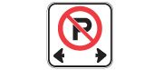 | **No parking.** Do not park in the area between the signs. This means you may not stop your vehicle except to load or unload passengers or merchandise. (Used in pairs or groups.) |
| 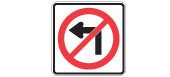 | **No left turn.** Do not turn left at the intersection. |
| 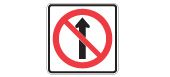 | **No straight through.** Do not drive through the intersection. |
| 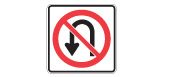 | **No U-turn.** Do not turn to go in the opposite direction. (U-turn) |
| 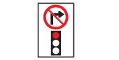 | **No right turn on red.** Do not turn right when facing a red light at the intersection. |
| 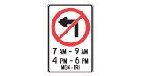 | **No left turn during times shown.** Do not turn left during the times shown. |
| 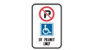 | **Accessible parking only.** This parking space is only for vehicles displaying a valid Accessible Parking Permit. |
| 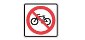 | **No bicycles.** No bicycles allowed on this road. |
| 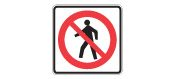 | **No pedestrians.** No pedestrians allowed on this road. |
| 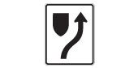 | **Keep right of traffic island.** Keep to the right of the traffic island. |
| 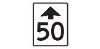 | **Speed limit changes ahead.** |
| 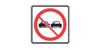 | **Do not pass.** Do not pass on this road. |
| 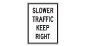 | **Slower traffic keep right.** Slow traffic on multi-lane roads must keep right. |
| 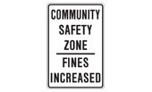 | **Community safety zone.** Indicates areas where the community has identified that there is a special risk to pedestrians. Traffic related offences committed within the zone are subject to increased fines. |
| 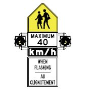 | **School zone speed limit (when flashing).** The speed limit in this zone is lower during school hours. Observe the speed limit shown when the yellow lights are flashing. |
| 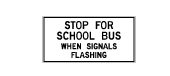 | **Stop for school bus when signals flashing.** Stop for school bus when signals are flashing. |
| 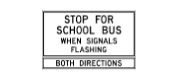 | **Stop for school bus, both directions.** This sign is installed on multi-lane highways with no centre median divider. It informs drivers approaching from both directions that they must stop for a school bus when its signal lights are flashing. |
| 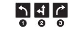 | **Lane use arrows.** These signs, above the road or on the pavement before an intersection, tell drivers the direction they must travel. For example: the driver in lane one must turn left; the driver in lane two must turn left or go straight ahead; and the driver in lane three must turn right. |
| 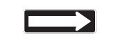 | **One way.** Traffic may travel in one direction only. |
| 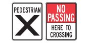 | **Pedestrian crossover.** This is a pedestrian crossover. Be prepared to stop and yield right-of-way to pedestrians. |
| 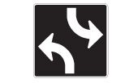 | **Two-way left-turn lane.** This sign, above the road or on the ground, means the lane is only for two-way left turns. |
| 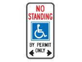 | **Accessible pick-up/drop-off only.** This sign reserves curb area for vehicles displaying a valid Accessible Person Parking Permit picking up and dropping off passengers with disabilities. |
| 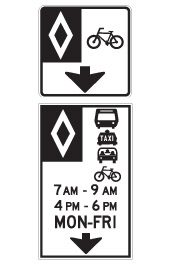 | **Reserved lane.** These signs mean lanes are only for specific types of vehicles, either all the time or during certain hours. Different symbols are used for the different types of vehicles. They include: buses, taxis, vehicles with three or more people and bicycles. |
| 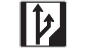 | **Keep right except to pass.** Keep to the right lane except when passing on two-lane sections where climbing or passing lanes are provided. |
| 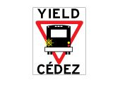 | **Yield to bus.** This sign on the back of transit buses serves as a reminder to motorists of the law requiring vehicles approaching a bus stopped at a dedicated Bus Stop to yield to the bus, once the bus has signalled its intent to return to the lane. |
| 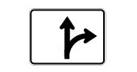 | **Road forks to the right.** |
| 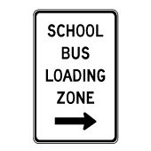 | **School bus loading zone.** Marks a zone within which school buses load or unload passengers without using the red alternating lights and stop arm. |
| 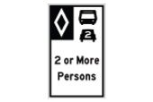 | **HOV lane.** Only public vehicles such as buses, or passenger vehicles carrying a specified minimum number of passengers, may use this lane. |
| 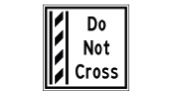 | **HOV: do not cross.** Vehicles cannot change lanes into or out of a high-occupancy vehicle lane in this area. |

## Memory tricks
- **Stopping < Standing < Parking.** No stopping is the strictest: never stop. No standing: people only. No parking: people **and** stuff.
- Arrows under a sign (← →) mean the rule covers **the area between the signs**.
- **Diamond symbol = reserved lane** (HOV, bus, bike).
