<!-- Generated by build.py. Edit data/ or the guide files instead, then run: python3 build.py -->

# S3 · Warning signs

**Signs half** · [Back to Signs](../README.md) · [Quiz: S3 questions](../questions/S3-warning.md)

## Key points
- Warning signs warn of **dangerous or unusual conditions ahead**, such as a curve, turn, dip or sideroad.
- They are usually **diamond-shaped** with a **yellow** background and black letters or symbols.
- A **checkerboard border** warns of danger: slow down, be careful.
- A square yellow sign with a number (like **60 km/h**) under a curve sign shows the **maximum safe speed** for the curve or ramp.

## The 40 pictures
| Picture | What it means |
|---|---|
| 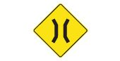 | **Narrow bridge ahead.** |
| 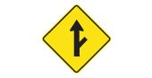 | **Road branching off ahead.** |
| 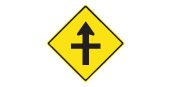 | **Intersection ahead.** Intersection ahead. The arrow shows which direction of traffic has the right-of-way. |
| 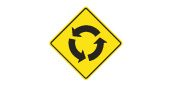 | **Roundabout ahead.** Roundabout Ahead. Reduce Speed. The counter-clockwise arrows show the direction of vehicle traffic within the roundabout. |
| 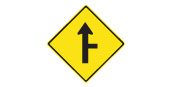 | **Hidden side road (no clear view).** Drivers on the sideroad at the intersection ahead don't have a clear view of traffic. |
| 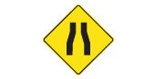 | **Pavement narrows ahead.** |
| 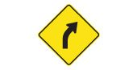 | **Slight bend ahead.** Slight bend or curve in the road ahead. |
| 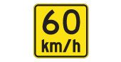 | **Maximum safe speed for curve.** Posted under a curve warning, this sign shows the maximum safe speed for the curve. |
| 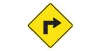 | **Sharp bend or turn ahead.** Sharp bend or turn in the road ahead. |
| 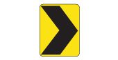 | **Chevron (sharp curve guide).** Chevron (arrowhead) signs are posted in groups to guide drivers around sharp curves in the road. |
| 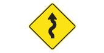 | **Winding road ahead.** |
| 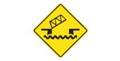 | **Bridge lifts or swings.** The bridge ahead lifts or swings to let boats pass. |
| 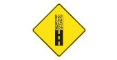 | **Paved surface ends.** Paved surface ends ahead. |
| 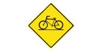 | **Bicycle crossing ahead.** |
| 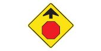 | **Stop sign ahead.** Stop sign ahead. Slow down. |
| 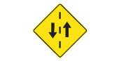 | **Two-way traffic (share with oncoming).** Share the road with oncoming traffic. |
| 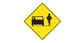 | **Share the road (cyclists).** The share the road sign is used to warn motorists that they are to provide safe space on the road for cyclists and other vehicles. This sign also warns motorists and cyclists to exercise additional caution on the upcoming section of road. |
| 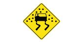 | **Slippery when wet.** Pavement is slippery when wet. Slow down and drive with caution. |
| 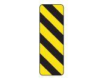 | **Hazard marker.** Hazard close to the edge of the road. The downward lines show the side on which you may safely pass. |
| 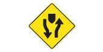 | **Divided highway begins.** Divided highway begins: traffic travels in both directions on separated roads ahead. Keep to the right-hand road. Each road carries one-way traffic. |
| 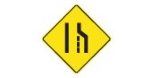 | **Right lane ends.** Right lane ends ahead. If you are in the right-hand lane, you must merge safely with traffic in the lane to the left. |
| 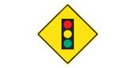 | **Traffic lights ahead.** Traffic lights ahead. Slow down. |
| 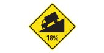 | **Steep hill.** Steep hill ahead. You may need to use a lower gear. |
| 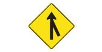 | **Merge (two roads join).** Two roads going in the same direction are about to join into one. Drivers on both roads are equally responsible for seeing that traffic merges smoothly and safely. |
| 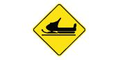 | **Snowmobiles cross.** Snowmobiles cross this road. |
| 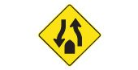 | **Divided highway ends.** Divided highway ends: traffic travels in both directions on the same road ahead. Keep to the right-hand road. |
| 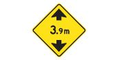 | **Low underpass.** Underpass ahead. Take care if you are driving a tall vehicle. Sign shows how much room you have. |
| 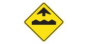 | **Bump or uneven pavement.** Bump or uneven pavement on the road ahead. Slow down and keep control of your vehicle. |
| 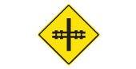 | **Railway crossing ahead.** Railway crossing ahead. Be alert for trains. This sign also shows the angle at which the railway tracks cross the road. |
| 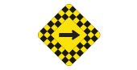 | **Sharp turn (checkerboard).** Sharp turn or bend in the road in the direction of the arrow. The checkerboard border warns of danger. Slow down; be careful. |
| 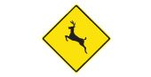 | **Deer crossing.** Deer regularly cross this road; be alert for animals. |
| 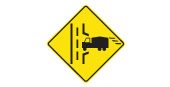 | **Truck entrance.** Truck entrance on the right side of the road ahead. If the sign shows the truck on the left, the entrance is on the left side of the road. |
| 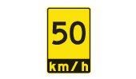 | **Maximum safe speed on ramp.** Shows maximum safe speed on ramp. |
| 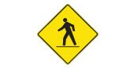 | **Pedestrians.** Watch for pedestrians and be prepared to share the road with them. |
| 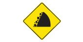 | **Falling rock.** Watch for fallen rock and be prepared to avoid a collision. |
| 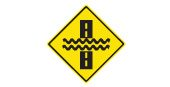 | **Water over road.** There may be water flowing over the road. |
| 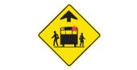 | **Hidden school bus stop.** This sign warns you that you are coming to a hidden school bus stop. Slow down, drive with extra caution, watch for children and for a school bus with flashing red lights. |
| 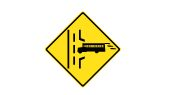 | **Bus entrance.** Indicates an upcoming bus entrance on the right and vehicles should be prepared to yield to buses entering the roadway. |
| 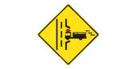 | **Fire truck entrance.** Indicates an upcoming fire truck entrance on the right and vehicles should be prepared to yield to fire trucks entering the roadway. |
| 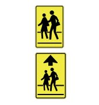 | **School crossing.** These signs warn of a school crossing. Watch for children and follow the directions of the crossing guard or school safety patroller. |

## Memory tricks
- **Yellow diamond = something is coming up ahead.** It warns; it doesn't give an order.
- **Look at the picture literally.** Arrow bending a little = slight bend. Arrow at a right angle = sharp turn. Arrows splitting around a shape = divided highway begins. Arrows coming together = divided highway ends.
- **Divided highway begins** shows the road splitting **apart**. **Ends** shows the two sides coming **together**.
