<!-- Generated by build.py. Edit data/ or the guide files instead, then run: python3 build.py -->

# S4 · Temporary condition (construction) signs

**Signs half** · [Back to Signs](../README.md) · [Quiz: S4 questions](../questions/S4-temporary-construction.md)

## Key points
- These signs warn of **unusual temporary conditions** such as road work zones, diversions, detours, lane closures or traffic control people on the road.
- They are usually **diamond-shaped** with an **orange** background and black letters or symbols.
- Speeding fines are **doubled in construction zones when workers are present**.
- You must obey **STOP or SLOW** signs held by a traffic-control person.

## The 14 pictures
| Picture | What it means |
|---|---|
| 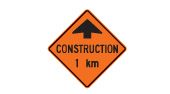 | **Construction 1 km ahead.** Construction work one kilometre ahead. |
| 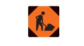 | **Road work ahead.** |
| 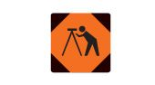 | **Survey crew ahead.** Survey crew working on the road ahead. |
| 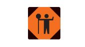 | **Traffic control person ahead.** Traffic control person ahead. Drive slowly and watch for instructions. |
| 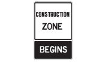 | **Construction zone begins.** You are entering a construction zone. Drive with extra caution and be prepared for a lower speed limit. |
| 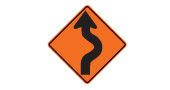 | **Detour.** Temporary detour from normal traffic route. |
| 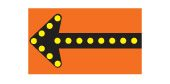 | **Flashing arrow board.** Flashing lights on the arrows show the direction to follow. |
| 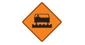 | **Milled or grooved pavement.** Pavement has been milled or grooved. Your vehicle's stopping ability may be affected so obey the speed limit and drive with extra caution. Motorcyclists may experience reduced traction on these surfaces. |
| 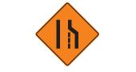 | **Lane closed ahead.** Lane ahead is closed for roadwork. Obey the speed limit and merge with traffic in the open lane. |
| 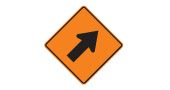 | **Closed lane: merge in arrow direction.** Closed lane. Adjust speed to merge with traffic in lane indicated by arrow. |
| 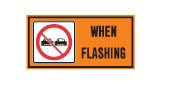 | **Do not pass pilot vehicle.** Do not pass the pilot vehicle or pace vehicle bearing this sign. |
| 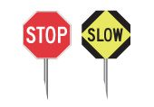 | **Traffic control STOP / SLOW paddle.** Reduce speed and be prepared to stop. |
| 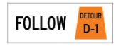 | **Follow detour marker.** Follow detour marker until you return to regular route. |
| 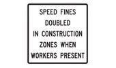 | **Speed fines doubled (workers present).** Enforces doubling the HTA fines for speeding in a designated construction zone when there are workers present. |

## Memory tricks
- **Orange = road work.** Think of orange cones and orange vests.
- In a construction zone: slow down, **don't change lanes**, be ready to stop, watch for workers.
