<!-- Generated by build.py. Edit data/ or the guide files instead, then run: python3 build.py -->

# S5 · Information, direction & other signs

**Signs half** · [Back to Signs](../README.md) · [Quiz: S5 questions](../questions/S5-information-other.md)

## Key points
- Information and direction signs tell you about **distances and destinations**.
- They are usually **rectangular** with a **green** background and white letters. Other signs with different colours guide you to **facilities, services and attractions**.
- Freeway **exit numbers** match the **distance in km** from where the freeway begins (exit 204 on Highway 401 is 204 km from Windsor).
- **Slow-moving vehicle** sign: **orange triangle with a red border**, on vehicles going **40 km/h or less**.
- **LCV** (long commercial vehicle): a double trailer up to **40 metres** long.

## The 19 pictures
| Picture | What it means |
|---|---|
| 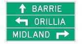 | **Directions to towns.** Shows directions to nearby towns and cities. |
| 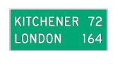 | **Distances to towns.** Shows the distances in kilometres to towns and cities on the road. |
| 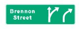 | **Freeway exit lanes.** Various exit signs are used on freeways. In urban areas, many exit ramps have more than one lane. Overhead and ground-mounted signs help drivers choose the correct lane to exit or stay on the freeway. |
| 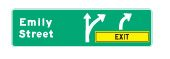 | **Advance exit sign.** Advance signs use arrows to show which lanes lead off the freeway. Signs are also posted at the exit. |
| 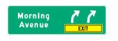 | **Exit-only lanes (yellow box).** Sometimes one or more lanes may lead off the freeway. The arrows matching the exit lanes are shown on the advance sign in a yellow box with the word ‘exit' under them. |
| 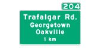 | **Interchange number.** Freeway interchanges or exits have numbers that correspond to the distance from the beginning of the freeway. |
| 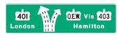 | **VIA (route to follow).** The term 'VIA' is used to describe the roads that must be followed to reach a destination. |
| 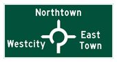 | **Roundabout exits.** Shows the upcoming roundabout exits and where they will take you. |
| 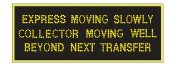 | **Changeable message sign.** These signs change according to traffic conditions to give drivers current information on delays and lane closures ahead. |
| 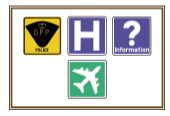 | **Off-road facilities.** Shows off-road facilities such as hospitals, airports, universities or carpool lots. |
| 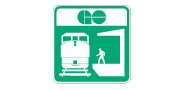 | **Passenger railway station.** Shows route to passenger railway station. |
|  | **Airport.** Shows route to airport. |
| 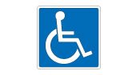 | **Wheelchair accessible.** Shows facilities that are accessible by wheelchair. |
|  | **Oversize load (D sign).** D sign – Oversize load |
| 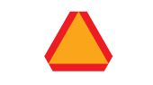 | **Slow-moving vehicle.** The “slow-moving vehicle” sign is an orange triangle with a red border. It alerts other drivers that the vehicle ahead will be travelling at 40 km/h or less. |
| 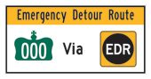 | **Emergency detour route (EDR).** EDR signs are used during the unscheduled closure of a provincial highway when OPP detour all traffic off the highway. |
|  | **Long commercial vehicle (LCV).** This placard indicates a long commercial vehicle, which is a double trailer and can be up to 40 metres in length. |
| 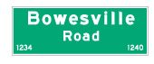 | **Emergency response numbering.** Some information signs include a numbering system along the bottom of the sign to assist emergency vehicles and drivers in determining an appropriate route. |
| 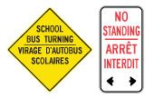 | **Bilingual signs.** Watch for these signs when driving in designated bilingual areas. Read the messages in the language you understand best. |

## Memory tricks
- **Green = go somewhere.** Directions, distances, exits.
- **Exit number = km from the start of the freeway.** Subtract two exit numbers to get the distance between them.
- **Orange triangle on the back of a tractor or buggy = 40 km/h or less.** Slow down and stay back.
