<!-- Generated by build.py. Edit data/ or the guide files instead, then run: python3 build.py -->

# S6 · Traffic lights & beacons

**Signs half** · [Back to Signs](../README.md) · [Quiz: S6 questions](../questions/S6-traffic-lights.md)

## Key points
- **Green**: go (turn left, straight or right) **after yielding** to vehicles and pedestrians already in the intersection.
- **Yellow (amber)**: red is coming. **Stop if you can do so safely**; otherwise go with caution.
- **Red**: complete stop. You may turn **right** on red after a full stop (unless a sign says no). You may turn **left on red only from a one-way road onto a one-way road**, after a full stop.
- **Flashing green** or **green arrow + green light** = **advance green**: you may turn left, go straight or turn right; oncoming traffic still has a red.
- **Green arrow with a red light** = simultaneous left turn from the left-turn lane. A **yellow arrow** after it: don't start your turn; stop if you safely can.
- **Flashing red** light or beacon = **complete stop**, then go when safe. **Flashing yellow** = drive with caution.
- **Blank (power out)** traffic lights = treat it like an **all-way stop**.
- **Transit priority signal** (white vertical bar) = buses/streetcars go; everyone else yields.

## The 17 pictures
| Picture | What it means |
|---|---|
| 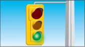 | **Green light.** A green light means you may turn left, go straight or turn right after yielding to vehicles and pedestrians already in the intersection. |
| 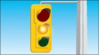 | **Yellow (amber) light.** A yellow - or amber - light means the red light is about to appear. You must stop if you can do so safely; otherwise, go with caution. |
| 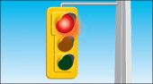 | **Red light.** A red light means you must stop. Bring your vehicle to a complete stop at the stop line if it is marked on the pavement. |
| 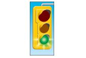 | **Flashing green light.** When you face a flashing green light or a left-pointing green arrow and a green light, you may turn left, go straight ahead or turn right from the proper lane. This is called an advanced green light because oncoming traffic still faces a red light. |
| 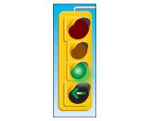 | **Green arrow + green light (advance green).** When you face a flashing green light or a left-pointing green arrow and a green light, you may turn left, go straight ahead or turn right from the proper lane. |
| 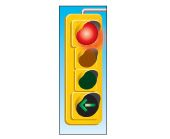 | **Left green arrow + red light.** When a left-turn green arrow is shown with a red light, you may turn left from the left-turn lane. Vehicles turning left from the opposite direction may also be making left turns because they too face a left-turn green arrow. |
| 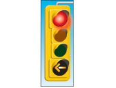 | **Yellow arrow + red light.** After the left-turn green arrow, a yellow arrow may appear. This means the green light is about to appear for traffic in one or both directions. Do not start your left turn. Stop if you can do so safely; otherwise, complete your turn with caution. |
| 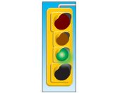 | **Green light after the arrow.** You can still turn left when the light is green, but only when the way is clear of traffic and pedestrians. If the light turns red when you are in the intersection, complete your turn when it is safe. |
| 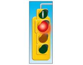 | **Transit priority signal.** Traffic and pedestrians must yield to public transit vehicles at a transit priority signal. The round signal is on top of a regular traffic signal and shows a white vertical bar on a dark background. |
| 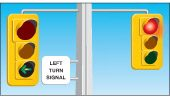 | **Fully protected left turn: green arrow.** You may turn left from the left-turn lane when you face a green arrow. Vehicles from the opposite direction may also be turning left. |
| 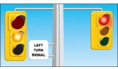 | **Fully protected left turn: yellow.** After the left-turn green arrow, a yellow light appears for left-turning vehicles only. |
| 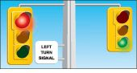 | **Fully protected left turn: red.** After the yellow light, a red light appears for left-turning vehicles only. Traffic going straight ahead or turning right will face a green light or green arrows pointing straight ahead and to the right. |
| 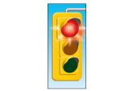 | **Flashing red light.** You must come to a complete stop at a flashing red light. Move through the intersection only when it is safe. |
| 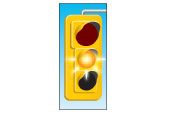 | **Flashing yellow light.** A flashing yellow light means you should drive with caution when approaching and moving through the intersection. |
| 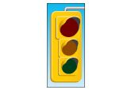 | **Blank traffic light (power failure).** During an electrical power loss, traffic lights at intersections will not work. Yield the right-of-way to vehicles in the intersection and to vehicles entering the intersection from your right. Go cautiously and use the intersection the same way you would use an intersection with all-way stop signs. |
|  | **Flashing red beacon.** A flashing red beacon above an intersection or stop sign means you must come to a complete stop. Move through the intersection only when it is safe to do so. |
|  | **Flashing yellow beacon.** A flashing yellow beacon above an intersection, above a warning sign or on an obstruction in the road, warns you to drive with caution. |

## Memory tricks
- **Flashing red = stop sign. Flashing yellow = caution sign.**
- **Dead light = all-way stop.**
- **Flashing green = you have the green, they have the red** (advance green).
