<!-- Generated by build.py. Edit data/ or the guide files instead, then run: python3 build.py -->

# S7 · Pedestrian signals & pavement markings

**Signs half** · [Back to Signs](../README.md) · [Quiz: S7 questions](../questions/S7-pedestrian-signals-markings.md)

## Key points
- **Walk** signal = a **white walking person**. A **flashing or steady orange hand** = pedestrians must **not begin** to cross.
- Pedestrians already crossing when the hand appears still have the right-of-way.
- Pedestrians may **not** cross on a **flashing green** light or a **left-turn green arrow** (unless a pedestrian signal says so).
- **Yellow lines** separate traffic going in **opposite** directions. **White lines** separate traffic going the **same** direction.
- **Solid line on your left** = unsafe to pass. **Broken line on your left** = you may pass if the way is clear.
- **Continuity lines** (wider, closer broken lines) **on your left** = your lane is ending or exiting.
- **Stop line** = single white line across the road. **Crosswalk** = two parallel white lines.
- **Pedestrian crossover** = two white **double** parallel lines with an **X in each approaching lane**.

## The 11 pictures
| Picture | What it means |
|---|---|
| 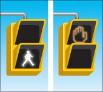 | **Walk and don't-walk signals.** The signal for pedestrians to walk is a white walking symbol. A flashing or steady orange hand symbol means pedestrians must not begin to cross. |
| 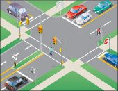 | **Intersection with pedestrian signals.** A pedestrian facing a flashing or steady hand symbol should not begin to cross the road. Pedestrians who have already begun to cross when the hand signal appears, should go as quickly as possible to a safe area. While they are crossing, pedestrians still have the right-of-way over vehicles. |
| 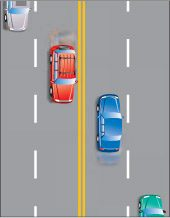 | **Yellow vs white lines.** Yellow lines separate traffic travelling in opposite directions. White lines separate traffic travelling in the same direction. |
| 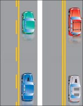 | **Solid line on your left.** A solid line at the left of your lane means it is unsafe to pass. ('A' should not pass.) |
| 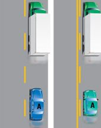 | **Broken line on your left.** A broken line at the left of your lane means you may pass if the way is clear. ('A' may pass if there are enough broken lines ahead to complete the pass safely.) |
| 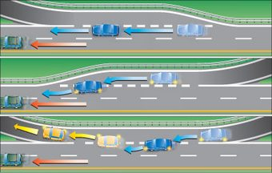 | **Continuity lines.** Broken lines that are wider and closer together than regular broken lines are called continuity lines. When you see continuity lines on your left side, it generally means the lane you are in is ending or exiting and that you must change lanes if you want to continue in your current direction. Continuity lines on your right mean your lane will continue unaffected. |
| 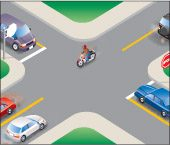 | **Stop line.** A stop line is a single white line painted across the road at an intersection. It shows where you must stop. |
| 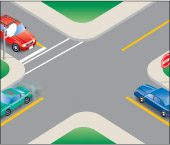 | **Crosswalk.** A crosswalk is marked by two parallel white lines painted across the road. However, crosswalks at intersections are not always marked. |
| 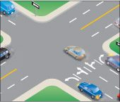 | **White lane arrows.** A white arrow painted on a lane means you may move only in the direction of the arrow. |
| 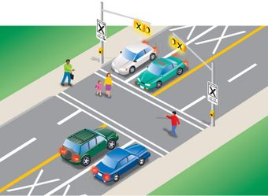 | **Pedestrian crossover markings.** Pedestrian crossovers are marked by two white double parallel lines across the road with an X in each lane approaching it. Drivers and cyclists must stop before the line and yield to pedestrians until pedestrians have completely crossed the road and cleared the roadway. |
| 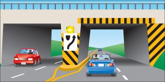 | **Lines around fixed objects.** Two solid lines painted on the pavement guide traffic away from fixed objects such as bridge piers or concrete islands. Yellow and black markings are also painted on the objects themselves as warnings. |

## Memory tricks
- **Yellow = opposite ways. White = same way.**
- **Solid = stay. Broken = OK to pass if clear.**
- **X on the road before a crossing = pedestrian crossover** (or a railway crossing, when there are railway signs).
