<!-- Generated by build.py. Edit data/ or the guide files instead, then run: python3 build.py -->

# S1 · Sign shapes & colours: questions

**Signs half** · 34 questions · [Study guide](../guide/S1-shapes-colours.md) · [All signs topics](../README.md)

Answers are hidden. Tap **Answer** under each question to check yourself.

---

### 1. What shape is a stop sign?

*Shapes & colours*

- **A.** Diamond
- **B.** Five-sided (pentagon)
- **C.** Triangle
- **D.** Eight-sided (octagon)

Answer

**D. Eight-sided (octagon)**

The stop sign is the only eight-sided sign.

> 📖 Handbook: "A stop sign is eight-sided"

---

### 2. What colours is a stop sign?

*Shapes & colours*

- **A.** Red background with white letters
- **B.** Orange background with black letters
- **C.** White background with a red border
- **D.** Yellow background with black letters

Answer

**A. Red background with white letters**

Stop = red with white letters. Yield is the one that's white with a red border.

> 📖 Handbook: "has a red background with white letters"

---

### 3. What shape is a yield sign?

*Shapes & colours*

- **A.** A triangle
- **B.** A pentagon
- **C.** An octagon
- **D.** A diamond

Answer

**A. A triangle**

A yield sign is a triangle with a white background and a red border.

> 📖 Handbook: "A yield sign is a triangle with a white background and a red border"

---

### 4. Which sign is a triangle with a white background and a red border?

*Shapes & colours*

- **A.** Yield
- **B.** Railway crossing
- **C.** Slow-moving vehicle
- **D.** Stop

Answer

**A. Yield**

White triangle with red border = yield. The slow-moving vehicle sign is an orange triangle with a red border.

> 📖 Handbook: "A yield sign is a triangle with a white background and a red border"

---

### 5. A five-sided sign with a fluorescent yellow/green background warns you about…

*Shapes & colours*

- **A.** A railway crossing
- **B.** A school zone
- **C.** Road work ahead
- **D.** A pedestrian crossover

Answer

**B. A school zone**

Five sides = school zone. Slow down and watch for children.

> 📖 Handbook: "A school zone sign is five-sided and has a fluorescent yellow/green background with black symbols"

---

### 6. What shape is a school zone sign?

*Shapes & colours*

- **A.** Eight-sided (octagon)
- **B.** X-shaped
- **C.** Five-sided (pentagon)
- **D.** Round

Answer

**C. Five-sided (pentagon)**

School zone signs are five-sided, like the outline of a little school house.

> 📖 Handbook: "A school zone sign is five-sided"

---

### 7. What does a railway crossing sign look like?

*Shapes & colours*

- **A.** Eight-sided and red
- **B.** Round and yellow with a black X
- **C.** X-shaped, white with a red outline
- **D.** Diamond-shaped and orange

Answer

**C. X-shaped, white with a red outline**

The railway crossing sign is an X (crossbuck): white with a red outline.

> 📖 Handbook: "A railway crossing sign is X-shaped with a white background and red outline"

---

### 8. Regulatory signs (signs giving a direction you must obey) are usually…

*Shapes & colours*

- **A.** Diamond-shaped with a yellow background
- **B.** Rectangular or square, with a white or black background
- **C.** Rectangular with a green background
- **D.** Diamond-shaped with an orange background

Answer

**B. Rectangular or square, with a white or black background**

Regulatory = rectangle or square, white or black. Yellow diamond = warning. Orange = road work. Green = directions.

> 📖 Handbook: "They are usually rectangular or square with a white or black background"

---

### 9. Warning signs are usually…

*Shapes & colours*

- **A.** Triangular, orange with a red border
- **B.** Rectangular, white with black letters
- **C.** Rectangular, green with white letters
- **D.** Diamond-shaped, yellow with black letters or symbols

Answer

**D. Diamond-shaped, yellow with black letters or symbols**

Yellow diamond = warning of something dangerous or unusual ahead.

> 📖 Handbook: "They are usually diamond-shaped and have a yellow background with black letters or symbols"

---

### 10. Temporary condition signs (road work, detours, lane closures) are usually…

*Shapes & colours*

- **A.** Diamond-shaped, yellow with black symbols
- **B.** Rectangular, green with white letters
- **C.** Five-sided, fluorescent yellow/green
- **D.** Diamond-shaped, orange with black letters or symbols

Answer

**D. Diamond-shaped, orange with black letters or symbols**

Orange = construction, like orange cones and vests.

> 📖 Handbook: "They are usually diamond-shaped with an orange background and black letters or symbols"

---

### 11. Information and direction signs are usually…

*Shapes & colours*

- **A.** Diamond-shaped, yellow with black letters
- **B.** Diamond-shaped, orange with black letters
- **C.** Square, white with a red circle
- **D.** Rectangular, green with white letters

Answer

**D. Rectangular, green with white letters**

Green rectangles tell you about distances and destinations.

> 📖 Handbook: "They are usually rectangular with a green background and white letters"

---

### 12. A sign with a green circle around a symbol means…

*Shapes & colours*

- **A.** You may or must do the activity shown
- **B.** The activity is not allowed
- **C.** The activity is allowed only at certain times
- **D.** Watch for the activity ahead

Answer

**A. You may or must do the activity shown**

Green circle = allowed or required. Red circle with a line = not allowed.

> 📖 Handbook: "A sign with a green circle means you may or must do the activity shown inside the ring"

---

### 13. A red circle with a line through it on a sign means…

*Shapes & colours*

- **A.** The activity shown is not allowed
- **B.** You must do the activity shown
- **C.** The activity is allowed with caution
- **D.** The activity happens nearby

Answer

**A. The activity shown is not allowed**

Red circle + slash = NO.

> 📖 Handbook: "A red circle with a line through it means the activity shown is not allowed"

---

### 14. An orange triangle with a red border on the back of a vehicle means…

*Shapes & colours*

- **A.** The vehicle travels at 40 km/h or less
- **B.** You must yield to the vehicle
- **C.** The vehicle is a school bus about to stop
- **D.** The vehicle carries dangerous goods

Answer

**A. The vehicle travels at 40 km/h or less**

That's the slow-moving vehicle sign. Slow down and stay back.

> 📖 Handbook: "The “slow-moving vehicle” sign is an orange triangle with a red border"

---

### 15. What does an orange diamond-shaped sign tell you?

*Shapes & colours*

- **A.** There is a temporary condition, like road work or a detour
- **B.** There is a permanent hazard, like a sharp curve
- **C.** A service, like a hospital, is nearby
- **D.** There is a school nearby

Answer

**A. There is a temporary condition, like road work or a detour**

Orange = temporary condition (construction). Yellow = permanent warning.

> 📖 Handbook: "These signs warn of unusual temporary conditions such as road work zones, diversions, detours, lane closures or traffic control people on the road"

---

### 16. What does a yellow diamond-shaped sign tell you?

*Shapes & colours*

- **A.** You must obey a rule
- **B.** Which way to a town or city
- **C.** There is road work ahead
- **D.** There is a dangerous or unusual condition ahead

Answer

**D. There is a dangerous or unusual condition ahead**

Yellow diamond = warning, such as a curve, turn, dip or sideroad.

> 📖 Handbook: "These signs warn of dangerous or unusual conditions ahead such as a curve, turn, dip or sideroad"

---

### 17. Which sign is the only one with eight sides?

*Shapes & colours*

- **A.** Yield
- **B.** Stop
- **C.** Railway crossing
- **D.** School zone

Answer

**B. Stop**

Eight sides always means STOP.

> 📖 Handbook: "A stop sign is eight-sided"

---

### 18. A sign with a checkerboard border warns of…

*Shapes & colours*

- **A.** A school zone ahead
- **B.** The end of a construction zone
- **C.** A railway crossing ahead
- **D.** Danger: a sharp turn or bend; slow down and be careful

Answer

**D. Danger: a sharp turn or bend; slow down and be careful**

The checkerboard border warns of danger.

> 📖 Handbook: "The checkerboard border warns of danger. Slow down; be careful."

---

### 19. Information signs are usually green. What do signs in other colours do?

*Shapes & colours*

- **A.** Guide you to facilities, services and attractions
- **B.** Warn about road work
- **C.** Give rules you must obey
- **D.** Mark school zones

Answer

**A. Guide you to facilities, services and attractions**

Other colours (like the blue wheelchair sign) point you to facilities, services and attractions.

> 📖 Handbook: "Other signs with different colours guide you to facilities, services and attractions"

---

### 20. Which kind of sign gives a direction that must be obeyed?

*Shapes & colours*

- **A.** Information and direction
- **B.** Warning
- **C.** Temporary condition
- **D.** Regulatory

Answer

**D. Regulatory**

Regulatory signs are the rules: no left turn, one way, speed limits and so on.

> 📖 Handbook: "These signs give a direction that must be obeyed"

---

### 21. Besides the stop, yield, school zone and railway crossing signs, the handbook names four other kinds of signs. Which list is right?

*Shapes & colours*

- **A.** Rules, hazards, services and tourism
- **B.** Regulatory, caution, detour and parking
- **C.** Regulatory, warning, temporary conditions, and information and direction
- **D.** Warning, school, speed and direction

Answer

**C. Regulatory, warning, temporary conditions, and information and direction**

Four kinds: regulatory, warning, temporary conditions, information and direction.

> 📖 Handbook: "There are four other kinds of signs: regulatory, warning, temporary conditions and information and direction."

---

### 22. What shape and colour is the sign on the back of a farm tractor on the road?

*Shapes & colours*

- **A.** A red octagon
- **B.** A yellow diamond with a tractor symbol
- **C.** A white triangle with a red border
- **D.** An orange triangle with a red border

Answer

**D. An orange triangle with a red border**

Farm machinery must show the orange-and-red slow-moving vehicle sign.

> 📖 Handbook: "Farm machinery on the road must display an orange and red slow-moving sign on the rear of the vehicle"

---

### 23. What does this sign mean?

*Sign meaning*

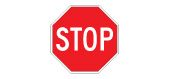

- **A.** Stop ahead: prepare to stop
- **B.** Slow down and go if the way is clear
- **C.** Stop only if other traffic is coming
- **D.** Come to a complete stop

Answer

**D. Come to a complete stop**

A stop sign always means a complete stop, even if no one is coming.

> 📖 Handbook: "It means you must come to a complete stop"

---

### 24. What does this sign mean?

*Sign meaning*

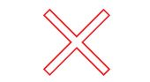

- **A.** Do not enter
- **B.** No left or right turn
- **C.** Intersection ahead
- **D.** Railway tracks cross the road here

Answer

**D. Railway tracks cross the road here**

The white X with a red outline marks a railway crossing. Slow down, look both ways, be ready to stop.

> 📖 Handbook: "It warns that railway tracks cross the road"

---

### 25. Which of these is a yield sign?

*Pick the sign*

| A | B | C | D |
|---|---|---|---|
| 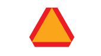 | 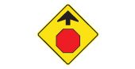 |  | 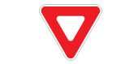 |

Answer

**D**

The yield sign is the white triangle with the red border, pointing down.

> 📖 Handbook: "A yield sign is a triangle with a white background and a red border"

---

### 26. Which sign warns that you are coming to a school zone?

*Pick the sign*

| A | B | C | D |
|---|---|---|---|
| 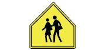 | 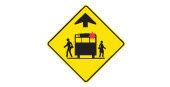 | 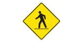 | 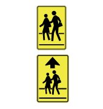 |

Answer

**A**

The five-sided fluorescent yellow/green sign is the school zone sign.

> 📖 Handbook: "It warns that you are coming to a school zone"

---

### 27. Which sign marks the place where railway tracks cross the road?

*Pick the sign*

| A | B | C | D |
|---|---|---|---|
| 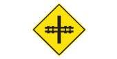 | 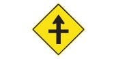 |  | 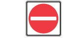 |

Answer

**C**

The red-and-white X (crossbuck) is at the crossing. The yellow diamond with tracks is the warning sign before it.

> 📖 Handbook: "A railway crossing sign is X-shaped with a white background and red outline"

---

### 28. What does this five-sided sign mean?

*Look-alikes*

- **A.** School crossing: follow the crossing guard
- **B.** Hidden school bus stop ahead
- **C.** School bus loading zone
- **D.** School zone: slow down and watch for children

Answer

**D. School zone: slow down and watch for children**

Five-sided = school zone. The school crossing sign is a rectangle, and the hidden bus stop sign is a yellow diamond.

> 📖 Handbook: "It warns that you are coming to a school zone. Slow down, drive with extra caution and watch for children."

---

### 29. What does this sign mean?

*Look-alikes*

- **A.** Let traffic in or near the intersection go first; stop if necessary
- **B.** Come to a complete stop every time
- **C.** Merge: both roads have the same right-of-way
- **D.** The vehicle ahead goes 40 km/h or less

Answer

**A. Let traffic in or near the intersection go first; stop if necessary**

Yield = let the other traffic go first. You don't have to stop if the way is clear.

> 📖 Handbook: "It means you must let traffic in the intersection or close to it go first. Stop if necessary and go only when the way is clear."

---

### 30. This triangle is orange with a red border. What does it mean?

*Look-alikes*

- **A.** Yield to traffic in the intersection
- **B.** Danger: hazardous materials
- **C.** Construction zone ahead
- **D.** The vehicle ahead will travel at 40 km/h or less

Answer

**D. The vehicle ahead will travel at 40 km/h or less**

Orange triangle = slow-moving vehicle. Don't mix it up with the white yield triangle.

> 📖 Handbook: "It alerts other drivers that the vehicle ahead will be travelling at 40 km/h or less"

---

### 31. There's no stop line, but there is a marked crosswalk. Where must you stop for this sign?

*What do you do?*

- **A.** Anywhere you can see both ways
- **B.** At the crosswalk
- **C.** Beside the sign
- **D.** At the edge of the intersection

Answer

**B. At the crosswalk**

Stop line first. No line: the crosswalk. No crosswalk: edge of the sidewalk. No sidewalk: edge of the intersection.

> 📖 Handbook: "If there is no stop line, stop at the crosswalk"

---

### 32. You come to this sign. What must you do?

*What do you do?*

- **A.** Always stop completely, then go
- **B.** Keep your speed; other drivers must yield to you
- **C.** Slow down, stop if necessary, and go only when the way is clear
- **D.** Speed up to merge ahead of traffic

Answer

**C. Slow down, stop if necessary, and go only when the way is clear**

A yield sign means let others go first. Stop only if you need to.

> 📖 Handbook: "Stop if necessary and go only when the way is clear"

---

### 33. What should you do when you see this sign?

*What do you do?*

- **A.** Stop only if the gates are down
- **B.** Honk and drive across
- **C.** Speed up to get across the tracks quickly
- **D.** Slow down, look both ways for trains, and be prepared to stop

Answer

**D. Slow down, look both ways for trains, and be prepared to stop**

At a railway crossing: slow down, look both ways and be ready to stop.

> 📖 Handbook: "Slow down and look both ways for trains. Be prepared to stop."

---

### 34. What should you do when you see this sign?

*What do you do?*

- **A.** Keep your speed; it only applies on weekends
- **B.** Stop for a school bus
- **C.** Slow down, drive with extra caution and watch for children
- **D.** Stop and wait for a crossing guard

Answer

**C. Slow down, drive with extra caution and watch for children**

School zone: slow down and watch for children.

> 📖 Handbook: "Slow down, drive with extra caution and watch for children"

