<!-- Generated by build.py. Edit data/ or the guide files instead, then run: python3 build.py -->

# S2 · Regulatory & HOV signs: questions

**Signs half** · 63 questions · [Study guide](../guide/S2-regulatory-hov.md) · [All signs topics](../README.md)

Answers are hidden. Tap **Answer** under each question to check yourself.

---

### 1. What does this sign mean?

*Sign meaning*

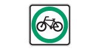

- **A.** Bicycle crossing ahead
- **B.** This road is an official bicycle route; be prepared to share the road with cyclists
- **C.** No bicycles allowed on this road
- **D.** Bicycle lane: cars may not enter

Answer

**B. This road is an official bicycle route; be prepared to share the road with cyclists**

Green circle = allowed. A bike in a green circle marks an official bicycle route.

> 📖 Handbook: "This road is an official bicycle route. Watch for cyclists and be prepared to share the road with them."

---

### 2. What does this sign mean?

*Sign meaning*

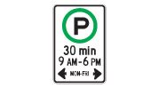

- **A.** Pay parking ahead
- **B.** You may park between the signs during the times posted
- **C.** Parking only for buses during the times posted
- **D.** No parking during the times posted

Answer

**B. You may park between the signs during the times posted**

A green P = parking allowed, for the times shown, between the signs.

> 📖 Handbook: "You may park in the area between the signs during the times posted."

---

### 3. What does this sign mean?

*Sign meaning*

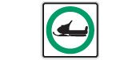

- **A.** Snowmobile trail ends
- **B.** Snowmobiles may use this road
- **C.** Snowmobiles cross this road ahead
- **D.** Snowmobiles are not allowed on this road

Answer

**B. Snowmobiles may use this road**

Green circle = allowed. A red slash would mean not allowed.

> 📖 Handbook: "Snowmobiles may use this road."

---

### 4. What does this sign mean?

*Sign meaning*

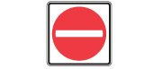

- **A.** No parking at any time
- **B.** Road closed ahead: detour
- **C.** One-way traffic ahead
- **D.** Do not enter this road

Answer

**D. Do not enter this road**

A red circle with a white bar = do not enter.

> 📖 Handbook: "Do not enter this road."

---

### 5. What does this sign mean?

*Sign meaning*

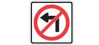

- **A.** Do not turn left at the intersection
- **B.** Left turn only
- **C.** No U-turn
- **D.** Left lane ends ahead

Answer

**A. Do not turn left at the intersection**

A left arrow inside a red circle with a slash = no left turn.

> 📖 Handbook: "Do not turn left at the intersection."

---

### 6. What does this sign mean?

*Sign meaning*

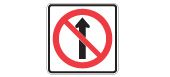

- **A.** Do not pass
- **B.** One way: straight ahead only
- **C.** Do not drive straight through the intersection
- **D.** Road ends ahead

Answer

**C. Do not drive straight through the intersection**

A straight arrow with a red slash = you may not go straight through.

> 📖 Handbook: "Do not drive through the intersection."

---

### 7. What does this sign mean?

*Sign meaning*

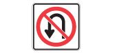

- **A.** Turn around at the next intersection
- **B.** No U-turn
- **C.** No left turn
- **D.** Sharp curve ahead

Answer

**B. No U-turn**

A U-shaped arrow with a red slash = no U-turns.

> 📖 Handbook: "Do not turn to go in the opposite direction. (U-turn)"

---

### 8. What does this sign mean?

*Sign meaning*

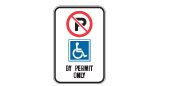

- **A.** No parking for anyone at any time
- **B.** Accessible drop-off only; no parking
- **C.** Wheelchair-accessible building ahead
- **D.** This parking space is only for vehicles displaying a valid Accessible Parking Permit

Answer

**D. This parking space is only for vehicles displaying a valid Accessible Parking Permit**

Only vehicles showing a valid Accessible Parking Permit may park here.

> 📖 Handbook: "This parking space is only for vehicles displaying a valid Accessible Parking Permit."

---

### 9. What does this sign mean?

*Sign meaning*

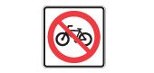

- **A.** Official bicycle route
- **B.** Bicycle crossing ahead
- **C.** No bicycles allowed on this road
- **D.** Share the road with cyclists

Answer

**C. No bicycles allowed on this road**

Bike + red slash = no bicycles.

> 📖 Handbook: "No bicycles allowed on this road."

---

### 10. What does this sign mean?

*Sign meaning*

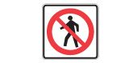

- **A.** No pedestrians allowed on this road
- **B.** School crossing ahead
- **C.** Watch for pedestrians
- **D.** Pedestrian crossover ahead

Answer

**A. No pedestrians allowed on this road**

Person walking + red slash = pedestrians are not allowed on this road.

> 📖 Handbook: "No pedestrians allowed on this road."

---

### 11. What does this sign mean?

*Sign meaning*

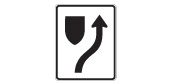

- **A.** Detour to the right
- **B.** Keep to the right of the traffic island
- **C.** Road forks to the right
- **D.** Right lane ends

Answer

**B. Keep to the right of the traffic island**

The arrow curving around the black island shape = keep right of the island.

> 📖 Handbook: "Keep to the right of the traffic island."

---

### 12. What does this sign mean?

*Sign meaning*

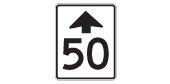

- **A.** Minimum speed on this road
- **B.** The speed limit changes ahead
- **C.** Maximum safe speed for the curve ahead
- **D.** Speed limit when the lights are flashing

Answer

**B. The speed limit changes ahead**

An arrow above the number warns that a new speed limit starts ahead.

> 📖 Handbook: "Speed limit changes ahead."

---

### 13. What does this sign mean?

*Sign meaning*

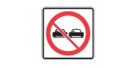

- **A.** Do not pass on this road
- **B.** Keep a safe following distance
- **C.** Two-way traffic ahead
- **D.** No trucks allowed

Answer

**A. Do not pass on this road**

Two cars inside a red circle with a slash = no passing.

> 📖 Handbook: "Do not pass on this road."

---

### 14. What does this sign mean?

*Sign meaning*

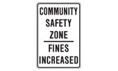

- **A.** No through traffic in this community
- **B.** Special risk to pedestrians; traffic fines are increased in this zone
- **C.** Neighbourhood watch area
- **D.** School zone: lower speed limit during school hours

Answer

**B. Special risk to pedestrians; traffic fines are increased in this zone**

Community safety zone = higher fines for traffic offences.

> 📖 Handbook: "Traffic related offences committed within the zone are subject to increased fines."

---

### 15. What does this sign mean?

*Sign meaning*

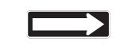

- **A.** Traffic may travel in one direction only
- **B.** Keep right except to pass
- **C.** Turn right at the next intersection
- **D.** Detour to the right

Answer

**A. Traffic may travel in one direction only**

A black-and-white arrow sign = one-way road.

> 📖 Handbook: "Traffic may travel in one direction only."

---

### 16. What does this sign mean?

*Sign meaning*

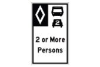

- **A.** Two-way left-turn lane
- **B.** Only buses, or vehicles carrying the posted minimum number of people, may use this lane
- **C.** Taxis and buses may park here
- **D.** Bus-only lane at all times

Answer

**B. Only buses, or vehicles carrying the posted minimum number of people, may use this lane**

This is an HOV (high occupancy vehicle) lane sign: here, 2 or more persons.

> 📖 Handbook: "Only public vehicles such as buses, or passenger vehicles carrying a specified minimum number of passengers, may use this lane."

---

### 17. Which sign means: do not turn right when facing a red light?

*Pick the sign*

| A | B | C | D |
|---|---|---|---|
|  | 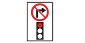 | 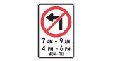 |  |

Answer

**B**

The no-right-turn symbol is shown above a traffic light.

> 📖 Handbook: "Do not turn right when facing a red light at the intersection."

---

### 18. Which sign means: do not turn left during the times shown?

*Pick the sign*

| A | B | C | D |
|---|---|---|---|
|  |  |  |  |

Answer

**B**

The no-left-turn sign with hours printed under it.

> 📖 Handbook: "Do not turn left during the times shown."

---

### 19. Which sign means: slow traffic on multi-lane roads must keep right?

*Pick the sign*

| A | B | C | D |
|---|---|---|---|
|  | 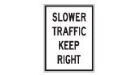 |  | 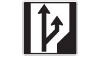 |

Answer

**B**

"Slower traffic keep right" is spelled out on the sign.

> 📖 Handbook: "Slow traffic on multi-lane roads must keep right."

---

### 20. Which sign tells you the speed limit is lower during school hours, when the yellow lights are flashing?

*Pick the sign*

| A | B | C | D |
|---|---|---|---|
| 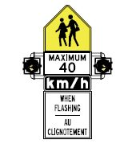 |  | 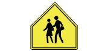 |  |

Answer

**A**

The school zone speed sign with flashing lights: obey the lower limit when the lights flash.

> 📖 Handbook: "The speed limit in this zone is lower during school hours. Observe the speed limit shown when the yellow lights are flashing."

---

### 21. Which sign tells drivers coming from BOTH directions that they must stop for a school bus with flashing lights?

*Pick the sign*

| A | B | C | D |
|---|---|---|---|
| 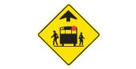 | 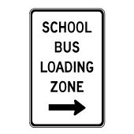 | 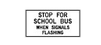 | 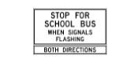 |

Answer

**D**

This one says "both directions". It's used on multi-lane highways with no centre median.

> 📖 Handbook: "It informs drivers approaching from both directions that they must stop for a school bus when its signal lights are flashing."

---

### 22. Which sign shows the direction you must travel from each lane?

*Pick the sign*

| A | B | C | D |
|---|---|---|---|
| 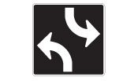 | 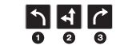 | 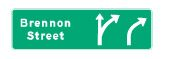 | 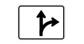 |

Answer

**B**

Lane-use arrows, above the road or on the pavement, show what each lane must do.

> 📖 Handbook: "These signs, above the road or on the pavement before an intersection, tell drivers the direction they must travel."

---

### 23. Which sign marks a pedestrian crossover?

*Pick the sign*

| A | B | C | D |
|---|---|---|---|
| 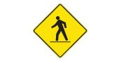 | 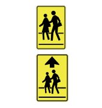 |  | 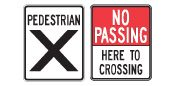 |

Answer

**D**

The crossover sign shows a big X and says "Pedestrian". Be prepared to stop and yield.

> 📖 Handbook: "This is a pedestrian crossover. Be prepared to stop and yield right-of-way to pedestrians."

---

### 24. Which sign means the lane is only for two-way left turns?

*Pick the sign*

| A | B | C | D |
|---|---|---|---|
|  | 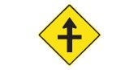 |  |  |

Answer

**D**

Two curved arrows pointing opposite ways = two-way left-turn lane.

> 📖 Handbook: "This sign, above the road or on the ground, means the lane is only for two-way left turns."

---

### 25. Which sign reserves a curb area for picking up and dropping off passengers with disabilities?

*Pick the sign*

| A | B | C | D |
|---|---|---|---|
|  | 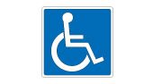 | 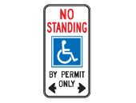 | 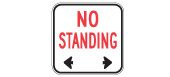 |

Answer

**C**

The "no standing, by permit only" sign with the wheelchair symbol is for pick-up and drop-off.

> 📖 Handbook: "This sign reserves curb area for vehicles displaying a valid Accessible Person Parking Permit picking up and dropping off passengers with disabilities."

---

### 26. Which sign means a lane is only for certain types of vehicles, such as buses, taxis or bicycles?

*Pick the sign*

| A | B | C | D |
|---|---|---|---|
|  | 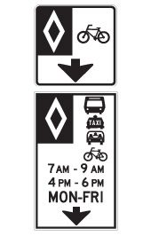 | 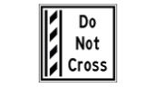 |  |

Answer

**B**

Reserved lane signs use a diamond and symbols for the allowed vehicles, with times if they apply.

> 📖 Handbook: "These signs mean lanes are only for specific types of vehicles, either all the time or during certain hours."

---

### 27. Which sign means: keep to the right lane except when passing on two-lane sections with climbing or passing lanes?

*Pick the sign*

| A | B | C | D |
|---|---|---|---|
|  |  |  |  |

Answer

**A**

The sign shows two lanes, with the arrow keeping right.

> 📖 Handbook: "Keep to the right lane except when passing on two-lane sections where climbing or passing lanes are provided."

---

### 28. Which sign appears on the back of transit buses, reminding you to yield when the bus signals to leave a bus stop?

*Pick the sign*

| A | B | C | D |
|---|---|---|---|
| 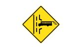 |  | 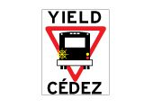 | 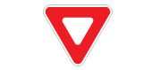 |

Answer

**C**

The bilingual YIELD / CÉDEZ sign with a bus on it.

> 📖 Handbook: "This sign on the back of transit buses serves as a reminder to motorists of the law requiring vehicles approaching a bus stopped at a dedicated Bus Stop to yield to the bus"

---

### 29. Which sign means vehicles cannot change lanes into or out of the HOV lane in this area?

*Pick the sign*

| A | B | C | D |
|---|---|---|---|
|  |  |  |  |

Answer

**B**

"Do Not Cross" beside the HOV lane: no lane changes here.

> 📖 Handbook: "Vehicles cannot change lanes into or out of a high-occupancy vehicle lane in this area."

---

### 30. Which sign tells you to stop for a school bus when its signals are flashing?

*Pick the sign*

| A | B | C | D |
|---|---|---|---|
|  |  |  |  |

Answer

**D**

A white regulatory sign: "Stop for school bus when signals flashing".

> 📖 Handbook: "Stop for school bus when signals are flashing."

---

### 31. What does this sign mean?

*Look-alikes*

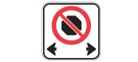

- **A.** No parking: you may stop only to load or unload passengers or goods
- **B.** No standing: you may stop only to load or unload passengers
- **C.** No stopping at the stop sign
- **D.** No stopping between the signs, not even for a moment

Answer

**D. No stopping between the signs, not even for a moment**

A stop sign inside the red circle = no stopping at all. It's the strictest of the three.

> 📖 Handbook: "This means you may not stop your vehicle in this area, even for a moment."

---

### 32. What does this "No Standing" sign allow?

*Look-alikes*

- **A.** Parking for up to 15 minutes
- **B.** Stopping only while loading or unloading passengers
- **C.** No stopping at all, not even for a moment
- **D.** Stopping to load or unload passengers or merchandise

Answer

**B. Stopping only while loading or unloading passengers**

No standing = people only. No parking = people or goods. No stopping = nothing.

> 📖 Handbook: "This means you may not stop your vehicle in this area except while loading or unloading passengers."

---

### 33. What does this sign mean?

*Look-alikes*

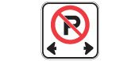

- **A.** No stopping, not even for a moment
- **B.** Parking for permit holders only
- **C.** No standing: you may stop only for passengers
- **D.** No parking: you may stop only to load or unload passengers or merchandise

Answer

**D. No parking: you may stop only to load or unload passengers or merchandise**

A P in a red circle with a slash = no parking. You may still stop briefly for passengers or goods.

> 📖 Handbook: "This means you may not stop your vehicle except to load or unload passengers or merchandise."

---

### 34. This sign has no times shown under it. What does it mean?

*Look-alikes*

- **A.** No U-turn
- **B.** No left turn only during rush hour
- **C.** Left turn only
- **D.** No left turn at this intersection, at any time

Answer

**D. No left turn at this intersection, at any time**

With no hours printed, it applies all the time. With hours (a different sign), only during those times.

> 📖 Handbook: "Do not turn left at the intersection."

---

### 35. What does this sign forbid?

*Look-alikes*

- **A.** Turning to go in the opposite direction (a U-turn)
- **B.** Turning left
- **C.** Driving straight through
- **D.** Turning right on a red light

Answer

**A. Turning to go in the opposite direction (a U-turn)**

The arrow curves back on itself: no U-turn. A no-left-turn arrow just bends left.

> 📖 Handbook: "Do not turn to go in the opposite direction. (U-turn)"

---

### 36. This round red sign has a white bar across it. What does it mean?

*Look-alikes*

- **A.** Stop ahead
- **B.** Do not enter this road
- **C.** One way: traffic flows away from you
- **D.** Road closed: detour

Answer

**B. Do not enter this road**

The red circle with a white bar is "do not enter". The one-way sign is a black-and-white arrow.

> 📖 Handbook: "Do not enter this road."

---

### 37. What does this sign mean?

*Look-alikes*

- **A.** The road forks to the right
- **B.** Keep to the right of the traffic island
- **C.** Two-way left-turn lane
- **D.** Right lane ends

Answer

**A. The road forks to the right**

A straight arrow with a branch to the right = the road forks to the right.

> 📖 Handbook: "Road forks to the right."

---

### 38. What does this sign mark?

*Look-alikes*

- **A.** A zone where school buses load or unload without using their red lights and stop arm
- **B.** A place where you must always stop for school buses
- **C.** A hidden school bus stop ahead
- **D.** A school zone with a lower speed limit

Answer

**A. A zone where school buses load or unload without using their red lights and stop arm**

School bus loading zone: buses load here without flashing red lights or the stop arm.

> 📖 Handbook: "Marks a zone within which school buses load or unload passengers without using the red alternating lights and stop arm."

---

### 39. This sign says "both directions". Where is it used and what does it mean?

*Look-alikes*

- **A.** At railway crossings: buses stop both ways
- **B.** In school zones: lower speed both ways
- **C.** On multi-lane highways with no median: traffic from both directions must stop for a school bus with flashing signals
- **D.** On divided highways: only traffic behind the bus must stop

Answer

**C. On multi-lane highways with no median: traffic from both directions must stop for a school bus with flashing signals**

No median = everyone stops, from both directions.

> 📖 Handbook: "This sign is installed on multi-lane highways with no centre median divider."

---

### 40. What do signs like this mean?

*Look-alikes*

- **A.** Bicycles must not use this lane
- **B.** The lane is for cars with 2 or more people only
- **C.** Vehicles cannot change lanes here
- **D.** The lane is only for specific types of vehicles, all the time or during certain hours

Answer

**D. The lane is only for specific types of vehicles, all the time or during certain hours**

Reserved lane signs list which vehicles may use the lane (buses, taxis, vehicles with 3+ people, bicycles) and when.

> 📖 Handbook: "These signs mean lanes are only for specific types of vehicles, either all the time or during certain hours."

---

### 41. What does this sign mean?

*Look-alikes*

- **A.** Right lane ends ahead
- **B.** Keep right of the traffic island
- **C.** Keep right except to pass on two-lane sections with passing lanes
- **D.** Slow traffic on multi-lane roads must keep right

Answer

**D. Slow traffic on multi-lane roads must keep right**

This one's about slower vehicles on multi-lane roads. A different sign covers climbing/passing lanes on two-lane roads.

> 📖 Handbook: "Slow traffic on multi-lane roads must keep right."

---

### 42. How is this sign different from an accessible parking space sign?

*Look-alikes*

- **A.** It means no vehicles may stop at any time
- **B.** It allows anyone to park for 15 minutes
- **C.** It reserves the curb only for picking up and dropping off passengers with disabilities
- **D.** It marks a wheelchair-accessible building

Answer

**C. It reserves the curb only for picking up and dropping off passengers with disabilities**

"No standing, by permit only": permit holders may stop just to pick up or drop off.

> 📖 Handbook: "This sign reserves curb area for vehicles displaying a valid Accessible Person Parking Permit picking up and dropping off passengers with disabilities."

---

### 43. What does this sign mean?

*Look-alikes*

- **A.** The speed limit is lower during school hours; obey it when the yellow lights flash
- **B.** Community safety zone: fines increased
- **C.** Speed limit changes ahead
- **D.** Maximum safe speed for the curve ahead

Answer

**A. The speed limit is lower during school hours; obey it when the yellow lights flash**

School zone speed limit: it applies when the yellow lights are flashing.

> 📖 Handbook: "Observe the speed limit shown when the yellow lights are flashing."

---

### 44. This sign has a white diamond and says "2 or More Persons". Who may use the lane?

*Look-alikes*

- **A.** Buses, or vehicles with at least the posted minimum number of people
- **B.** Any vehicle outside rush hour
- **C.** Only buses and taxis
- **D.** Only bicycles

Answer

**A. Buses, or vehicles with at least the posted minimum number of people**

It's an HOV lane: here, vehicles carrying 2 or more people (plus buses).

> 📖 Handbook: "Only public vehicles such as buses, or passenger vehicles carrying a specified minimum number of passengers, may use this lane."

---

### 45. What kind of sign is this?

*Shapes & colours*

- **A.** Warning
- **B.** Temporary condition
- **C.** Regulatory: a rule you must obey
- **D.** Information and direction

Answer

**C. Regulatory: a rule you must obey**

Do not enter is a regulatory sign: you must obey it.

> 📖 Handbook: "These signs give a direction that must be obeyed"

---

### 46. What does the green circle on this sign tell you?

*Shapes & colours*

- **A.** Watch for the activity ahead
- **B.** The activity shown is allowed (you may or must do it)
- **C.** The activity is only allowed on weekends
- **D.** The activity is not allowed

Answer

**B. The activity shown is allowed (you may or must do it)**

Green circle = allowed or required. Here: an official bike route.

> 📖 Handbook: "A sign with a green circle means you may or must do the activity shown inside the ring"

---

### 47. What does the red circle with a line through it on this sign tell you?

*Shapes & colours*

- **A.** The activity happens nearby
- **B.** The activity is allowed with care
- **C.** The activity shown is not allowed
- **D.** You must do the activity

Answer

**C. The activity shown is not allowed**

Red circle + slash = not allowed. Here: no bicycles.

> 📖 Handbook: "A red circle with a line through it means the activity shown is not allowed"

---

### 48. This sign has arrows pointing left and right at the bottom. What do they tell you?

*Shapes & colours*

- **A.** Traffic comes from both directions
- **B.** You must turn left or right
- **C.** The rule applies in the area between the signs (they're used in pairs or groups)
- **D.** The road is a two-way road

Answer

**C. The rule applies in the area between the signs (they're used in pairs or groups)**

Parking and stopping signs come in pairs or groups. The arrows show the rule covers the area between them.

> 📖 Handbook: "Do not stop in the area between the signs."

---

### 49. What kind of sign is this one-way sign?

*Shapes & colours*

- **A.** Information and direction
- **B.** Temporary condition
- **C.** Warning
- **D.** Regulatory

Answer

**D. Regulatory**

One way is a regulatory sign: it's a rule, not a warning.

> 📖 Handbook: "These signs give a direction that must be obeyed"

---

### 50. This sign is a white rectangle with black letters. What kind of sign is it?

*Shapes & colours*

- **A.** Information and direction
- **B.** Temporary condition
- **C.** Regulatory
- **D.** Warning

Answer

**C. Regulatory**

White rectangle = regulatory. The community safety zone sign means fines are increased.

> 📖 Handbook: "They are usually rectangular or square with a white or black background"

---

### 51. What kind of sign is this, and what does the green ring mean?

*Shapes & colours*

- **A.** Information: snowmobile rentals nearby
- **B.** Warning: snowmobiles cross ahead
- **C.** Regulatory: snowmobiles are not allowed
- **D.** Regulatory: snowmobiles are allowed on this road

Answer

**D. Regulatory: snowmobiles are allowed on this road**

A green ring on a regulatory sign = allowed. The yellow diamond with a snowmobile is the crossing warning.

> 📖 Handbook: "Snowmobiles may use this road."

---

### 52. What does the red circle with a P and a slash at the top of this sign mean?

*Shapes & colours*

- **A.** No parking, except for vehicles with a valid Accessible Parking Permit
- **B.** Parking for anyone for a short time
- **C.** No stopping for anyone
- **D.** Pay parking

Answer

**A. No parking, except for vehicles with a valid Accessible Parking Permit**

No parking for most vehicles. The space is only for vehicles with a valid Accessible Parking Permit.

> 📖 Handbook: "This parking space is only for vehicles displaying a valid Accessible Parking Permit."

---

### 53. You're at a red light and see this sign. You want to turn right. What must you do?

*What do you do?*

- **A.** Turn right without stopping if clear
- **B.** Stop, then turn right when clear
- **C.** Wait for a green light before turning right
- **D.** Turn right only if no pedestrians are present

Answer

**C. Wait for a green light before turning right**

This sign takes away the usual right turn on red.

> 📖 Handbook: "Do not turn right when facing a red light at the intersection."

---

### 54. What must you do when you see this sign?

*What do you do?*

- **A.** Watch for a hidden school bus stop
- **B.** Stop for a school bus when its signals are flashing
- **C.** Slow down to the school zone speed
- **D.** Let school buses merge ahead of you

Answer

**B. Stop for a school bus when its signals are flashing**

Red flashing lights on a school bus mean stop.

> 📖 Handbook: "Stop for school bus when signals are flashing."

---

### 55. What must you do at a pedestrian crossover marked by this sign?

*What do you do?*

- **A.** Honk to warn pedestrians, then go
- **B.** Be prepared to stop and yield right-of-way to pedestrians
- **C.** Stop only if a crossing guard is there
- **D.** Yield only to pedestrians already in your lane

Answer

**B. Be prepared to stop and yield right-of-way to pedestrians**

Stop and wait until pedestrians have completely crossed the road.

> 📖 Handbook: "Be prepared to stop and yield right-of-way to pedestrians."

---

### 56. You see this sign above the centre lane. How may you use that lane?

*What do you do?*

- **A.** For left turns from your direction only
- **B.** Only for left turns, by traffic from both directions
- **C.** For passing slower vehicles
- **D.** For buses and taxis only

Answer

**B. Only for left turns, by traffic from both directions**

A two-way left-turn lane is never used for passing.

> 📖 Handbook: "means the lane is only for two-way left turns"

---

### 57. This sign is on the back of a bus stopped at a bus stop. The bus signals to pull out. What must you do?

*What do you do?*

- **A.** Stop only if children get off
- **B.** Yield and let the bus back into your lane
- **C.** Speed up and pass the bus
- **D.** Honk so the bus waits

Answer

**B. Yield and let the bus back into your lane**

The law says you must yield to a bus leaving a dedicated bus stop once it signals.

> 📖 Handbook: "to yield to the bus, once the bus has signalled its intent to return to the lane"

---

### 58. You're driving in the HOV lane and see this sign. What does it mean for you?

*What do you do?*

- **A.** You can't change lanes out of (or into) the HOV lane here
- **B.** The HOV lane ends; merge now
- **C.** Only buses may cross here
- **D.** You must leave the HOV lane now

Answer

**A. You can't change lanes out of (or into) the HOV lane here**

"Do Not Cross" = no lane changes in this area. Wait for an entry/exit zone.

> 📖 Handbook: "Vehicles cannot change lanes into or out of a high-occupancy vehicle lane in this area."

---

### 59. You're in lane 2 (the middle lane) at these signs. What may you do?

*What do you do?*

- **A.** Only turn left
- **B.** Turn left or go straight ahead
- **C.** Turn right or go straight
- **D.** Only go straight

Answer

**B. Turn left or go straight ahead**

Lane 1 must turn left, lane 2 may turn left or go straight, lane 3 must turn right.

> 📖 Handbook: "the driver in lane two must turn left or go straight ahead"

---

### 60. You're driving slower than other traffic on a multi-lane road with this sign. Where should you drive?

*What do you do?*

- **A.** In the left lane
- **B.** On the shoulder
- **C.** In the right lane
- **D.** In any lane

Answer

**C. In the right lane**

Slower traffic keeps right, so others can pass on the left.

> 📖 Handbook: "Slow traffic on multi-lane roads must keep right."

---

### 61. You enter an area with this sign. What should you expect?

*What do you do?*

- **A.** Lower speed limits only at night
- **B.** Special risk to pedestrians, and increased fines for traffic offences
- **C.** Free parking for residents
- **D.** No pedestrians allowed

Answer

**B. Special risk to pedestrians, and increased fines for traffic offences**

Community safety zone: drive extra carefully. Fines are increased.

> 📖 Handbook: "Indicates areas where the community has identified that there is a special risk to pedestrians."

---

### 62. You don't have an Accessible Parking Permit. What may you do at a curb with this sign?

*What do you do?*

- **A.** Park for up to 10 minutes
- **B.** Stop if you turn on your hazard lights
- **C.** Nothing: don't stop there
- **D.** Stop briefly to drop off passengers

Answer

**C. Nothing: don't stop there**

The curb is reserved for permit holders picking up or dropping off passengers with disabilities.

> 📖 Handbook: "This sign reserves curb area for vehicles displaying a valid Accessible Person Parking Permit picking up and dropping off passengers with disabilities."

---

### 63. You want to turn onto a road marked with this sign. What must you do?

*What do you do?*

- **A.** Enter only if no traffic is coming
- **B.** Enter slowly with your hazard lights on
- **C.** Don't enter; find another route
- **D.** Enter only to park

Answer

**C. Don't enter; find another route**

Do not enter means exactly that.

> 📖 Handbook: "Do not enter this road."

