<!-- Generated by build.py. Edit data/ or the guide files instead, then run: python3 build.py -->

# S3 · Warning signs: questions

**Signs half** · 68 questions · [Study guide](../guide/S3-warning.md) · [All signs topics](../README.md)

Answers are hidden. Tap **Answer** under each question to check yourself.

---

### 1. What does this sign mean?

*Sign meaning*

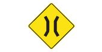

- **A.** Narrow bridge ahead
- **B.** Divided highway ends
- **C.** Pavement narrows ahead
- **D.** Right lane ends

Answer

**A. Narrow bridge ahead**

Two lines bending in on both sides = narrow bridge.

> 📖 Handbook: "Narrow bridge ahead."

---

### 2. What does this sign mean?

*Sign meaning*

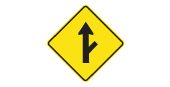

- **A.** Intersection ahead
- **B.** A road branches off ahead
- **C.** Road forks to the right: you must turn
- **D.** Merge ahead

Answer

**B. A road branches off ahead**

A side road branching off to one side. A full cross (+) would be an intersection.

> 📖 Handbook: "Road branching off ahead."

---

### 3. What does this sign mean?

*Sign meaning*

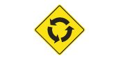

- **A.** Roundabout ahead: reduce speed
- **B.** Traffic circle: traffic goes clockwise
- **C.** U-turns allowed ahead
- **D.** Recycling depot ahead

Answer

**A. Roundabout ahead: reduce speed**

The arrows show traffic moves counter-clockwise inside the roundabout.

> 📖 Handbook: "Roundabout Ahead. Reduce Speed."

---

### 4. What does this sign mean?

*Sign meaning*

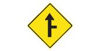

- **A.** Truck entrance ahead
- **B.** Merge ahead
- **C.** Road branching off ahead
- **D.** Drivers on the side road ahead don't have a clear view of traffic

Answer

**D. Drivers on the side road ahead don't have a clear view of traffic**

Hidden side road: be ready for drivers pulling out who can't see you well.

> 📖 Handbook: "Drivers on the sideroad at the intersection ahead don't have a clear view of traffic."

---

### 5. What does this sign mean?

*Sign meaning*

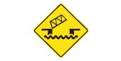

- **A.** Bridge out: detour
- **B.** The bridge ahead lifts or swings to let boats pass
- **C.** Narrow bridge ahead
- **D.** Ferry crossing ahead

Answer

**B. The bridge ahead lifts or swings to let boats pass**

A bridge with water underneath and a raised section = lift or swing bridge.

> 📖 Handbook: "The bridge ahead lifts or swings to let boats pass."

---

### 6. What does this sign mean?

*Sign meaning*

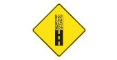

- **A.** Construction zone begins
- **B.** The paved surface ends ahead
- **C.** Bump ahead
- **D.** Road narrows ahead

Answer

**B. The paved surface ends ahead**

The road picture changes from paved to dotted gravel: pavement ends.

> 📖 Handbook: "Paved surface ends ahead."

---

### 7. What does this sign mean?

*Sign meaning*

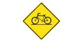

- **A.** Bicycle lane ends
- **B.** Official bicycle route
- **C.** No bicycles allowed
- **D.** Bicycle crossing ahead

Answer

**D. Bicycle crossing ahead**

Yellow diamond with a bike = bikes cross ahead. A green circle bike sign is a bike route.

> 📖 Handbook: "Bicycle crossing ahead."

---

### 8. What does this sign mean?

*Sign meaning*

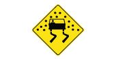

- **A.** Road work: loose gravel
- **B.** Pavement is slippery when wet; slow down and drive with caution
- **C.** Winding road ahead
- **D.** Drinking and driving is illegal

Answer

**B. Pavement is slippery when wet; slow down and drive with caution**

A car with wavy skid marks = slippery when wet.

> 📖 Handbook: "Pavement is slippery when wet. Slow down and drive with caution."

---

### 9. What does this sign mean?

*Sign meaning*

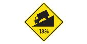

- **A.** Truck entrance ahead
- **B.** Falling rock
- **C.** Steep hill ahead; you may need a lower gear
- **D.** Runaway truck lane

Answer

**C. Steep hill ahead; you may need a lower gear**

A truck on a slope with a percent grade = steep hill.

> 📖 Handbook: "Steep hill ahead. You may need to use a lower gear."

---

### 10. What does this sign mean?

*Sign meaning*

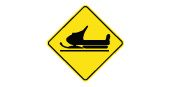

- **A.** No snowmobiles allowed
- **B.** Snowmobiles may use this road
- **C.** Snowmobiles cross this road
- **D.** Snowmobile rentals ahead

Answer

**C. Snowmobiles cross this road**

A yellow diamond warns that snowmobiles cross here.

> 📖 Handbook: "Snowmobiles cross this road."

---

### 11. What does this sign mean?

*Sign meaning*

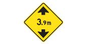

- **A.** Maximum vehicle width is 3.9 m
- **B.** Minimum following distance
- **C.** Underpass ahead; the number shows how much height clearance you have
- **D.** Road narrows to 3.9 m

Answer

**C. Underpass ahead; the number shows how much height clearance you have**

Arrows pointing up and down with a height = low underpass. Take care in a tall vehicle.

> 📖 Handbook: "Underpass ahead. Take care if you are driving a tall vehicle. Sign shows how much room you have."

---

### 12. What does this sign mean?

*Sign meaning*

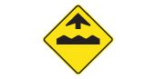

- **A.** Pavement ends
- **B.** Hill ahead
- **C.** Bump or uneven pavement ahead
- **D.** Speed bump: stop

Answer

**C. Bump or uneven pavement ahead**

Slow down and keep control of your vehicle.

> 📖 Handbook: "Bump or uneven pavement on the road ahead."

---

### 13. What does this sign mean?

*Sign meaning*

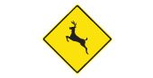

- **A.** Hunting area
- **B.** Deer regularly cross this road
- **C.** No animals allowed on the road
- **D.** Zoo or wildlife park ahead

Answer

**B. Deer regularly cross this road**

Be alert for animals, especially from dusk to dawn.

> 📖 Handbook: "Deer regularly cross this road; be alert for animals."

---

### 14. What does this sign mean?

*Sign meaning*

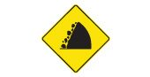

- **A.** Steep hill
- **B.** Road work: gravel
- **C.** Pavement ends
- **D.** Watch for fallen rock

Answer

**D. Watch for fallen rock**

Be prepared to avoid rocks on the road.

> 📖 Handbook: "Watch for fallen rock and be prepared to avoid a collision."

---

### 15. What does this sign mean?

*Sign meaning*

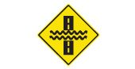

- **A.** Ferry dock ahead
- **B.** Slippery when wet
- **C.** Bridge lifts for boats
- **D.** There may be water flowing over the road

Answer

**D. There may be water flowing over the road**

Water across the road picture = flooding possible.

> 📖 Handbook: "There may be water flowing over the road."

---

### 16. What does this sign mean?

*Sign meaning*

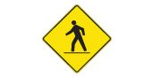

- **A.** Watch for pedestrians and be prepared to share the road with them
- **B.** Pedestrian crossover: you must stop
- **C.** No pedestrians allowed
- **D.** School crossing

Answer

**A. Watch for pedestrians and be prepared to share the road with them**

A yellow diamond with a walking person = pedestrians may be on or near the road.

> 📖 Handbook: "Watch for pedestrians and be prepared to share the road with them."

---

### 17. What does this sign mean?

*Sign meaning*

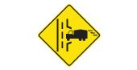

- **A.** Truck weigh station ahead
- **B.** No trucks allowed
- **C.** Truck entrance on the right side of the road ahead
- **D.** Trucks must use the right lane

Answer

**C. Truck entrance on the right side of the road ahead**

If the truck is drawn on the left, the entrance is on the left.

> 📖 Handbook: "Truck entrance on the right side of the road ahead."

---

### 18. What does this sign mean?

*Sign meaning*

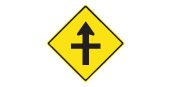

- **A.** Hospital ahead
- **B.** Four-way stop ahead
- **C.** Railway crossing ahead
- **D.** Intersection ahead; the wide arrow shows which road has the right-of-way

Answer

**D. Intersection ahead; the wide arrow shows which road has the right-of-way**

The thicker arrow shows which direction of traffic has the right-of-way.

> 📖 Handbook: "Intersection ahead. The arrow shows which direction of traffic has the right-of-way."

---

### 19. Which sign warns of a stop sign ahead?

*Pick the sign*

| A | B | C | D |
|---|---|---|---|
| 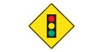 |  | 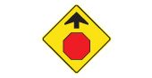 | 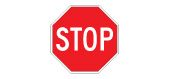 |

Answer

**C**

A yellow diamond with a small red octagon and an arrow = stop sign ahead. Slow down.

> 📖 Handbook: "Stop sign ahead. Slow down."

---

### 20. Which sign warns of traffic lights ahead?

*Pick the sign*

| A | B | C | D |
|---|---|---|---|
|  |  |  | 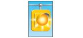 |

Answer

**C**

A yellow diamond showing a traffic light.

> 📖 Handbook: "Traffic lights ahead. Slow down."

---

### 21. Which sign means a winding road ahead?

*Pick the sign*

| A | B | C | D |
|---|---|---|---|
|  | 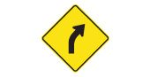 | 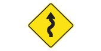 | 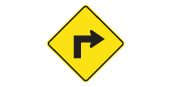 |

Answer

**C**

The arrow wiggles back and forth more than once = winding road.

> 📖 Handbook: "Winding road ahead."

---

### 22. Which sign is posted in groups to guide drivers around a sharp curve?

*Pick the sign*

| A | B | C | D |
|---|---|---|---|
| 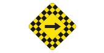 | 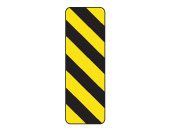 | 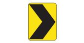 | 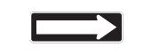 |

Answer

**C**

Chevron (arrowhead) signs come in groups around sharp curves.

> 📖 Handbook: "Chevron (arrowhead) signs are posted in groups to guide drivers around sharp curves in the road."

---

### 23. Which sign marks a hazard close to the edge of the road?

*Pick the sign*

| A | B | C | D |
|---|---|---|---|
|  |  |  | 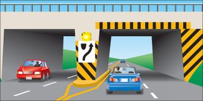 |

Answer

**A**

The hazard marker has diagonal stripes; the lines slope down toward the side where you may safely pass.

> 📖 Handbook: "Hazard close to the edge of the road."

---

### 24. Which sign means: divided highway begins?

*Pick the sign*

| A | B | C | D |
|---|---|---|---|
| 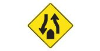 | 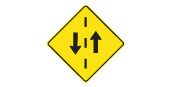 | 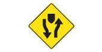 | 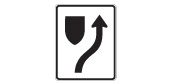 |

Answer

**C**

The arrows split around a median: the road divides ahead. Keep to the right-hand road.

> 📖 Handbook: "Divided highway begins: traffic travels in both directions on separated roads ahead."

---

### 25. Which sign means: divided highway ends?

*Pick the sign*

| A | B | C | D |
|---|---|---|---|
| 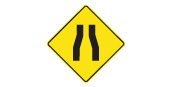 | 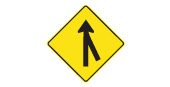 |  |  |

Answer

**D**

The median ends and both directions share the same road ahead.

> 📖 Handbook: "Divided highway ends: traffic travels in both directions on the same road ahead."

---

### 26. Which sign means the right lane ends ahead?

*Pick the sign*

| A | B | C | D |
|---|---|---|---|
| 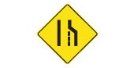 |  | 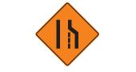 |  |

Answer

**A**

One lane line bends in on the right = right lane ends. Merge safely to the left.

> 📖 Handbook: "Right lane ends ahead."

---

### 27. Which sign means two roads going the same direction are about to join into one?

*Pick the sign*

| A | B | C | D |
|---|---|---|---|
|  |  |  |  |

Answer

**B**

Merge sign: drivers on both roads share the job of merging safely.

> 📖 Handbook: "Two roads going in the same direction are about to join into one."

---

### 28. Which sign warns of a railway crossing ahead and shows the angle of the tracks?

*Pick the sign*

| A | B | C | D |
|---|---|---|---|
| 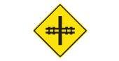 | 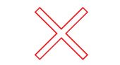 |  |  |

Answer

**A**

The yellow diamond with tracks crossing the road warns before the crossing.

> 📖 Handbook: "Railway crossing ahead. Be alert for trains. This sign also shows the angle at which the railway tracks cross the road."

---

### 29. Which sign tells drivers to provide safe space on the road for cyclists?

*Pick the sign*

| A | B | C | D |
|---|---|---|---|
| 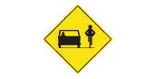 | 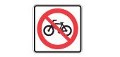 |  | 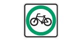 |

Answer

**A**

The "share the road" sign shows a car and a cyclist side by side.

> 📖 Handbook: "The share the road sign is used to warn motorists that they are to provide safe space on the road for cyclists and other vehicles."

---

### 30. Which sign means: share the road with oncoming traffic (two-way traffic)?

*Pick the sign*

| A | B | C | D |
|---|---|---|---|
|  |  | 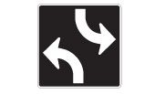 |  |

Answer

**D**

Two arrows pointing opposite ways in a yellow diamond = two-way traffic.

> 📖 Handbook: "Share the road with oncoming traffic."

---

### 31. Which sign warns of a hidden school bus stop ahead?

*Pick the sign*

| A | B | C | D |
|---|---|---|---|
| 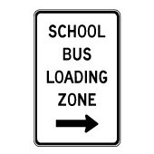 | 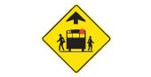 | 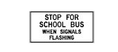 | 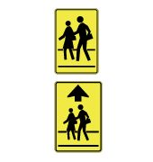 |

Answer

**B**

A yellow diamond with a school bus and children.

> 📖 Handbook: "This sign warns you that you are coming to a hidden school bus stop."

---

### 32. Which sign warns of an upcoming bus entrance on the right?

*Pick the sign*

| A | B | C | D |
|---|---|---|---|
| 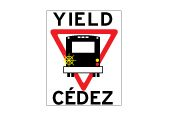 |  | 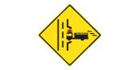 |  |

Answer

**D**

Look at the vehicle: a bus (not a truck or fire truck). Be ready to yield to buses entering.

> 📖 Handbook: "Indicates an upcoming bus entrance on the right and vehicles should be prepared to yield to buses entering the roadway."

---

### 33. Which sign warns of an upcoming fire truck entrance?

*Pick the sign*

| A | B | C | D |
|---|---|---|---|
|  |  |  |  |

Answer

**C**

A yellow diamond with a fire truck. Be ready to yield to fire trucks entering the road.

> 📖 Handbook: "Indicates an upcoming fire truck entrance on the right and vehicles should be prepared to yield to fire trucks entering the roadway."

---

### 34. Which sign warns of a school crossing?

*Pick the sign*

| A | B | C | D |
|---|---|---|---|
|  |  |  |  |

Answer

**B**

School crossing signs are fluorescent yellow/green rectangles with children crossing.

> 📖 Handbook: "These signs warn of a school crossing."

---

### 35. What does this sign mean?

*Look-alikes*

- **A.** Road branching off ahead
- **B.** Slight bend or curve in the road ahead
- **C.** Sharp bend or turn ahead
- **D.** Winding road ahead

Answer

**B. Slight bend or curve in the road ahead**

A gently curved arrow = slight bend. A right-angle arrow = sharp turn.

> 📖 Handbook: "Slight bend or curve in the road ahead."

---

### 36. What does this sign mean?

*Look-alikes*

- **A.** Sharp bend or turn in the road ahead
- **B.** Turn right only
- **C.** Slight bend ahead
- **D.** Detour to the right

Answer

**A. Sharp bend or turn in the road ahead**

The arrow bends at a right angle = sharp turn.

> 📖 Handbook: "Sharp bend or turn in the road ahead."

---

### 37. What does this sign with a checkerboard border mean?

*Look-alikes*

- **A.** Detour to the right
- **B.** Sharp turn in the direction of the arrow: danger, slow down
- **C.** Keep right of the traffic island
- **D.** One way to the right

Answer

**B. Sharp turn in the direction of the arrow: danger, slow down**

The checkerboard border warns of danger.

> 📖 Handbook: "Sharp turn or bend in the road in the direction of the arrow."

---

### 38. What does this sign mean?

*Look-alikes*

- **A.** Right lane ends
- **B.** Pavement narrows ahead
- **C.** Divided highway ends
- **D.** Narrow bridge ahead

Answer

**B. Pavement narrows ahead**

Both edges come in a little = the pavement narrows. A narrow bridge sign has bracket-shaped lines.

> 📖 Handbook: "Pavement narrows ahead."

---

### 39. What does this sign mean?

*Look-alikes*

- **A.** Keep right of the traffic island
- **B.** Divided highway begins
- **C.** Merge with traffic from the left
- **D.** Divided highway ends: two-way traffic on the same road ahead

Answer

**D. Divided highway ends: two-way traffic on the same road ahead**

The divider stops and the arrows come together: the divided highway ends. Keep to the right.

> 📖 Handbook: "Divided highway ends: traffic travels in both directions on the same road ahead. Keep to the right-hand road."

---

### 40. What does this sign mean?

*Look-alikes*

- **A.** Divided highway ends
- **B.** Road forks ahead
- **C.** Divided highway begins: keep to the right-hand road
- **D.** Two-way left-turn lane

Answer

**C. Divided highway begins: keep to the right-hand road**

The arrows separate around a divider: two separate one-way roads ahead.

> 📖 Handbook: "Divided highway begins: traffic travels in both directions on separated roads ahead. Keep to the right-hand road. Each road carries one-way traffic."

---

### 41. Two roads join into one at this sign. Who is responsible for merging safely?

*What do you do?*

- **A.** Only drivers on the road that ends
- **B.** Whoever is going faster
- **C.** Only drivers on the main road
- **D.** Drivers on both roads, equally

Answer

**D. Drivers on both roads, equally**

At a merge, drivers on both roads share the job of merging smoothly and safely.

> 📖 Handbook: "Drivers on both roads are equally responsible for seeing that traffic merges smoothly and safely."

---

### 42. This square yellow sign is posted under a curve warning. What does the number mean?

*Look-alikes*

- **A.** The distance to the curve in metres
- **B.** The regular speed limit for the road
- **C.** The maximum safe speed for the curve
- **D.** The minimum speed for the curve

Answer

**C. The maximum safe speed for the curve**

The yellow advisory sign under a curve sign shows the safe speed for that curve.

> 📖 Handbook: "Posted under a curve warning, this sign shows the maximum safe speed for the curve."

---

### 43. This square yellow sign is posted at a freeway ramp. What does it show?

*Look-alikes*

- **A.** The minimum speed for merging
- **B.** The speed limit on the freeway
- **C.** The maximum safe speed on the ramp
- **D.** The exit number

Answer

**C. The maximum safe speed on the ramp**

Yellow advisory speed = safe speed for the ramp. Speed limit signs are white.

> 📖 Handbook: "Shows maximum safe speed on ramp."

---

### 44. Which vehicle is shown, and what does the sign warn?

*Look-alikes*

- **A.** A tractor: farm vehicles on the road
- **B.** A truck: truck entrance on the right side ahead
- **C.** A bus: bus entrance on the right
- **D.** A fire truck: fire hall entrance

Answer

**B. A truck: truck entrance on the right side ahead**

Truck = truck entrance. The bus and fire truck entrance signs look similar. Check the vehicle.

> 📖 Handbook: "Truck entrance on the right side of the road ahead."

---

### 45. What does this yellow diamond sign warn of?

*Look-alikes*

- **A.** A hidden school bus stop ahead
- **B.** A school zone with a lower speed limit
- **C.** A bus entrance on the right
- **D.** A school bus loading zone

Answer

**A. A hidden school bus stop ahead**

Slow down, watch for children and for a school bus with flashing red lights.

> 📖 Handbook: "This sign warns you that you are coming to a hidden school bus stop."

---

### 46. This sign shows a car and a bicycle side by side. What does it mean?

*Look-alikes*

- **A.** Official bicycle route
- **B.** Share the road: give cyclists and other vehicles safe space
- **C.** Bike lane: cars not allowed
- **D.** Bicycle crossing ahead

Answer

**B. Share the road: give cyclists and other vehicles safe space**

Share the road = give cyclists room, and both take extra care on this stretch.

> 📖 Handbook: "The share the road sign is used to warn motorists that they are to provide safe space on the road for cyclists and other vehicles."

---

### 47. What does this sign mean?

*Look-alikes*

- **A.** Share the road with oncoming traffic (two-way traffic)
- **B.** Divided highway begins
- **C.** One-way road ends
- **D.** Passing lane ahead

Answer

**A. Share the road with oncoming traffic (two-way traffic)**

Arrows going opposite ways = traffic comes toward you in the other lane.

> 📖 Handbook: "Share the road with oncoming traffic."

---

### 48. What does this sign mean?

*Look-alikes*

- **A.** Hospital ahead
- **B.** Intersection ahead
- **C.** Railway crossing ahead; the sign shows the angle of the tracks
- **D.** Snowmobile trail crossing

Answer

**C. Railway crossing ahead; the sign shows the angle of the tracks**

The yellow diamond warns of the crossing. The red-and-white X sign is at the crossing itself.

> 📖 Handbook: "Railway crossing ahead. Be alert for trains."

---

### 49. This sign has black and yellow diagonal stripes. What does it mean?

*Look-alikes*

- **A.** Hazard close to the edge of the road; pass on the side the lines slope down to
- **B.** Railway crossing gate ahead
- **C.** Road closed
- **D.** Sharp curve: follow the chevrons

Answer

**A. Hazard close to the edge of the road; pass on the side the lines slope down to**

The hazard marker shows an object near the road, and which side to pass on.

> 📖 Handbook: "The downward lines show the side on which you may safely pass."

---

### 50. What is this sign, and where do you see it?

*Look-alikes*

- **A.** A detour arrow in construction zones
- **B.** A hazard marker on a bridge pier
- **C.** A one-way sign at intersections
- **D.** A chevron, posted in groups to guide you around a sharp curve

Answer

**D. A chevron, posted in groups to guide you around a sharp curve**

Chevrons = arrowheads guiding you around a sharp curve.

> 📖 Handbook: "Chevron (arrowhead) signs are posted in groups to guide drivers around sharp curves in the road."

---

### 51. What kind of sign is this?

*Shapes & colours*

- **A.** Regulatory
- **B.** Warning
- **C.** Information and direction
- **D.** Temporary condition

Answer

**B. Warning**

Yellow diamond = warning of a dangerous or unusual condition.

> 📖 Handbook: "They are usually diamond-shaped and have a yellow background with black letters or symbols."

---

### 52. What kind of sign is this?

*Shapes & colours*

- **A.** Information and direction
- **B.** Regulatory
- **C.** Temporary condition
- **D.** Warning

Answer

**D. Warning**

Yellow diamond = warning. Here: deer crossing.

> 📖 Handbook: "These signs warn of dangerous or unusual conditions ahead"

---

### 53. What kind of sign is this?

*Shapes & colours*

- **A.** Information and direction
- **B.** Warning
- **C.** Temporary condition
- **D.** Regulatory

Answer

**B. Warning**

It's yellow, so it's a permanent warning (steep hill). Orange would mean a temporary condition.

> 📖 Handbook: "They are usually diamond-shaped and have a yellow background with black letters or symbols."

---

### 54. What colour is this school crossing sign?

*Shapes & colours*

- **A.** Orange
- **B.** Blue
- **C.** Fluorescent yellow/green
- **D.** Red

Answer

**C. Fluorescent yellow/green**

School signs use fluorescent yellow/green so they stand out.

> 📖 Handbook: "These signs warn of a school crossing."

---

### 55. What does the black-and-white checkered edge on this sign add?

*Shapes & colours*

- **A.** It marks a racing area
- **B.** It warns of danger: slow down and be careful
- **C.** It shows the end of a construction zone
- **D.** It means the road is closed

Answer

**B. It warns of danger: slow down and be careful**

A checkerboard border means danger.

> 📖 Handbook: "The checkerboard border warns of danger."

---

### 56. Why is this bicycle sign a yellow diamond instead of a green circle?

*Shapes & colours*

- **A.** It's a warning (bicycles cross ahead), not a regulatory sign
- **B.** It marks an official bike route
- **C.** It's a temporary sign for road work
- **D.** It means bicycles are not allowed

Answer

**A. It's a warning (bicycles cross ahead), not a regulatory sign**

Yellow diamond = warning. A green circle would be a regulatory "allowed" sign.

> 📖 Handbook: "Bicycle crossing ahead."

---

### 57. This is a square yellow sign with a speed on it. What kind of sign is it?

*Shapes & colours*

- **A.** Regulatory speed limit
- **B.** Information about distance
- **C.** Warning (advisory safe speed)
- **D.** Temporary construction speed

Answer

**C. Warning (advisory safe speed)**

It's yellow, so it's a warning showing the safe speed for a curve or ramp, not the speed limit.

> 📖 Handbook: "Posted under a curve warning, this sign shows the maximum safe speed for the curve."

---

### 58. What kind of sign is this?

*Shapes & colours*

- **A.** Regulatory
- **B.** Warning
- **C.** Information and direction
- **D.** Temporary condition

Answer

**B. Warning**

Yellow diamond = warning. Here: traffic lights ahead.

> 📖 Handbook: "Traffic lights ahead. Slow down."

---

### 59. You're in the right lane and see this sign. What must you do?

*What do you do?*

- **A.** Speed up and pass the cars on your left
- **B.** Merge safely with traffic in the lane to your left
- **C.** Move to the right shoulder
- **D.** Stop at the end of the lane

Answer

**B. Merge safely with traffic in the lane to your left**

Right lane ends: signal, check your blind spot and merge left.

> 📖 Handbook: "If you are in the right-hand lane, you must merge safely with traffic in the lane to the left."

---

### 60. How do you use this sign to pass the hazard?

*What do you do?*

- **A.** Stop and wait for a flag person
- **B.** Pass on either side
- **C.** Pass on the side the stripes slope up toward
- **D.** Pass on the side the stripes slope down toward

Answer

**D. Pass on the side the stripes slope down toward**

The downward lines show the safe side to pass on.

> 📖 Handbook: "The downward lines show the side on which you may safely pass."

---

### 61. What may you need to do when you see this sign?

*What do you do?*

- **A.** Speed up to climb the hill
- **B.** Use a lower gear
- **C.** Turn on your hazard lights
- **D.** Stop at the top of the hill

Answer

**B. Use a lower gear**

Steep hill: a lower gear helps control your speed.

> 📖 Handbook: "You may need to use a lower gear."

---

### 62. What should you be prepared to do when you see this sign?

*What do you do?*

- **A.** Yield to fire trucks entering the roadway
- **B.** Turn into the fire station
- **C.** Speed up to clear the entrance
- **D.** Stop until a fire truck comes out

Answer

**A. Yield to fire trucks entering the roadway**

Fire truck entrance: be ready to yield.

> 📖 Handbook: "vehicles should be prepared to yield to fire trucks entering the roadway"

---

### 63. What should you do when you see this sign?

*What do you do?*

- **A.** Slow down and watch for children and a school bus with flashing red lights
- **B.** Stop at the sign
- **C.** Keep your speed; it only applies to buses
- **D.** Honk to warn children

Answer

**A. Slow down and watch for children and a school bus with flashing red lights**

Hidden school bus stop: slow down and drive with extra caution.

> 📖 Handbook: "Slow down, drive with extra caution, watch for children and for a school bus with flashing red lights."

---

### 64. You see this sign. What should you do?

*What do you do?*

- **A.** Speed up before the road narrows
- **B.** Get ready to turn left
- **C.** Move to the left lane
- **D.** Keep to the right: traffic ahead travels both ways on the same road

Answer

**D. Keep to the right: traffic ahead travels both ways on the same road**

Divided highway ends: oncoming traffic will be on the same road, so keep right.

> 📖 Handbook: "Divided highway ends: traffic travels in both directions on the same road ahead. Keep to the right-hand road."

---

### 65. What should you do when you see this sign?

*What do you do?*

- **A.** Watch for children and follow the directions of the crossing guard or school safety patroller
- **B.** Stop only if you see a school bus
- **C.** Honk to warn children
- **D.** Speed up to clear the crossing

Answer

**A. Watch for children and follow the directions of the crossing guard or school safety patroller**

School crossing: watch for children and obey the crossing guard.

> 📖 Handbook: "Watch for children and follow the directions of the crossing guard or school safety patroller."

---

### 66. What should you do when you see this sign?

*What do you do?*

- **A.** Speed up before the light changes
- **B.** Stop right at this sign
- **C.** Slow down and get ready to stop at the stop sign ahead
- **D.** Yield only to traffic on your right

Answer

**C. Slow down and get ready to stop at the stop sign ahead**

Stop sign ahead: slow down.

> 📖 Handbook: "Stop sign ahead. Slow down."

---

### 67. Who most needs to pay attention to this sign?

*What do you do?*

- **A.** Drivers towing trailers longer than 3.9 m
- **B.** Drivers of tall vehicles: the number shows the height clearance
- **C.** Drivers of wide vehicles: it's the road width
- **D.** Drivers going faster than 39 km/h

Answer

**B. Drivers of tall vehicles: the number shows the height clearance**

Low underpass: take care if you're driving a tall vehicle.

> 📖 Handbook: "Take care if you are driving a tall vehicle."

---

### 68. You see this sign. What should you expect?

*What do you do?*

- **A.** The side road is closed
- **B.** Only trucks use the side road
- **C.** Drivers coming from the side road may not see you, so be ready
- **D.** You must stop at the side road

Answer

**C. Drivers coming from the side road may not see you, so be ready**

Hidden side road: drivers there don't have a clear view of traffic.

> 📖 Handbook: "Drivers on the sideroad at the intersection ahead don't have a clear view of traffic."

