<!-- Generated by build.py. Edit data/ or the guide files instead, then run: python3 build.py -->

# S4 · Temporary condition (construction) signs: questions

**Signs half** · 35 questions · [Study guide](../guide/S4-temporary-construction.md) · [All signs topics](../README.md)

Answers are hidden. Tap **Answer** under each question to check yourself.

---

### 1. What does this sign mean?

*Sign meaning*

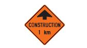

- **A.** Construction zone ends in 1 km
- **B.** Detour for 1 kilometre
- **C.** Construction work 1 kilometre ahead
- **D.** Speed limit 1 km/h

Answer

**C. Construction work 1 kilometre ahead**

Orange sign with "1 km": road work starts one kilometre ahead.

> 📖 Handbook: "Construction work one kilometre ahead."

---

### 2. What does this sign mean?

*Sign meaning*

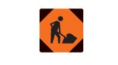

- **A.** Traffic control person ahead
- **B.** Men at work in a park
- **C.** Survey crew ahead
- **D.** Road work ahead

Answer

**D. Road work ahead**

A worker with a shovel = road work ahead.

> 📖 Handbook: "Road work ahead."

---

### 3. What does this sign mean?

*Sign meaning*

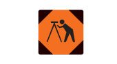

- **A.** Road work ahead
- **B.** Traffic control person ahead
- **C.** Photo radar ahead
- **D.** Survey crew working on the road ahead

Answer

**D. Survey crew working on the road ahead**

A person with a surveyor's tripod = survey crew.

> 📖 Handbook: "Survey crew working on the road ahead."

---

### 4. What does this sign mean?

*Sign meaning*

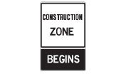

- **A.** Construction starts next week
- **B.** You are entering a construction zone; drive with extra caution and expect a lower speed limit
- **C.** Construction vehicles only
- **D.** Construction zone ends

Answer

**B. You are entering a construction zone; drive with extra caution and expect a lower speed limit**

Construction zone begins: extra caution, possibly a lower speed limit.

> 📖 Handbook: "You are entering a construction zone. Drive with extra caution and be prepared for a lower speed limit."

---

### 5. What does this sign mean?

*Sign meaning*

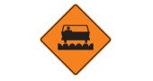

- **A.** Railway tracks ahead
- **B.** Bump ahead
- **C.** Gravel road ahead
- **D.** The pavement has been milled or grooved; stopping may be affected

Answer

**D. The pavement has been milled or grooved; stopping may be affected**

Grooved pavement can affect stopping and gives motorcycles less traction.

> 📖 Handbook: "Pavement has been milled or grooved. Your vehicle's stopping ability may be affected"

---

### 6. What does this sign mean?

*Sign meaning*

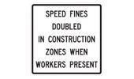

- **A.** Fines are doubled at all times on this highway
- **B.** Workers may issue speeding tickets
- **C.** Speeding fines are doubled in this construction zone when workers are present
- **D.** Speed limit doubles after the construction zone

Answer

**C. Speeding fines are doubled in this construction zone when workers are present**

Speeding in a construction zone with workers present = double fines.

> 📖 Handbook: "Enforces doubling the HTA fines for speeding in a designated construction zone when there are workers present."

---

### 7. What does this lighted arrow board mean?

*Sign meaning*

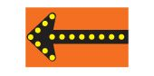

- **A.** The flashing arrow shows the direction to follow
- **B.** One-way traffic
- **C.** Turn left at the next intersection
- **D.** The left lane is open; stay right

Answer

**A. The flashing arrow shows the direction to follow**

Follow the direction of the flashing arrow.

> 📖 Handbook: "Flashing lights on the arrows show the direction to follow."

---

### 8. Which sign means a temporary detour from the normal traffic route?

*Pick the sign*

| A | B | C | D |
|---|---|---|---|
| 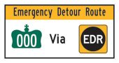 | 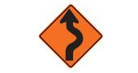 | 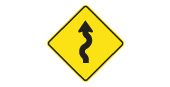 | 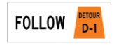 |

Answer

**B**

An orange diamond with a winding arrow = temporary detour. The yellow version means a permanent winding road.

> 📖 Handbook: "Temporary detour from normal traffic route."

---

### 9. Which sign means: traffic control person ahead, drive slowly and watch for instructions?

*Pick the sign*

| A | B | C | D |
|---|---|---|---|
|  | 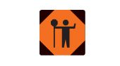 | 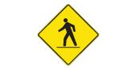 |  |

Answer

**B**

The person holding a sign (paddle) = traffic control person ahead.

> 📖 Handbook: "Traffic control person ahead. Drive slowly and watch for instructions."

---

### 10. Which sign means the lane ahead is closed for roadwork?

*Pick the sign*

| A | B | C | D |
|---|---|---|---|
| 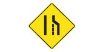 | 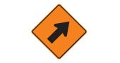 | 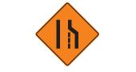 | 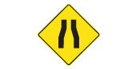 |

Answer

**C**

Orange = construction. The lane-ends picture on orange = lane closed for road work.

> 📖 Handbook: "Lane ahead is closed for roadwork."

---

### 11. Which sign tells you a lane is closed and to merge in the direction of the arrow?

*Pick the sign*

| A | B | C | D |
|---|---|---|---|
| 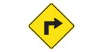 |  |  | 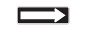 |

Answer

**C**

The orange diamond with a slanted arrow: adjust your speed and merge into the lane it points to.

> 📖 Handbook: "Closed lane. Adjust speed to merge with traffic in lane indicated by arrow."

---

### 12. Which sign is carried on a pilot or pace vehicle that you must not pass?

*Pick the sign*

| A | B | C | D |
|---|---|---|---|
| 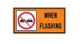 | 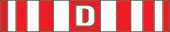 | 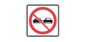 | 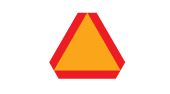 |

Answer

**A**

The orange sign with the no-passing symbol and "When Flashing".

> 📖 Handbook: "Do not pass the pilot vehicle or pace vehicle bearing this sign."

---

### 13. Which sign tells you to follow detour markers until you return to your regular route?

*Pick the sign*

| A | B | C | D |
|---|---|---|---|
|  |  |  | 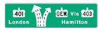 |

Answer

**A**

"Follow" with an orange detour marker.

> 📖 Handbook: "Follow detour marker until you return to regular route."

---

### 14. Which signs does a traffic control person hold up to stop or slow traffic?

*Pick the sign*

| A | B | C | D |
|---|---|---|---|
|  | 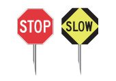 | 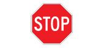 | 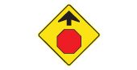 |

Answer

**B**

The STOP / SLOW paddle signs held by traffic control people.

> 📖 Handbook: "Reduce speed and be prepared to stop."

---

### 15. Three orange construction signs show workers. What does this one mean?

*Look-alikes*

- **A.** Workers cutting trees
- **B.** Road work ahead
- **C.** Traffic control person ahead: drive slowly and watch for instructions
- **D.** Survey crew ahead

Answer

**C. Traffic control person ahead: drive slowly and watch for instructions**

The worker holding up a paddle = traffic control person. Shovel = road work. Tripod = survey crew.

> 📖 Handbook: "Traffic control person ahead. Drive slowly and watch for instructions."

---

### 16. This orange diamond shows a winding arrow. What does it mean?

*Look-alikes*

- **A.** Winding road ahead (permanent)
- **B.** Slippery when wet
- **C.** Sharp curve ahead
- **D.** A temporary detour from the normal traffic route

Answer

**D. A temporary detour from the normal traffic route**

Orange = temporary condition. The same arrow on yellow means a permanent winding road.

> 📖 Handbook: "Temporary detour from normal traffic route."

---

### 17. This sign looks like a "right lane ends" sign, but it's orange. What does it mean?

*Look-alikes*

- **A.** The right lane ends permanently
- **B.** A narrow bridge ahead
- **C.** The lane ahead is closed for roadwork; merge into the open lane
- **D.** The pavement narrows ahead

Answer

**C. The lane ahead is closed for roadwork; merge into the open lane**

Orange = road work. Obey the speed limit and merge into the open lane.

> 📖 Handbook: "Lane ahead is closed for roadwork. Obey the speed limit and merge with traffic in the open lane."

---

### 18. What does this sign mean?

*Look-alikes*

- **A.** Construction work 1 km ahead
- **B.** Construction zone begins
- **C.** Speeding fines doubled
- **D.** Construction zone ends

Answer

**B. Construction zone begins**

"Construction zone begins": extra caution, expect a lower speed limit.

> 📖 Handbook: "You are entering a construction zone."

---

### 19. What does this sign mean?

*Look-alikes*

- **A.** Emergency detour route for a highway closure
- **B.** Detour ends
- **C.** Follow the detour markers until you're back on your regular route
- **D.** Follow the car in front of you

Answer

**C. Follow the detour markers until you're back on your regular route**

Orange detour marker = road-work detour. The EDR sign is for unplanned highway closures.

> 📖 Handbook: "Follow detour marker until you return to regular route."

---

### 20. What does this orange sign on a vehicle mean?

*Look-alikes*

- **A.** Wide load following
- **B.** No passing zone on this road
- **C.** Do not pass this pilot or pace vehicle
- **D.** Slow-moving vehicle

Answer

**C. Do not pass this pilot or pace vehicle**

It's on a pilot or pace vehicle in a work zone. Don't pass it.

> 📖 Handbook: "Do not pass the pilot vehicle or pace vehicle bearing this sign."

---

### 21. What kind of sign is this?

*Shapes & colours*

- **A.** Information and direction
- **B.** Temporary condition (construction)
- **C.** Regulatory
- **D.** Warning

Answer

**B. Temporary condition (construction)**

Orange diamond = temporary condition, like road work.

> 📖 Handbook: "They are usually diamond-shaped with an orange background and black letters or symbols."

---

### 22. What kind of sign is this?

*Shapes & colours*

- **A.** Information and direction
- **B.** Regulatory
- **C.** Warning
- **D.** Temporary condition

Answer

**D. Temporary condition**

It's orange, so it's a temporary condition (road work).

> 📖 Handbook: "These signs warn of unusual temporary conditions such as road work zones, diversions, detours, lane closures or traffic control people on the road."

---

### 23. What kind of sign is this?

*Shapes & colours*

- **A.** Regulatory
- **B.** Temporary condition
- **C.** Information and direction
- **D.** Warning

Answer

**B. Temporary condition**

Orange diamond = temporary condition. Here: milled or grooved pavement.

> 📖 Handbook: "They are usually diamond-shaped with an orange background and black letters or symbols."

---

### 24. What is the background colour of temporary condition (construction) signs?

*Shapes & colours*

- **A.** Orange
- **B.** Yellow
- **C.** Green
- **D.** Fluorescent yellow/green

Answer

**A. Orange**

Orange = construction and other temporary conditions.

> 📖 Handbook: "They are usually diamond-shaped with an orange background and black letters or symbols."

---

### 25. Temporary condition signs warn about which of these?

*Shapes & colours*

- **A.** Permanent curves and hills
- **B.** Road work zones, detours, lane closures or traffic control people
- **C.** Hospitals and airports
- **D.** School zones and crossings

Answer

**B. Road work zones, detours, lane closures or traffic control people**

Temporary = conditions that won't stay forever, like construction.

> 📖 Handbook: "These signs warn of unusual temporary conditions such as road work zones, diversions, detours, lane closures or traffic control people on the road."

---

### 26. Why is this winding-arrow sign orange instead of yellow?

*Shapes & colours*

- **A.** It's in a school zone
- **B.** It's a temporary detour, not a permanent winding road
- **C.** Orange means the speed limit is lower
- **D.** Orange signs are used at night

Answer

**B. It's a temporary detour, not a permanent winding road**

Orange = temporary condition. Yellow = permanent warning.

> 📖 Handbook: "Temporary detour from normal traffic route."

---

### 27. This white rectangular sign is about construction zones. What kind of sign is it?

*Shapes & colours*

- **A.** Information: construction schedule
- **B.** Temporary condition: detour
- **C.** Regulatory: it enforces doubled speeding fines when workers are present
- **D.** Warning: workers ahead

Answer

**C. Regulatory: it enforces doubled speeding fines when workers are present**

White rectangle = regulatory, even though it's about construction zones.

> 📖 Handbook: "Enforces doubling the HTA fines for speeding in a designated construction zone when there are workers present."

---

### 28. A traffic control person shows you the SLOW side of this paddle. What must you do?

*What do you do?*

- **A.** Stop and wait for the STOP side
- **B.** Reduce speed and be prepared to stop
- **C.** Keep your normal speed
- **D.** Turn around

Answer

**B. Reduce speed and be prepared to stop**

SLOW = reduce speed and be ready to stop. STOP = stop.

> 📖 Handbook: "Reduce speed and be prepared to stop."

---

### 29. Is it an offence to ignore a STOP or SLOW sign held by a traffic-control person?

*What do you do?*

- **A.** Only at night
- **B.** Yes, it is an offence to disobey it
- **C.** Only if a police officer is present
- **D.** No, it's only advice

Answer

**B. Yes, it is an offence to disobey it**

You must obey STOP and SLOW signs held by a traffic-control person or firefighter.

> 📖 Handbook: "It is also an offence to disobey STOP or SLOW signs displayed by a traffic-control person or firefighter."

---

### 30. You see this sign. What should you do?

*What do you do?*

- **A.** Obey the speed limit and merge with traffic in the open lane
- **B.** Drive on the shoulder past the closure
- **C.** Stop and wait for the lane to reopen
- **D.** Speed up to pass cars before the lane closes

Answer

**A. Obey the speed limit and merge with traffic in the open lane**

Lane closed ahead: slow down and merge into the open lane.

> 📖 Handbook: "Obey the speed limit and merge with traffic in the open lane."

---

### 31. You're behind a vehicle with this sign flashing. What must you do?

*What do you do?*

- **A.** Honk so it moves over
- **B.** Pass it on the right
- **C.** Pass it on the left when safe
- **D.** Stay behind it: don't pass

Answer

**D. Stay behind it: don't pass**

Never pass a pilot or pace vehicle carrying this sign.

> 📖 Handbook: "Do not pass the pilot vehicle or pace vehicle bearing this sign."

---

### 32. You see this sign. What should you do?

*What do you do?*

- **A.** Obey the speed limit and drive with extra caution; stopping may take longer
- **B.** Change lanes often to find smooth pavement
- **C.** Use your high beams
- **D.** Speed up to get past the rough section

Answer

**A. Obey the speed limit and drive with extra caution; stopping may take longer**

Milled or grooved pavement can affect your stopping ability.

> 📖 Handbook: "so obey the speed limit and drive with extra caution"

---

### 33. You pass this sign. What should you do while driving through the zone?

*What do you do?*

- **A.** Follow the vehicle ahead closely
- **B.** Keep your normal highway speed
- **C.** Drive carefully, don't change lanes, and be ready for sudden stops
- **D.** Change lanes often to avoid workers

Answer

**C. Drive carefully, don't change lanes, and be ready for sudden stops**

In construction zones: slow down, don't change lanes, watch for workers and equipment.

> 📖 Handbook: "In the construction zone, drive carefully and adjust your driving to suit the conditions, do not change lanes, be ready for sudden stops"

---

### 34. You speed in a construction zone with this sign while workers are present. What happens to the fine?

*What do you do?*

- **A.** It is the same as anywhere else
- **B.** It is cut in half
- **C.** There is no fine, only a warning
- **D.** It is doubled

Answer

**D. It is doubled**

Speeding fines double in construction zones when workers are present.

> 📖 Handbook: "doubled fines for speeding in a construction zone when workers are present"

---

### 35. What should you do when you see this sign?

*What do you do?*

- **A.** Drive slowly and watch for the traffic control person's instructions
- **B.** Speed up before the lane closes
- **C.** Stop and wait for police
- **D.** Drive on the shoulder

Answer

**A. Drive slowly and watch for the traffic control person's instructions**

A traffic control person ahead will direct you.

> 📖 Handbook: "Drive slowly and watch for instructions."

