<!-- Generated by build.py. Edit data/ or the guide files instead, then run: python3 build.py -->

# S5 · Information, direction & other signs: questions

**Signs half** · 33 questions · [Study guide](../guide/S5-information-other.md) · [All signs topics](../README.md)

Answers are hidden. Tap **Answer** under each question to check yourself.

---

### 1. What does this green sign show?

*Sign meaning*

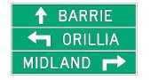

- **A.** Distances to towns in kilometres
- **B.** A detour route
- **C.** Freeway exit lanes
- **D.** Directions to nearby towns and cities

Answer

**D. Directions to nearby towns and cities**

Arrows beside town names = which way to go.

> 📖 Handbook: "Shows directions to nearby towns and cities."

---

### 2. What do the numbers on this sign mean?

*Sign meaning*

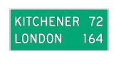

- **A.** The distances in kilometres to the towns
- **B.** The highway numbers
- **C.** The exit numbers
- **D.** The speed limits in each town

Answer

**A. The distances in kilometres to the towns**

Town name + number = distance in km.

> 📖 Handbook: "Shows the distances in kilometres to towns and cities on the road."

---

### 3. On this sign, what does the word "VIA" mean?

*Sign meaning*

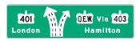

- **A.** Very important area
- **B.** The road is closed
- **C.** The roads you must follow to reach the destination
- **D.** Vehicles in alternate lanes

Answer

**C. The roads you must follow to reach the destination**

VIA = the route to take to get there.

> 📖 Handbook: "The term 'VIA' is used to describe the roads that must be followed to reach a destination."

---

### 4. What does this kind of sign do?

*Sign meaning*

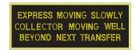

- **A.** It shows the time and temperature only
- **B.** It changes with traffic conditions to give current information about delays and lane closures
- **C.** It advertises local businesses
- **D.** It shows the speed limit for each lane

Answer

**B. It changes with traffic conditions to give current information about delays and lane closures**

Changeable message signs give live traffic information.

> 📖 Handbook: "These signs change according to traffic conditions to give drivers current information on delays and lane closures ahead."

---

### 5. What does this sign show?

*Sign meaning*

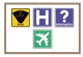

- **A.** Tourist information only
- **B.** Off-road facilities such as hospitals, airports, universities or carpool lots
- **C.** Emergency detour route
- **D.** Police checkpoint ahead

Answer

**B. Off-road facilities such as hospitals, airports, universities or carpool lots**

Facility signs point you to services off the road.

> 📖 Handbook: "Shows off-road facilities such as hospitals, airports, universities or carpool lots."

---

### 6. You see this sign on the back of a farm tractor. What does it mean?

*Sign meaning*

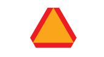

- **A.** Yield to the vehicle
- **B.** The vehicle is wider than one lane
- **C.** The vehicle travels at 40 km/h or less
- **D.** The vehicle carries hazardous material

Answer

**C. The vehicle travels at 40 km/h or less**

Slow-moving vehicle sign: slow down and pass only when it's safe.

> 📖 Handbook: "It alerts other drivers that the vehicle ahead will be travelling at 40 km/h or less."

---

### 7. This placard is on the back of a truck. What does it tell you?

*Sign meaning*

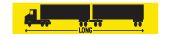

- **A.** The truck is an oversize load
- **B.** The truck is a slow-moving vehicle
- **C.** It's a long commercial vehicle (double trailer) that can be up to 40 metres long
- **D.** The truck carries dangerous goods

Answer

**C. It's a long commercial vehicle (double trailer) that can be up to 40 metres long**

LCV = long commercial vehicle. Expect extra length and limited speed when passing.

> 📖 Handbook: "This placard indicates a long commercial vehicle, which is a double trailer and can be up to 40 metres in length."

---

### 8. Which sign shows the route to an airport?

*Pick the sign*

| A | B | C | D |
|---|---|---|---|
| 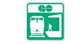 | 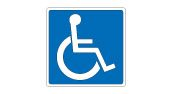 |  | 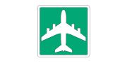 |

Answer

**D**

A white airplane on green.

> 📖 Handbook: "Shows route to airport."

---

### 9. Which sign shows the route to a passenger railway station?

*Pick the sign*

| A | B | C | D |
|---|---|---|---|
| 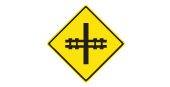 |  | 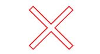 |  |

Answer

**D**

A train with a person = passenger railway station. Railway crossing signs are different.

> 📖 Handbook: "Shows route to passenger railway station."

---

### 10. Which sign shows facilities that are accessible by wheelchair?

*Pick the sign*

| A | B | C | D |
|---|---|---|---|
|  | 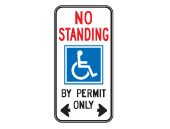 |  | 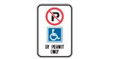 |

Answer

**A**

The blue sign with a wheelchair symbol, with no parking rules on it.

> 📖 Handbook: "Shows facilities that are accessible by wheelchair."

---

### 11. Which sign is the "D" sign for an oversize load?

*Pick the sign*

| A | B | C | D |
|---|---|---|---|
|  | 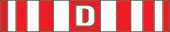 |  | 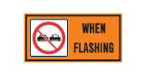 |

Answer

**B**

Red and white stripes with a D = oversize load.

> 📖 Handbook: "D sign – Oversize load"

---

### 12. Which sign marks an Emergency Detour Route (EDR)?

*Pick the sign*

| A | B | C | D |
|---|---|---|---|
| 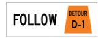 |  | 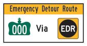 | 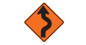 |

Answer

**C**

EDR markers guide traffic around an unplanned provincial highway closure and back onto the highway.

> 📖 Handbook: "EDR signs are used during the unscheduled closure of a provincial highway when OPP detour all traffic off the highway."

---

### 13. Which sign shows the upcoming roundabout exits and where they go?

*Pick the sign*

| A | B | C | D |
|---|---|---|---|
| 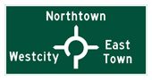 | 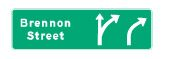 |  | 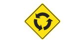 |

Answer

**A**

A green sign with a circle and the exit destinations.

> 📖 Handbook: "Shows the upcoming roundabout exits and where they will take you."

---

### 14. Which sign shows a freeway interchange (exit) number?

*Pick the sign*

| A | B | C | D |
|---|---|---|---|
| 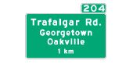 | 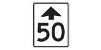 |  | 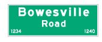 |

Answer

**A**

The number on the tab at the top is the interchange number.

> 📖 Handbook: "Freeway interchanges or exits have numbers that correspond to the distance from the beginning of the freeway."

---

### 15. On an advance freeway sign, which one shows a lane that leads off the freeway (exit only), in a yellow box?

*Pick the sign*

| A | B | C | D |
|---|---|---|---|
|  |  |  | 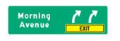 |

Answer

**D**

Exit-lane arrows are shown in a yellow box with the word "exit" under them.

> 📖 Handbook: "The arrows matching the exit lanes are shown on the advance sign in a yellow box with the word ‘exit' under them."

---

### 16. What do the arrows on this advance freeway sign show?

*Look-alikes*

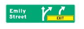

- **A.** The direction of the detour
- **B.** Which lanes lead off the freeway at the exit
- **C.** Which lanes are closed ahead
- **D.** Which lanes are HOV lanes

Answer

**B. Which lanes lead off the freeway at the exit**

Advance exit signs use arrows to show the exit lanes. Signs are also posted at the exit itself.

> 📖 Handbook: "Advance signs use arrows to show which lanes lead off the freeway."

---

### 17. What is this sign for?

*Look-alikes*

- **A.** Showing the distance to the next town
- **B.** Marking an emergency detour route
- **C.** Helping drivers choose the correct lane to exit or stay on the freeway
- **D.** Showing a roundabout's exits

Answer

**C. Helping drivers choose the correct lane to exit or stay on the freeway**

Overhead and ground-mounted exit signs help you pick the right lane.

> 📖 Handbook: "Overhead and ground-mounted signs help drivers choose the correct lane to exit or stay on the freeway."

---

### 18. How is this EDR sign different from an orange road-work detour sign?

*Look-alikes*

- **A.** It's used when police close a provincial highway unexpectedly, guiding traffic around and back
- **B.** It marks a scenic tourist route
- **C.** It's used only for planned construction
- **D.** It means the road is permanently closed

Answer

**A. It's used when police close a provincial highway unexpectedly, guiding traffic around and back**

EDR = Emergency Detour Route, for unscheduled highway closures.

> 📖 Handbook: "EDR signs are used during the unscheduled closure of a provincial highway when OPP detour all traffic off the highway."

---

### 19. What are the small numbers along the bottom of this green sign for?

*Look-alikes*

- **A.** To help emergency vehicles and drivers find the right route
- **B.** The distances to the next exits
- **C.** The speed limits
- **D.** The postal codes of the area

Answer

**A. To help emergency vehicles and drivers find the right route**

Emergency response numbering helps emergency vehicles choose a route.

> 📖 Handbook: "Some information signs include a numbering system along the bottom of the sign to assist emergency vehicles and drivers in determining an appropriate route."

---

### 20. What does this red and white sign with a "D" mean?

*Look-alikes*

- **A.** Oversize load
- **B.** Dangerous goods
- **C.** Detour
- **D.** Disabled vehicle

Answer

**A. Oversize load**

The "D" sign marks an oversize load.

> 📖 Handbook: "D sign – Oversize load"

---

### 21. Which statement about this sign is true?

*Look-alikes*

- **A.** It's a yield sign for farm roads
- **B.** It marks a vehicle carrying explosives
- **C.** It's orange with a red border and marks vehicles going 40 km/h or less
- **D.** It means you must stop behind the vehicle

Answer

**C. It's orange with a red border and marks vehicles going 40 km/h or less**

Farm tractors, horse-drawn buggies and other slow vehicles must show it.

> 📖 Handbook: "The “slow-moving vehicle” sign is an orange triangle with a red border."

---

### 22. What kind of sign is this?

*Shapes & colours*

- **A.** Regulatory
- **B.** Temporary condition
- **C.** Warning
- **D.** Information and direction

Answer

**D. Information and direction**

Green rectangle with white letters = information and direction.

> 📖 Handbook: "They are usually rectangular with a green background and white letters."

---

### 23. What kind of sign is this?

*Shapes & colours*

- **A.** Information and direction
- **B.** Warning
- **C.** Regulatory
- **D.** Temporary condition

Answer

**A. Information and direction**

Green = distances and destinations.

> 📖 Handbook: "These signs tell you about distances and destinations."

---

### 24. What do information and direction signs tell you about?

*Shapes & colours*

- **A.** Road work
- **B.** Dangers ahead
- **C.** Distances and destinations
- **D.** Rules you must obey

Answer

**C. Distances and destinations**

Information and direction signs = where things are and how far.

> 📖 Handbook: "These signs tell you about distances and destinations."

---

### 25. This sign isn't green. Why?

*Shapes & colours*

- **A.** Blue signs warn of danger
- **B.** Blue signs mark school zones
- **C.** Blue signs are rules you must obey
- **D.** Signs in other colours guide you to facilities, services and attractions

Answer

**D. Signs in other colours guide you to facilities, services and attractions**

Information signs are usually green, but other colours point to facilities and services.

> 📖 Handbook: "Other signs with different colours guide you to facilities, services and attractions."

---

### 26. What does it mean when a sign shows the same message in English and French?

*Shapes & colours*

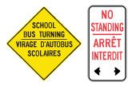

- **A.** You're entering Quebec
- **B.** The sign is only for tourists
- **C.** You're in a designated bilingual area; read the language you understand best
- **D.** You must obey only the French message

Answer

**C. You're in a designated bilingual area; read the language you understand best**

Bilingual signs appear in designated bilingual areas.

> 📖 Handbook: "Watch for these signs when driving in designated bilingual areas. Read the messages in the language you understand best."

---

### 27. Where would you see this yellow placard?

*Shapes & colours*

- **A.** On a school bus
- **B.** On a farm tractor
- **C.** On the back of a long commercial vehicle (double trailer)
- **D.** At a truck stop entrance

Answer

**C. On the back of a long commercial vehicle (double trailer)**

LCV placards are on the rear of long double-trailer trucks.

> 📖 Handbook: "It is important to be able to recognize an LCV on the highway, based on rear signage"

---

### 28. What kind of sign is this changeable message board?

*Shapes & colours*

- **A.** Information: current traffic conditions
- **B.** Warning: permanent hazards
- **C.** Temporary: construction detours only
- **D.** Regulatory: speed limits

Answer

**A. Information: current traffic conditions**

It gives current information on delays and lane closures.

> 📖 Handbook: "to give drivers current information on delays and lane closures ahead"

---

### 29. You come up behind a vehicle showing this sign. What should you do?

*What do you do?*

- **A.** Pass it right away, even on a hill
- **B.** Honk so it pulls over
- **C.** Follow closely so others can't cut in
- **D.** Slow down, stay back, and pass only when it's safe

Answer

**D. Slow down, stay back, and pass only when it's safe**

Slow-moving vehicles go 40 km/h or less. Be patient.

> 📖 Handbook: "Watch for these slow moving vehicles and reduce your speed as necessary."

---

### 30. You want to pass a truck with this placard. What should you expect?

*What do you do?*

- **A.** It may not be passed at all
- **B.** Extra length (up to 40 m) and limited speed, so you need more room to pass
- **C.** It's shorter than normal trucks
- **D.** It will pull over to let you pass

Answer

**B. Extra length (up to 40 m) and limited speed, so you need more room to pass**

Anticipate the long length when you plan a pass.

> 📖 Handbook: "anticipate both the extended length and limited speed when preparing to pass one on the highway"

---

### 31. You're at exit 204 on Highway 401 and want to get off at exit 230. How far is it?

*What do you do?*

- **A.** 26 kilometres
- **B.** 434 kilometres
- **C.** 230 kilometres
- **D.** 204 kilometres

Answer

**A. 26 kilometres**

Exit numbers = km from where the freeway begins. Subtract: 230 − 204 = 26 km.

> 📖 Handbook: "Distances can be calculated by subtracting one interchange number from another."

---

### 32. Interchange number 204 on Highway 401 tells you…

*What do you do?*

- **A.** It is 204 kilometres from where the freeway begins (Windsor)
- **B.** It is 204 km to Toronto
- **C.** It is the 204th exit
- **D.** The speed limit is 204 km/h

Answer

**A. It is 204 kilometres from where the freeway begins (Windsor)**

Exit numbers count kilometres from the start of the freeway.

> 📖 Handbook: "interchange number 204 on Highway 401 is 204 kilometres from Windsor, where the freeway begins"

---

### 33. You're driving in a bilingual area and see a sign in English and French. What should you do?

*What do you do?*

- **A.** Read the message in the language you understand best
- **B.** Read both messages fully before acting
- **C.** Pull over to read it
- **D.** Follow only the English message

Answer

**A. Read the message in the language you understand best**

Both messages say the same thing.

> 📖 Handbook: "Read the messages in the language you understand best."

