<!-- Generated by build.py. Edit data/ or the guide files instead, then run: python3 build.py -->

# S6 · Traffic lights & beacons: questions

**Signs half** · 42 questions · [Study guide](../guide/S6-traffic-lights.md) · [All signs topics](../README.md)

Answers are hidden. Tap **Answer** under each question to check yourself.

---

### 1. What does a yellow (amber) light mean?

*Sign meaning*

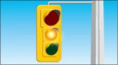

- **A.** Stop immediately, even if you're in the intersection
- **B.** Speed up to get through before it turns red
- **C.** The red light is about to appear: stop if you can do so safely; otherwise go with caution
- **D.** The light is broken: treat it as an all-way stop

Answer

**C. The red light is about to appear: stop if you can do so safely; otherwise go with caution**

Yellow = red is coming. Stop if it's safe to stop.

> 📖 Handbook: "A yellow - or amber - light means the red light is about to appear. You must stop if you can do so safely; otherwise, go with caution."

---

### 2. The green light ahead of you is flashing. What does it mean?

*Sign meaning*

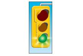

- **A.** Pedestrians may cross now
- **B.** Proceed with caution; it's a broken light
- **C.** The light is about to turn red
- **D.** Advance green: you may turn left, go straight or turn right; oncoming traffic still has a red

Answer

**D. Advance green: you may turn left, go straight or turn right; oncoming traffic still has a red**

A flashing green is an advance green. Oncoming traffic is still stopped.

> 📖 Handbook: "This is called an advanced green light because oncoming traffic still faces a red light."

---

### 3. A left-turn green arrow is shown with a red light. What does it mean?

*Sign meaning*

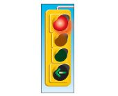

- **A.** You may turn left from the left-turn lane; oncoming left-turners may be turning too
- **B.** Turn left only after stopping completely
- **C.** Only oncoming traffic may go
- **D.** You may go straight or turn left

Answer

**A. You may turn left from the left-turn lane; oncoming left-turners may be turning too**

Simultaneous left turn: left-turners from both directions go together.

> 📖 Handbook: "When a left-turn green arrow is shown with a red light, you may turn left from the left-turn lane."

---

### 4. This round signal on top of the traffic light shows a white vertical bar. What does it mean?

*Sign meaning*

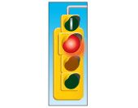

- **A.** Transit priority signal: traffic and pedestrians must yield to public transit vehicles
- **B.** All traffic may go straight
- **C.** The light is out of order
- **D.** Pedestrians may cross now

Answer

**A. Transit priority signal: traffic and pedestrians must yield to public transit vehicles**

The white bar lets buses or streetcars go while all conflicting traffic faces red.

> 📖 Handbook: "Traffic and pedestrians must yield to public transit vehicles at a transit priority signal."

---

### 5. The traffic lights are completely dark because of a power failure. What does that mean?

*Sign meaning*

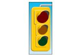

- **A.** Treat the intersection like an all-way stop
- **B.** Drive through carefully without stopping
- **C.** Only turn right
- **D.** The main road keeps the right-of-way

Answer

**A. Treat the intersection like an all-way stop**

Dead lights = all-way stop. Yield to vehicles in the intersection and to vehicles coming from your right.

> 📖 Handbook: "Go cautiously and use the intersection the same way you would use an intersection with all-way stop signs."

---

### 6. The yellow light ahead is flashing. What does it mean?

*Sign meaning*

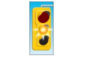

- **A.** The light is about to turn red
- **B.** Come to a complete stop
- **C.** Drive with caution as you approach and go through the intersection
- **D.** Stop and yield to pedestrians

Answer

**C. Drive with caution as you approach and go through the intersection**

Flashing yellow = caution. Flashing red = stop.

> 📖 Handbook: "A flashing yellow light means you should drive with caution when approaching and moving through the intersection."

---

### 7. A single flashing yellow beacon hangs above an intersection. What does it mean?

*Sign meaning*

- **A.** Drive with caution
- **B.** Yield to traffic from the left
- **C.** Road closed ahead
- **D.** Come to a complete stop

Answer

**A. Drive with caution**

A flashing yellow beacon warns you to drive with caution.

> 📖 Handbook: "A flashing yellow beacon above an intersection, above a warning sign or on an obstruction in the road, warns you to drive with caution."

---

### 8. Which signal shows a green light with a left-pointing green arrow (an advance green)?

*Pick the sign*

| A | B | C | D |
|---|---|---|---|
| 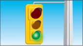 | 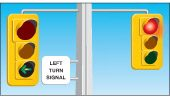 |  | 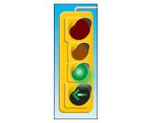 |

Answer

**D**

A green arrow together with a green light = advance green.

> 📖 Handbook: "When you face a flashing green light or a left-pointing green arrow and a green light, you may turn left, go straight ahead or turn right from the proper lane."

---

### 9. Which signal means: don't start your left turn, the green light is about to appear for other traffic?

*Pick the sign*

| A | B | C | D |
|---|---|---|---|
|  | 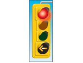 |  | 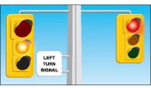 |

Answer

**B**

The yellow arrow (with a red light) comes after the green arrow.

> 📖 Handbook: "After the left-turn green arrow, a yellow arrow may appear. This means the green light is about to appear for traffic in one or both directions."

---

### 10. Which signal shows a fully protected left turn with a green arrow?

*Pick the sign*

| A | B | C | D |
|---|---|---|---|
|  |  |  |  |

Answer

**B**

Fully protected left turns have their own separate signal, marked "left turn signal".

> 📖 Handbook: "You may turn left from the left-turn lane when you face a green arrow."

---

### 11. At an intersection with a separate left-turn signal, which picture shows yellow for left-turning vehicles only?

*Pick the sign*

| A | B | C | D |
|---|---|---|---|
|  | 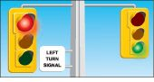 |  |  |

Answer

**D**

After the left-turn green arrow, a yellow light appears for left-turners only.

> 📖 Handbook: "After the left-turn green arrow, a yellow light appears for left-turning vehicles only."

---

### 12. Which picture shows a red light for left-turning vehicles only, while other traffic has a green light?

*Pick the sign*

| A | B | C | D |
|---|---|---|---|
|  | 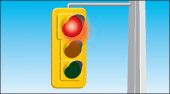 |  |  |

Answer

**C**

Fully protected left turn: red for left-turners while straight and right-turning traffic go.

> 📖 Handbook: "After the yellow light, a red light appears for left-turning vehicles only."

---

### 13. Which is a flashing red beacon?

*Pick the sign*

| A | B | C | D |
|---|---|---|---|
|  |  | 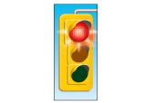 |  |

Answer

**B**

A beacon is a single flashing light. Red beacon = complete stop.

> 📖 Handbook: "A flashing red beacon above an intersection or stop sign means you must come to a complete stop."

---

### 14. Which picture shows a transit priority signal?

*Pick the sign*

| A | B | C | D |
|---|---|---|---|
|  | 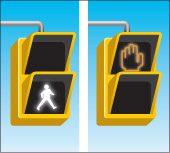 |  |  |

Answer

**C**

The extra round signal on top shows a white vertical bar for transit vehicles.

> 📖 Handbook: "The round signal is on top of a regular traffic signal and shows a white vertical bar on a dark background."

---

### 15. Which picture shows traffic lights that are out because of a power failure?

*Pick the sign*

| A | B | C | D |
|---|---|---|---|
|  |  |  |  |

Answer

**C**

All the lights are dark. Use the intersection like an all-way stop.

> 📖 Handbook: "During an electrical power loss, traffic lights at intersections will not work."

---

### 16. Flashing green light vs regular green light: what's special about the flashing green?

*Look-alikes*

- **A.** It means the light is about to turn yellow
- **B.** Nothing; they mean exactly the same
- **C.** Oncoming traffic still faces a red light, so you may turn left without waiting for them
- **D.** It means pedestrians have the right-of-way

Answer

**C. Oncoming traffic still faces a red light, so you may turn left without waiting for them**

Flashing green = advance green. On a regular green, left-turners must yield to oncoming traffic.

> 📖 Handbook: "This is called an advanced green light because oncoming traffic still faces a red light."

---

### 17. You face a green light with a left green arrow. What may you do?

*Look-alikes*

- **A.** Turn left, go straight or turn right from the proper lane
- **B.** Only go straight
- **C.** Turn left only after oncoming traffic clears
- **D.** Only turn left

Answer

**A. Turn left, go straight or turn right from the proper lane**

Green arrow + green light = advance green, the same as a flashing green.

> 📖 Handbook: "you may turn left, go straight ahead or turn right from the proper lane"

---

### 18. You face a left green arrow with a RED light. You want to go straight. What do you do?

*Look-alikes*

- **A.** Go straight after stopping
- **B.** Wait: only left turns from the left-turn lane may go
- **C.** Turn left instead, from any lane
- **D.** Go straight, since the arrow is green

Answer

**B. Wait: only left turns from the left-turn lane may go**

The red light still applies to through traffic. The arrow is only for left turns.

> 📖 Handbook: "When a left-turn green arrow is shown with a red light, you may turn left from the left-turn lane."

---

### 19. A yellow arrow appears after the green arrow. What does it mean?

*Look-alikes*

- **A.** Yield to pedestrians, then turn
- **B.** Left turns are allowed until the light turns red
- **C.** The green is about to appear for other traffic: don't start your turn; stop if you can safely
- **D.** Turn left with caution

Answer

**C. The green is about to appear for other traffic: don't start your turn; stop if you can safely**

Yellow arrow = your turning time is ending.

> 📖 Handbook: "Do not start your left turn. Stop if you can do so safely; otherwise, complete your turn with caution."

---

### 20. The red light ahead is flashing. What must you do?

*Look-alikes*

- **A.** Come to a complete stop, then go when it's safe
- **B.** Yield only to vehicles on your right
- **C.** Stop and wait for it to turn green
- **D.** Slow down and go with caution

Answer

**A. Come to a complete stop, then go when it's safe**

Flashing red = treat it like a stop sign.

> 📖 Handbook: "You must come to a complete stop at a flashing red light. Move through the intersection only when it is safe."

---

### 21. Flashing yellow vs flashing red: which statement is right for a flashing YELLOW light?

*Look-alikes*

- **A.** Treat it as an all-way stop
- **B.** Drive with caution; you don't have to stop
- **C.** Stop if pedestrians are waiting
- **D.** Come to a complete stop

Answer

**B. Drive with caution; you don't have to stop**

Flashing red = stop. Flashing yellow = caution.

> 📖 Handbook: "A flashing yellow light means you should drive with caution when approaching and moving through the intersection."

---

### 22. A single flashing red beacon hangs above a stop sign. What does it mean?

*Look-alikes*

- **A.** Railway crossing ahead
- **B.** Emergency vehicle entrance
- **C.** Come to a complete stop; go only when it's safe
- **D.** Slow down and go with caution

Answer

**C. Come to a complete stop; go only when it's safe**

Red beacon = complete stop, just like the stop sign.

> 📖 Handbook: "A flashing red beacon above an intersection or stop sign means you must come to a complete stop. Move through the intersection only when it is safe to do so."

---

### 23. A flashing yellow beacon is placed over a warning sign. What does it tell you?

*Look-alikes*

- **A.** Speed up to clear the hazard
- **B.** Come to a complete stop
- **C.** Drive with caution
- **D.** The sign is no longer in effect

Answer

**C. Drive with caution**

Yellow beacons warn; red beacons stop.

> 📖 Handbook: "A flashing yellow beacon above an intersection, above a warning sign or on an obstruction in the road, warns you to drive with caution."

---

### 24. The left green arrow has ended and the light is now a solid green. Can you still turn left?

*Look-alikes*

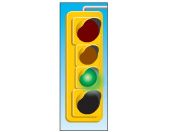

- **A.** Yes, but only when the way is clear of traffic and pedestrians
- **B.** Only if you were first in line
- **C.** Yes, oncoming traffic must stop for you
- **D.** No, left turns are only allowed on the arrow

Answer

**A. Yes, but only when the way is clear of traffic and pedestrians**

On a plain green, you may turn left after yielding.

> 📖 Handbook: "You can still turn left when the light is green, but only when the way is clear of traffic and pedestrians."

---

### 25. At a fully protected left turn, the left-turn signal shows red but straight-ahead traffic has green. Can you turn left?

*Look-alikes*

- **A.** Yes, after a complete stop
- **B.** Yes, if no oncoming traffic is coming
- **C.** Yes, but only on a one-way road
- **D.** No: you may not begin a left turn after the green light appears for other traffic

Answer

**D. No: you may not begin a left turn after the green light appears for other traffic**

At these intersections, left turns go only on the left-turn arrow.

> 📖 Handbook: "In these intersections, you may not begin turning left after the green light appears for traffic going straight ahead or turning right."

---

### 26. What is a traffic beacon?

*Shapes & colours*

- **A.** A light on top of a police car
- **B.** A pedestrian push button
- **C.** A traffic light with an arrow
- **D.** A single flashing light hung over an intersection, or placed over signs or on obstacles in the road

Answer

**D. A single flashing light hung over an intersection, or placed over signs or on obstacles in the road**

Beacons are single flashing lights: red = stop, yellow = caution.

> 📖 Handbook: "A traffic beacon is a single flashing light hung over an intersection or placed over signs or on obstacles in the road."

---

### 27. What does a transit priority signal look like?

*Shapes & colours*

- **A.** A white walking person
- **B.** A green arrow pointing up
- **C.** A blue flashing light
- **D.** A round signal on top of a regular traffic light, showing a white vertical bar

Answer

**D. A round signal on top of a regular traffic light, showing a white vertical bar**

The white vertical bar is for buses and streetcars.

> 📖 Handbook: "The round signal is on top of a regular traffic signal and shows a white vertical bar on a dark background."

---

### 28. Which light colour is also called "amber"?

*Shapes & colours*

- **A.** White
- **B.** Red
- **C.** Green
- **D.** Yellow

Answer

**D. Yellow**

Yellow and amber mean the same light.

> 📖 Handbook: "A yellow - or amber - light means the red light is about to appear."

---

### 29. Where can a flashing yellow beacon be placed?

*Shapes & colours*

- **A.** Only at railway crossings
- **B.** Only on school buses
- **C.** Only on police cars
- **D.** Above an intersection, above a warning sign, or on an obstruction in the road

Answer

**D. Above an intersection, above a warning sign, or on an obstruction in the road**

Yellow beacons warn you to drive with caution.

> 📖 Handbook: "A flashing yellow beacon above an intersection, above a warning sign or on an obstruction in the road, warns you to drive with caution."

---

### 30. You have a green light and want to turn left. What must you do?

*What do you do?*

- **A.** Wait for a green arrow
- **B.** Turn left before the oncoming cars move
- **C.** Turn right away; green means you have the right-of-way
- **D.** Yield to oncoming vehicles and pedestrians, then turn when it's clear

Answer

**D. Yield to oncoming vehicles and pedestrians, then turn when it's clear**

Green lets you go after yielding to vehicles and pedestrians already in the intersection.

> 📖 Handbook: "A green light means you may turn left, go straight or turn right after yielding to vehicles and pedestrians already in the intersection."

---

### 31. You have a green light and are turning right. A pedestrian is crossing the road you're turning onto. What must you do?

*What do you do?*

- **A.** Honk and turn
- **B.** Turn; you have the green
- **C.** Turn quickly before they reach your lane
- **D.** Yield to the pedestrian

Answer

**D. Yield to the pedestrian**

When turning on a green light, pedestrians crossing the intersection have the right-of-way.

> 📖 Handbook: "When turning left or right you must yield the right-of-way to pedestrians crossing the intersection."

---

### 32. The light turns yellow and you are close enough to stop safely. What should you do?

*What do you do?*

- **A.** Stop
- **B.** Keep your speed and go through
- **C.** Speed up to make it through
- **D.** Honk and go through

Answer

**A. Stop**

Stop on yellow if you can do it safely.

> 📖 Handbook: "You must stop if you can do so safely"

---

### 33. The light turns yellow when you are so close that you can't stop safely. What should you do?

*What do you do?*

- **A.** Back up behind the stop line
- **B.** Stop in the middle of the intersection
- **C.** Slam on the brakes
- **D.** Drive through the intersection with caution

Answer

**D. Drive through the intersection with caution**

If you're too close to stop safely, go through with caution.

> 📖 Handbook: "However, if you are already so close that you cannot stop safely, drive through the intersection with caution."

---

### 34. You're at a red light and want to turn right. There's no sign forbidding it. What must you do?

*What do you do?*

- **A.** Turn without stopping if no pedestrians are near
- **B.** Slow down and turn if clear
- **C.** Wait for the green light
- **D.** Come to a complete stop, wait until the way is clear, then turn

Answer

**D. Come to a complete stop, wait until the way is clear, then turn**

Right on red is allowed after a full stop, unless a sign says no.

> 📖 Handbook: "Unless a sign tells you not to, you may turn right on a red light only after coming to a complete stop and waiting until the way is clear."

---

### 35. When may you turn LEFT on a red light?

*What do you do?*

- **A.** Only when a police officer waves you on
- **B.** From a one-way road onto a one-way road, after a complete stop
- **C.** From any road, after a complete stop
- **D.** Never

Answer

**B. From a one-way road onto a one-way road, after a complete stop**

Left on red only works one-way to one-way.

> 📖 Handbook: "You may also turn left on a red light if you are moving from a one-way road onto a one-way road, but you must come to a complete stop first and wait until the way is clear."

---

### 36. You must stop for a red light. There is a stop line painted on the road. Where do you stop?

*What do you do?*

- **A.** At the crosswalk on the far side
- **B.** At the edge of the intersection
- **C.** Beside the traffic light pole
- **D.** At the stop line

Answer

**D. At the stop line**

Stop line first. No line: crosswalk. No crosswalk: edge of the sidewalk. No sidewalk: edge of the intersection.

> 📖 Handbook: "Bring your vehicle to a complete stop at the stop line if it is marked on the pavement."

---

### 37. You come to a flashing red light. What must you do?

*What do you do?*

- **A.** Stop only if traffic is coming
- **B.** Wait for the light to turn green
- **C.** Stop completely, then go when it's safe
- **D.** Slow down and keep going

Answer

**C. Stop completely, then go when it's safe**

A flashing red light works like a stop sign.

> 📖 Handbook: "You must come to a complete stop at a flashing red light."

---

### 38. The traffic lights are out. You and a car on your right arrive at the same time. Who goes first?

*What do you do?*

- **A.** You do
- **B.** Whoever is on the busier road
- **C.** The car on your right
- **D.** Whoever is going straight

Answer

**C. The car on your right**

Dead lights = all-way stop. Yield to vehicles in the intersection and entering from your right.

> 📖 Handbook: "Yield the right-of-way to vehicles in the intersection and to vehicles entering the intersection from your right."

---

### 39. You're in the middle of a fully protected left turn when the left-turn signal turns yellow. What should you do?

*What do you do?*

- **A.** Back up to the stop line
- **B.** Complete your turn with caution
- **C.** Wait for the next green arrow
- **D.** Stop in the intersection

Answer

**B. Complete your turn with caution**

If it turns yellow while you're already in the intersection, finish the turn with caution.

> 📖 Handbook: "If the light turns yellow while you are in the intersection, complete your turn with caution."

---

### 40. You're turning left on a green light and the light turns red while you're in the intersection. What should you do?

*What do you do?*

- **A.** Turn right instead
- **B.** Stop where you are
- **C.** Complete your turn when it's safe
- **D.** Reverse out of the intersection

Answer

**C. Complete your turn when it's safe**

Don't stay stuck in the intersection. Finish the turn when it's safe.

> 📖 Handbook: "If the light turns red when you are in the intersection, complete your turn when it is safe."

---

### 41. The transit signal shows a white vertical bar. A bus beside you wants to go. What do you do?

*What do you do?*

- **A.** Go with the bus
- **B.** Yield to the bus: the signal is for transit vehicles
- **C.** Honk to let the bus know you're there
- **D.** Turn right in front of the bus

Answer

**B. Yield to the bus: the signal is for transit vehicles**

At a transit priority signal, everyone else yields to transit vehicles.

> 📖 Handbook: "This allows transit vehicles to go through, turn right or left, while all conflicting traffic faces a red light."

---

### 42. The light is flashing green. A pedestrian is waiting to cross in front of you, but there's no pedestrian signal. May they cross?

*What do you do?*

- **A.** Yes, if they push the button
- **B.** Only if a crossing guard is there
- **C.** No: pedestrians must not cross on a flashing green unless a pedestrian signal tells them to
- **D.** Yes, pedestrians may always cross on green

Answer

**C. No: pedestrians must not cross on a flashing green unless a pedestrian signal tells them to**

Flashing green is for turning traffic; pedestrians wait.

> 📖 Handbook: "Pedestrians must not cross on a flashing green light unless a pedestrian signal tells them to."

