<!-- Generated by build.py. Edit data/ or the guide files instead, then run: python3 build.py -->

# S7 · Pedestrian signals & pavement markings: questions

**Signs half** · 25 questions · [Study guide](../guide/S7-pedestrian-signals-markings.md) · [All signs topics](../README.md)

Answers are hidden. Tap **Answer** under each question to check yourself.

---

### 1. What do these two pedestrian signals mean?

*Sign meaning*

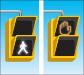

- **A.** Walking person: school zone. Hand: crossing guard ahead
- **B.** Walking person: cars may go. Hand: cars must stop
- **C.** Both mean pedestrians must wait
- **D.** White walking person: pedestrians may cross. Orange hand: pedestrians must not begin to cross

Answer

**D. White walking person: pedestrians may cross. Orange hand: pedestrians must not begin to cross**

Walk = white walking symbol. Don't start = flashing or steady orange hand.

> 📖 Handbook: "The signal for pedestrians to walk is a white walking symbol. A flashing or steady orange hand symbol means pedestrians must not begin to cross."

---

### 2. What do yellow lines and white lines on the road tell you?

*Sign meaning*

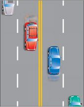

- **A.** Yellow lines are for passing; white lines are for no passing
- **B.** Yellow lines separate traffic going in opposite directions; white lines separate traffic going the same direction
- **C.** Yellow lines are temporary; white lines are permanent
- **D.** Yellow lines mark bike lanes; white lines mark car lanes

Answer

**B. Yellow lines separate traffic going in opposite directions; white lines separate traffic going the same direction**

Yellow = opposite directions. White = same direction.

> 📖 Handbook: "Yellow lines separate traffic travelling in opposite directions. White lines separate traffic travelling in the same direction."

---

### 3. What does a white arrow painted on your lane mean?

*Sign meaning*

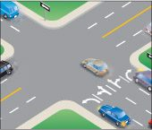

- **A.** You may move only in the direction of the arrow
- **B.** It's a suggestion for the best route
- **C.** One-way street ahead
- **D.** Bike lane ahead

Answer

**A. You may move only in the direction of the arrow**

Lane arrows are rules: follow the arrow.

> 📖 Handbook: "A white arrow painted on a lane means you may move only in the direction of the arrow."

---

### 4. Which picture shows a stop line?

*Pick the sign*

| A | B | C | D |
|---|---|---|---|
| 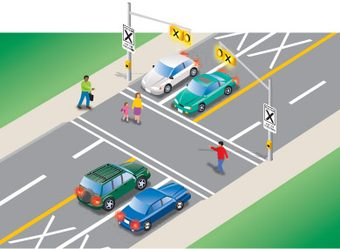 | 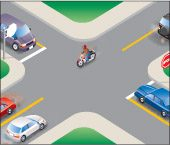 |  | 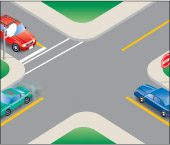 |

Answer

**B**

A stop line is a single white line across the road where you must stop.

> 📖 Handbook: "A stop line is a single white line painted across the road at an intersection. It shows where you must stop."

---

### 5. Which picture shows a crosswalk marked by two parallel white lines?

*Pick the sign*

| A | B | C | D |
|---|---|---|---|
|  |  | 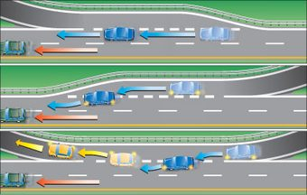 |  |

Answer

**D**

Two parallel white lines across the road = crosswalk.

> 📖 Handbook: "A crosswalk is marked by two parallel white lines painted across the road."

---

### 6. Which picture shows a pedestrian crossover (double white lines with an X in each approaching lane)?

*Pick the sign*

| A | B | C | D |
|---|---|---|---|
|  | 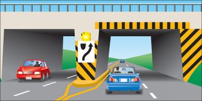 |  |  |

Answer

**D**

Crossovers have signs, overhead yellow lights, double white lines and an X in each lane approaching them.

> 📖 Handbook: "Pedestrian crossovers are marked by two white double parallel lines across the road with an X in each lane approaching it."

---

### 7. Which picture shows continuity lines (wider, closer-together broken lines)?

*Pick the sign*

| A | B | C | D |
|---|---|---|---|
| 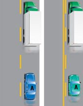 |  | 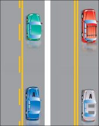 |  |

Answer

**B**

Continuity lines mark lanes that are ending or exiting, like at on-ramps and off-ramps.

> 📖 Handbook: "Broken lines that are wider and closer together than regular broken lines are called continuity lines."

---

### 8. There is a solid line on the left of your lane. What does it mean?

*Look-alikes*

- **A.** You may pass if the way is clear
- **B.** It is unsafe to pass
- **C.** Your lane is ending
- **D.** Bike lane on your left

Answer

**B. It is unsafe to pass**

Solid = don't pass. Broken = you may pass if it's clear.

> 📖 Handbook: "A solid line at the left of your lane means it is unsafe to pass."

---

### 9. There is a broken line on the left of your lane. What does it mean?

*Look-alikes*

- **A.** Passing is never allowed
- **B.** You may pass if the way is clear and there's enough room ahead to finish the pass
- **C.** Your lane is ending
- **D.** Only buses may pass

Answer

**B. You may pass if the way is clear and there's enough room ahead to finish the pass**

A broken line allows passing, but only when it's safe.

> 📖 Handbook: "A broken line at the left of your lane means you may pass if the way is clear."

---

### 10. You see continuity lines (wide, close-together broken lines) on your LEFT side. What does it usually mean?

*Look-alikes*

- **A.** You're in an HOV lane
- **B.** You may pass on the left
- **C.** Your lane is ending or exiting; change lanes if you want to keep going the same way
- **D.** Your lane continues unaffected

Answer

**C. Your lane is ending or exiting; change lanes if you want to keep going the same way**

Continuity lines on your left = your lane ends or exits. On your right = your lane continues.

> 📖 Handbook: "When you see continuity lines on your left side, it generally means the lane you are in is ending or exiting and that you must change lanes if you want to continue in your current direction."

---

### 11. The continuity lines are on your RIGHT side. What does that mean?

*Look-alikes*

- **A.** Your lane will continue unaffected
- **B.** You must exit
- **C.** Your lane is ending
- **D.** You may not change lanes

Answer

**A. Your lane will continue unaffected**

Right side = your lane continues. Left side = your lane is ending or exiting.

> 📖 Handbook: "Continuity lines on your right mean your lane will continue unaffected."

---

### 12. Crosswalk vs stop line: what marks a crosswalk?

*Look-alikes*

- **A.** Two parallel white lines across the road
- **B.** Yellow diagonal stripes
- **C.** Double white lines with an X before them
- **D.** A single white line across the road

Answer

**A. Two parallel white lines across the road**

Stop line = one white line. Crosswalk = two parallel lines. Crossover = double lines with an X.

> 📖 Handbook: "A crosswalk is marked by two parallel white lines painted across the road."

---

### 13. Two solid lines guide traffic around a bridge pier, and the pier is painted yellow and black. What do these markings mean?

*Look-alikes*

- **A.** A pedestrian crossing
- **B.** They guide traffic away from a fixed object and warn you about it
- **C.** A bike lane
- **D.** A passing lane starts here

Answer

**B. They guide traffic away from a fixed object and warn you about it**

Solid lines lead you around the object, and the yellow and black paint warns you it's there.

> 📖 Handbook: "Two solid lines painted on the pavement guide traffic away from fixed objects such as bridge piers or concrete islands."

---

### 14. A pedestrian started crossing on the walk signal, and now the orange hand appears. Who has the right-of-way?

*What do you do?*

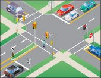

- **A.** The pedestrian, until they finish crossing
- **B.** The cars, as soon as the hand appears
- **C.** The cars, if they have a green light
- **D.** Whoever is turning right

Answer

**A. The pedestrian, until they finish crossing**

Pedestrians already crossing should hurry, but they still have the right-of-way.

> 📖 Handbook: "While they are crossing, pedestrians still have the right-of-way over vehicles."

---

### 15. What colour is the hand symbol that tells pedestrians not to start crossing?

*Shapes & colours*

- **A.** Orange
- **B.** White
- **C.** Red
- **D.** Yellow-green

Answer

**A. Orange**

Walk = white walking person. Don't start = orange hand (flashing or steady).

> 📖 Handbook: "A flashing or steady orange hand symbol means pedestrians must not begin to cross."

---

### 16. Which lines separate traffic travelling in opposite directions?

*Shapes & colours*

- **A.** Orange lines
- **B.** Yellow lines
- **C.** White lines
- **D.** Blue lines

Answer

**B. Yellow lines**

Yellow = opposite directions. White = same direction.

> 📖 Handbook: "Yellow lines separate traffic travelling in opposite directions."

---

### 17. What does a stop line look like?

*Shapes & colours*

- **A.** A yellow line across the road
- **B.** A white X in the lane
- **C.** Two parallel white lines
- **D.** A single white line painted across the road

Answer

**D. A single white line painted across the road**

One white line = stop line. Two lines = crosswalk.

> 📖 Handbook: "A stop line is a single white line painted across the road at an intersection."

---

### 18. Besides signs and overhead yellow lights, how is a pedestrian crossover marked on the road?

*Shapes & colours*

- **A.** A single yellow line
- **B.** Two white double parallel lines across the road, with an X in each approaching lane
- **C.** Yellow and black stripes
- **D.** A white bicycle symbol

Answer

**B. Two white double parallel lines across the road, with an X in each approaching lane**

Look for the X on the road before the crossing.

> 📖 Handbook: "Pedestrian crossovers are identified by specific signs, overhead yellow lights, and pavement markings."

---

### 19. Pedestrians are using this crossover. When may you go?

*What do you do?*

- **A.** As soon as they've passed your lane
- **B.** Right away, if you honk first
- **C.** Only after they have completely crossed the road and cleared the roadway
- **D.** When they reach the middle of the road

Answer

**C. Only after they have completely crossed the road and cleared the roadway**

At a crossover, wait until pedestrians are all the way across.

> 📖 Handbook: "Drivers and cyclists must stop before the line and yield to pedestrians until pedestrians have completely crossed the road and cleared the roadway."

---

### 20. There's no stop line, no crosswalk and no sidewalk. Where do you stop for a red light?

*What do you do?*

- **A.** At the edge of the intersection
- **B.** One car length past the light
- **C.** In the middle of the intersection
- **D.** Beside the traffic light pole

Answer

**A. At the edge of the intersection**

Stop line, then crosswalk, then edge of the sidewalk, then edge of the intersection.

> 📖 Handbook: "If there is no sidewalk, stop at the edge of the intersection."

---

### 21. There's no stop line, but there is a crosswalk. Where do you stop?

*What do you do?*

- **A.** At the crosswalk (marked or not)
- **B.** Past the crosswalk
- **C.** At the edge of the intersection
- **D.** At the far side of the intersection

Answer

**A. At the crosswalk (marked or not)**

No stop line? Stop at the crosswalk.

> 📖 Handbook: "If there is no stop line marked on the road, stop at the crosswalk, marked or not."

---

### 22. You're on a two-lane road with a broken yellow line on your left. A slow vehicle is ahead, and the road ahead is clear. What may you do?

*What do you do?*

- **A.** Pass, if there are enough broken lines ahead to finish the pass safely
- **B.** Pass only if the driver waves you on
- **C.** Never pass on a two-lane road
- **D.** Pass on the right shoulder

Answer

**A. Pass, if there are enough broken lines ahead to finish the pass safely**

Broken line = passing allowed when it's clear and you have room to finish.

> 📖 Handbook: "('A' may pass if there are enough broken lines ahead to complete the pass safely.)"

---

### 23. You're behind a slow truck and there's a solid line on your left. What should you do?

*What do you do?*

- **A.** Pass on the shoulder
- **B.** Pass if the truck driver waves you on
- **C.** Pass quickly
- **D.** Stay behind it: it's unsafe to pass

Answer

**D. Stay behind it: it's unsafe to pass**

A solid line on your left means don't pass.

> 📖 Handbook: "A solid line at the left of your lane means it is unsafe to pass."

---

### 24. Your lane has a white arrow pointing only left. What must you do at the intersection?

*What do you do?*

- **A.** Turn left
- **B.** Turn left or right
- **C.** Go straight or turn left
- **D.** You may do anything if no one is behind you

Answer

**A. Turn left**

White lane arrows: you may move only in the direction of the arrow.

> 📖 Handbook: "A white arrow painted on a lane means you may move only in the direction of the arrow."

---

### 25. Can pedestrians cross on a left-turn green arrow?

*What do you do?*

- **A.** No, not unless a pedestrian signal tells them to
- **B.** Only at night
- **C.** Yes, if no cars are turning
- **D.** Yes, always

Answer

**A. No, not unless a pedestrian signal tells them to**

Pedestrians may not cross on a flashing green light or a left-turn green arrow.

> 📖 Handbook: "Pedestrians may not cross on a flashing green light or a left-turn green arrow."

